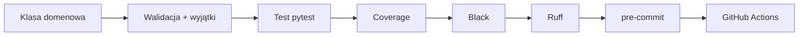

# 🎓 Weekend 4 — przewodnik kursanta

> **Kurs:** AI Python Engineer
> **Blok:** Programowanie obiektowe, testy w pytest, jakość kodu i CI
> **Czas:** 2 dni / ok. 8 godzin
> **Główny efekt:** umiesz projektować klasy domenowe, zabezpieczać je testami i dołączać do projektu Black, Ruff, pre-commit oraz pipeline GitHub Actions.

---

## 🧭 Spis treści

- [O czym jest ten blok?](#-o-czym-jest-ten-blok)
- [Wymagania wstępne](#-wymagania-wstępne)
- [Przygotowanie środowiska](#-przygotowanie-środowiska)
- [Struktura projektu](#-struktura-projektu)
- [Domena ćwiczeń](#-domena-ćwiczeń)
- [Sobota — OOP i pytest](#-sobota--oop-i-pytest)
- [Niedziela — jakość kodu i CI](#-niedziela--jakość-kodu-i-ci)
- [Jak używać AI w tym bloku](#-jak-używać-ai-w-tym-bloku)
- [Typowe problemy](#-typowe-problemy)
- [Zadanie domowe](#-zadanie-domowe)
- [Jak ten blok wspiera projekt końcowy](#-jak-ten-blok-wspiera-projekt-końcowy)
- [Checklista końcowa](#-checklista-końcowa)

---

## 🧭 O czym jest ten blok?

Przez dwa dni przechodzisz od pisania pojedynczych funkcji do pracy w stylu realnego projektu backendowego.

**Sobota:** budujesz proste klasy domenowe (`User`, `Document`, `SupportTicket`) i uczysz się pisać do nich testy w `pytest`.

**Niedziela:** dokańczasz tę samą domenę (`KnowledgeBase`) i dokładasz pełny workflow jakości — formatowanie, linting, `pre-commit` i pipeline CI w GitHub Actions.



> [!IMPORTANT]
> Od tego bloku „napisałem i działa u mnie” to za mało. Kod ma testy, jest sformatowany, przechodzi lint i automatyczne sprawdzenia w CI.

---

## 🛠️ Wymagania wstępne

Powinieneś/aś już umieć:

- pisać funkcje, używać list/słowników i podstawowych wyjątków (`ValueError`),
- pracować z terminalem i wirtualnym środowiskiem,
- używać podstaw Gita (`add`, `commit`, `push`).

Nie musisz wcześniej znać: programowania obiektowego, `pytest`, Blacka, Ruffa, `pre-commit`, GitHub Actions — zaczynamy od podstaw.

---

## ⚙️ Przygotowanie środowiska

```bash
mkdir oop-pytest-basics && cd oop-pytest-basics
python -m venv .venv
source .venv/bin/activate          # Windows: .venv\Scripts\Activate.ps1
python -m pip install --upgrade pip
python -m pip install pytest pytest-cov black ruff pre-commit jupyter
```

Sprawdzenie:

```bash
python --version    # Python 3.12.x
pytest --version
black --version
ruff --version
pre-commit --version
```

- [ ] Środowisko `.venv` utworzone i aktywne.
- [ ] Wszystkie pięć poleceń zwraca wersję narzędzia.
- [ ] Terminal jest w katalogu projektu.

---

## 🗂️ Struktura projektu

Docelowo, po obu dniach:

```text
oop-pytest-basics/
├── pyproject.toml
├── .pre-commit-config.yaml
├── .github/
│   └── workflows/
│       └── ci.yml
├── src/
│   └── knowledge_app/
│       ├── __init__.py
│       ├── users.py
│       ├── documents.py
│       ├── support.py
│       └── knowledge_base.py
└── tests/
    ├── conftest.py
    ├── test_users.py
    ├── test_documents.py
    ├── test_support.py
    └── test_knowledge_base.py
```

---

## 🗃️ Domena ćwiczeń

Budujesz fragment aplikacji do zarządzania wiedzą i obsługi zgłoszeń — bez bazy danych, jako zwykłe klasy Pythona.

| Klasa | Odpowiedzialność |
|---|---|
| `User` / `AdminUser` | użytkownik, rola (`user`/`agent`/`admin`), aktywność konta |
| `Document` | dokument: tytuł, treść, tagi |
| `SupportTicket` | zgłoszenie: autor, priorytet, status, komentarze |
| `KnowledgeBase` | kolekcja dokumentów: dodawanie, wyszukiwanie, pokrycie tagami, archiwizacja |

---

# 🌞 Sobota — OOP i pytest

## Klasa `User`

```python
class User:
    ALLOWED_ROLES = {"user", "agent", "admin"}

    def __init__(self, email: str, role: str = "user") -> None:
        if not email.strip():
            raise ValueError("Email cannot be empty")
        if role not in self.ALLOWED_ROLES:
            raise ValueError("Unsupported role")

        self.email = email
        self.role = role
        self.is_active = True

    def deactivate(self) -> None:
        self.is_active = False

    def can_manage_documents(self) -> bool:
        return self.is_active and self.role in {"agent", "admin"}
```

## Pierwszy test i AAA

```python
def test_deactivate_changes_user_status() -> None:
    # Arrange
    user = User(email="anna@example.com")
    # Act
    user.deactivate()
    # Assert
    assert user.is_active is False
```

```bash
pytest -v
```

## Testowanie wyjątków i parametryzacja

```python
import pytest

def test_user_rejects_empty_email() -> None:
    with pytest.raises(ValueError, match="Email cannot be empty"):
        User(email="")

@pytest.mark.parametrize(
    ("role", "expected"),
    [("user", False), ("agent", True), ("admin", True)],
)
def test_can_manage_documents_depends_on_role(role: str, expected: bool) -> None:
    user = User(email="person@example.com", role=role)
    assert user.can_manage_documents() is expected
```

## Fixtures i coverage

```python
@pytest.fixture
def regular_user() -> User:
    return User(email="user@example.com")
```

```bash
pytest --cov=knowledge_app --cov-branch --cov-report=term-missing
```

## Plan pracy soboty

1. `User` + `AdminUser` (dziedziczenie).
2. `Document` (mutowalne atrybuty, `add_tag`).
3. Pierwsze testy + AAA.
4. Wyjątki i parametryzacja.
5. Fixtures i izolacja testów.
6. Mini-projekt `SupportTicket` (konstruktor, `add_comment`, `close`).
7. Coverage i podsumowanie.

**Zadanie domowe przed niedzielą:** dokończ `KnowledgeBase` (przechowuje dokumenty, `add_document` odrzuca duplikat ID, `get_document` zgłasza `LookupError`, `find_by_tag` filtruje) — jeśli nie zdążysz, dokończymy ją wspólnie na początku niedzieli.

➡️ Pracuj w `cwiczenia_sobota_clean.ipynb`, porównuj z `cwiczenia_sobota_solved.ipynb`.

---

# 🌤️ Niedziela — jakość kodu i CI

Kontynuujemy `knowledge_app` z soboty. Dokańczamy `KnowledgeBase`, dokładamy `tag_coverage()` (pierwszy `float` w projekcie → `pytest.approx`), porządkujemy testy w osobnych plikach, a potem dodajemy Black, Ruff, `pre-commit` i CI.

## Organizacja testów

```text
tests/
├── conftest.py             # fixtures wspólne: regular_user, sample_document, support_ticket, knowledge_base_with_documents
├── test_users.py
├── test_documents.py
├── test_support.py
└── test_knowledge_base.py
```

## `pytest.approx`

```python
def test_tag_coverage_returns_expected_ratio(knowledge_base_with_documents) -> None:
    result = knowledge_base_with_documents.tag_coverage("python")
    assert result == pytest.approx(2 / 3)
```

## Black i Ruff

```bash
black --check src tests
black src tests
ruff check src tests
ruff check src tests --fix
git diff          # zawsze sprawdzaj po automatycznych poprawkach
```

## `pyproject.toml`

```toml
[tool.black]
line-length = 88
target-version = ["py312"]

[tool.ruff]
line-length = 88
target-version = "py312"

[tool.ruff.lint]
select = ["E", "F", "I", "B"]
```

## pre-commit

```bash
pip install pre-commit
pre-commit install
pre-commit run --all-files
```

```yaml
# .pre-commit-config.yaml
repos:
  - repo: https://github.com/psf/black
    rev: 24.10.0
    hooks:
      - id: black
  - repo: https://github.com/astral-sh/ruff-pre-commit
    rev: v0.8.4
    hooks:
      - id: ruff
        args: ["--fix"]
      - id: ruff-format
```

Jeśli hook poprawi plik i przerwie commit — to normalne:

```bash
git status
git diff
git add .
git commit -m "Add knowledge base"     # tym razem powinno się udać
```

## GitHub Actions

```yaml
# .github/workflows/ci.yml
name: CI
on:
  push:
  pull_request:
jobs:
  quality:
    runs-on: ubuntu-latest
    steps:
      - uses: actions/checkout@v4
      - uses: actions/setup-python@v5
        with:
          python-version: "3.12"
      - run: python -m pip install --upgrade pip && pip install -r requirements-dev.txt
      - run: ruff check src tests
      - run: black --check src tests
      - run: pytest --cov=knowledge_app --cov-report=term-missing
```

Po pushu wejdź w zakładkę **Actions** i sprawdź wynik. Jeśli jest czerwony: znajdź pierwszy nieudany krok → przeczytaj log → uruchom to samo polecenie lokalnie → popraw → push ponownie.

## Plan pracy niedzieli

1. Dokończenie `KnowledgeBase` + `tag_coverage()`.
2. Testy `KnowledgeBase` (duplikat ID, `LookupError`, filtrowanie, `pytest.approx`).
3. Reorganizacja testów + `conftest.py`.
4. Black i Ruff.
5. `pyproject.toml`, `pre-commit`.
6. GitHub Actions — pierwszy pipeline, potem naprawa celowo zepsutego.
7. Mini-projekt: `archive_document()` + pełny cykl jakości.
8. Przegląd przypadków testowych z AI.

➡️ Pracuj w `cwiczenia_niedziela_clean.ipynb`, porównuj z `cwiczenia_niedziela_solved.ipynb`.

---

## 🤖 Jak używać AI w tym bloku

Dobre zastosowania: propozycje przypadków testowych, wyjaśnienie błędu `pytest` lub logu CI, ocena czytelności nazwy testu.

```text
Mam klasę SupportTicket z metodami add_comment i close.
Reguły: tytuł nie może być pusty, autor musi być aktywny, zamkniętego zgłoszenia
nie można zamknąć ponownie.
Zaproponuj maksymalnie 6 przypadków testowych. Nie pisz kodu.
```

Każdą propozycję oceń: zgodna z wymaganiami / niezgodna / wymaga doprecyzowania / wartościowa poza zakresem. **AI może zaproponować — Ty odpowiadasz za to, czy test ma sens.**

---

## 🧯 Typowe problemy

| Problem | Sprawdź |
|---|---|
| `ModuleNotFoundError` | czy uruchamiasz `pytest` z katalogu głównego; czy `pyproject.toml` ma `pythonpath = ["src"]` |
| `fixture ... not found` | czy jest `@pytest.fixture`; czy nazwa argumentu testu zgadza się z nazwą fixture; czy fixture jest w `conftest.py` |
| Test nie widzi wyjątku | czy wywołanie jest **wewnątrz** `with pytest.raises(...)` |
| Porównanie `float` nie przechodzi | użyj `pytest.approx(...)` zamiast `==` |
| Black/Ruff zmienił pliki | to normalne — sprawdź `git diff`, potem `git add .` |
| pre-commit przerywa commit | sprawdź `git status`/`git diff`, `git add .`, commit ponownie |
| CI czerwone, lokalnie zielono | sprawdź `requirements-dev.txt`, wersję Pythona (3.12), czy wszystkie pliki są w repo |

---

## 🏠 Zadanie domowe

Wybierz 2 funkcje/metody z własnego projektu końcowego i dodaj do nich testy: przypadek poprawny, przypadek graniczny, przypadek błędu (jeśli możliwy). Uruchom coverage. Jeśli Twój projekt nie ma jeszcze Blacka/Ruffa/`pre-commit`/CI — dodaj je teraz, korzystając z konfiguracji z tego bloku.

---

## 🧩 Jak ten blok wspiera projekt końcowy

Od tego weekendu Twój projekt `ai-knowledge-desk` powinien mieć klasy domenowe (`User`, `Document`, `KnowledgeBase`, `SupportTicket` — na razie bez bazy danych, to przygotowanie pod modele Django z Weekend 6), testy tych klas oraz testy modułów `akd_cli` z Weekend 2–3, a także pierwszy pipeline CI. Zobacz `capstone.md`.

---

## ✅ Checklista końcowa

**Sobota**

- [ ] Mam klasy `User`, `AdminUser`, `Document`, `SupportTicket` z walidacją.
- [ ] Mam min. 12 testów, w tym min. 3 testy wyjątków, 1 parametryzowany, min. 2 fixtures.
- [ ] Umiem uruchomić i przeczytać raport coverage.

**Niedziela**

- [ ] `KnowledgeBase` jest dokończona i przetestowana (w tym `pytest.approx`).
- [ ] `black --check .` i `ruff check .` przechodzą.
- [ ] Projekt ma `pyproject.toml`, `.pre-commit-config.yaml`, `pre-commit run --all-files` przechodzi.
- [ ] Projekt ma `.github/workflows/ci.yml` na Pythonie 3.12, ostatni workflow jest zielony.

> [!IMPORTANT]
> Od tego bloku „działa u mnie” to za mało — kod powinien przechodzić testy, formatowanie, linting i CI.
