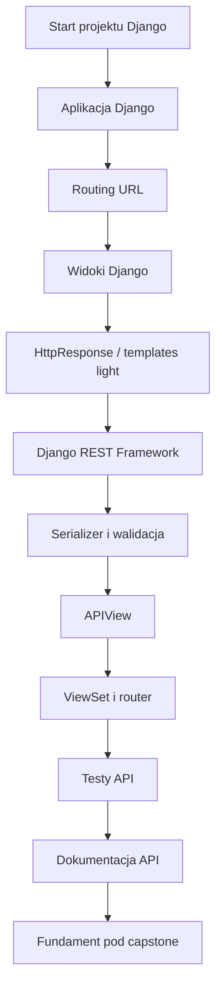
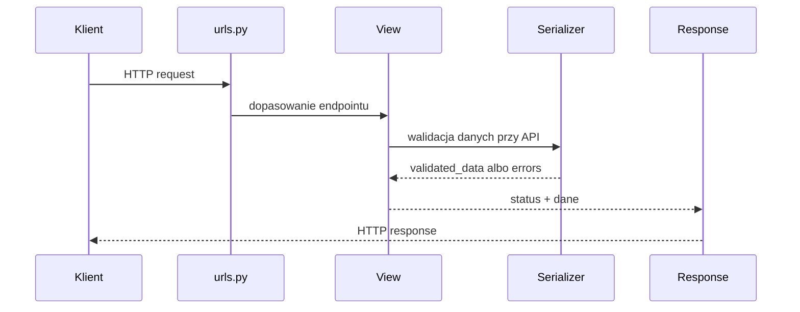
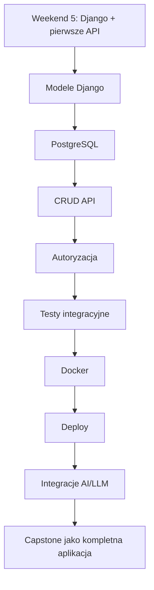

# 🚀 Weekend 5 — Django: fundamenty web i API

> **Kurs:** AI Python Engineer  
> **Blok:** Weekend 5  
> **Temat:** Django, podstawy backendu webowego i pierwsze REST API w Django REST Framework  
> **Czas:** 2 dni / ok. 8 godzin  
> **Główny efekt:** działający szkielet backendu Django pod projekt końcowy

---

## 🧭 Cel bloku

Ten blok wprowadza kursantów w budowanie backendu webowego w **Django** oraz pierwszego REST API w **Django REST Framework**.

Po weekendzie kursant powinien rozumieć podstawowy przepływ:

```text
request -> urls.py -> view -> serializer -> response
```

oraz mieć działający szkielet backendu pod projekt końcowy.

---

## Spis treści

- [Cel bloku](#-cel-bloku)
- [Mapa bloku](#️-mapa-bloku)
- [Zakres weekendu](#-zakres-weekendu)
- [Case biznesowy](#-case-biznesowy)
- [Struktura materiałów](#-struktura-materiałów)
- [Wymagania techniczne](#-wymagania-techniczne)
- [Szybki start projektu ćwiczeniowego](#-szybki-start-projektu-ćwiczeniowego)
- [Przykładowa struktura projektu](#-przykładowa-struktura-projektu)
- [Minimalny efekt końcowy](#-minimalny-efekt-końcowy)
- [Jak korzystać z materiałów](#-jak-korzystać-z-materiałów)
- [Rola w projekcie końcowym](#-rola-w-projekcie-końcowym)
- [Najważniejsze do zapamiętania](#-najważniejsze-do-zapamiętania)

---

# 🗺️ Mapa bloku



---

## Najważniejszy przepływ



---

# 📚 Zakres weekendu

## Sobota — Django: start projektu

W sobotę kursanci poznają fundamenty klasycznego Django.

Zakres:

- projekt Django i aplikacje Django,
- `settings.py`,
- `manage.py`,
- `urls.py`,
- routing URL,
- widoki funkcyjne,
- `HttpResponse`,
- templates light,
- struktura projektu pod capstone.

Efekt soboty:

```text
działający projekt Django + aplikacja domenowa + routing + pierwszy widok
```

---

## Niedziela — Django REST Framework: pierwsze API

W niedzielę kursanci przechodzą od klasycznego widoku do API.

Zakres:

- serializer i walidacja danych,
- `APIView`,
- `ViewSet`,
- routery DRF,
- statusy HTTP,
- format błędów,
- testy endpointów przez `pytest-django` i `APIClient`,
- lekka dokumentacja API.

Efekt niedzieli:

```text
działające API GET/POST + walidacja + testy + dokumentacja
```

---

# 🛒 Case biznesowy

Domyślny case: prosta aplikacja do zarządzania zadaniami projektowymi.

Główna encja:

```text
Task
```

---

## Pola encji `Task`

| Pole | Typ | Opis |
|---|---:|---|
| `id` | integer | identyfikator zadania |
| `title` | string | nazwa zadania |
| `description` | string | opis zadania |
| `status` | string | `todo`, `in_progress`, `done` |
| `priority` | string | `low`, `medium`, `high` |

---

## Docelowe endpointy ćwiczeniowe

| Metoda | Endpoint | Cel | Status |
|---|---|---|---:|
| `GET` | `/health/` | sprawdzenie, czy backend działa | `200` |
| `GET` | `/tasks/` | prosty widok tekstowy lub HTML | `200` |
| `GET` | `/api/tasks/` | pobranie listy zadań | `200` |
| `POST` | `/api/tasks/` | utworzenie zadania | `201` |
| `POST` | `/api/tasks/` | błędne dane wejściowe | `400` |
| `GET` | `/api/tasks/{id}/` | szczegóły zadania, wersja rozszerzona | `200` / `404` |

---

# 📁 Struktura materiałów

| Plik | Opis |
|---|---|
| `readme_trener.md` | instrukcja dla prowadzącego |
| `readme_kursant.md` | instrukcja dla kursanta |
| `teoria.md` | kompendium teoretyczne |
| `cwiczenia_clean_w5.ipynb` | notebook z ćwiczeniami bez rozwiązań |
| `cwiczenia_solved_w5.ipynb` | notebook z rozwiązaniami |
| `capstone.md` | instrukcja rozbudowy projektu końcowego (ai-knowledge-desk) |
| `cheatsheet.md` | szybka ściąga |
| `troubleshooting.md` | typowe błędy i sposoby naprawy |
| `promptbook_AI.md` | prompty do pracy z AI |
| `zadania_praktyczne.md` | pełna lista zadań warsztatowych |
| `scenariusz_live_coding.md` | scenariusz live codingu |
| `zadanie_domowe.md` | zadanie domowe |
| `o_datasecie.md` | opis opcjonalnego dodatku SQL — dataset Help Desk Tickets, niepowiązany z resztą weekendu (domena Task/Document) |
| `cwiczenia_sql_clean.sql` | opcjonalny dodatek SQL bez rozwiązań, niepowiązany z resztą weekendu (osobny dataset Help Desk Tickets) |
| `cwiczenia_sql_solved.sql` | opcjonalny dodatek SQL z rozwiązaniami, niepowiązany z resztą weekendu (osobny dataset Help Desk Tickets) |

---

## Jak czytać strukturę?

```text
README.md
    -> szybkie wejście do bloku

readme_kursant.md
    -> instrukcja pracy dla uczestnika

readme_trener.md
    -> instrukcja prowadzenia dla trenera

teoria.md
    -> uporządkowana wiedza

zadania_praktyczne.md
    -> ćwiczenia do wykonania

capstone.md
    -> przełożenie bloku na projekt końcowy

troubleshooting.md
    -> pomoc, gdy coś nie działa
```

---

# 🛠️ Wymagania techniczne

Wymagane narzędzia:

- Python 3.11+
- Django 5.x
- Django REST Framework
- pytest
- pytest-django
- SQLite lokalnie
- Git
- VS Code, PyCharm albo inny edytor

---

## Zalecane umiejętności przed blokiem

Kursant powinien umieć:

- utworzyć i aktywować `.venv`,
- zainstalować paczki przez `pip`,
- uruchomić plik Pythona,
- pracować z terminalem,
- rozumieć importy,
- pisać proste funkcje i klasy,
- czytać podstawowe tracebacki,
- uruchomić testy przez `pytest`.

---

# ⚡ Szybki start projektu ćwiczeniowego

## Linux / macOS

```bash
mkdir weekend_05_django_api
cd weekend_05_django_api

python -m venv .venv
source .venv/bin/activate

pip install django djangorestframework pytest pytest-django
pip freeze > requirements.txt

django-admin startproject config .
python manage.py startapp tasks
python manage.py runserver
```

---

## Windows PowerShell

```powershell
mkdir weekend_05_django_api
cd weekend_05_django_api

python -m venv .venv
.venv\Scripts\activate

pip install django djangorestframework pytest pytest-django
pip freeze > requirements.txt

django-admin startproject config .
python manage.py startapp tasks
python manage.py runserver
```

---

## Sprawdzenie działania

Po uruchomieniu serwera otwórz:

```text
http://127.0.0.1:8000/
```

Jeśli wszystko działa, zobaczysz stronę startową Django.

---

# 🗂️ Przykładowa struktura projektu

Po wykonaniu bloku projekt może wyglądać tak:

```text
weekend_05_django_api/
├── manage.py
├── requirements.txt
├── pytest.ini
├── config/
│   ├── __init__.py
│   ├── settings.py
│   ├── urls.py
│   ├── asgi.py
│   └── wsgi.py
├── tasks/
│   ├── __init__.py
│   ├── apps.py
│   ├── models.py
│   ├── serializers.py
│   ├── urls.py
│   ├── views.py
│   └── tests/
│       ├── __init__.py
│       └── test_tasks_api.py
└── templates/
    └── home.html
```

---

## Rola najważniejszych katalogów

| Element | Rola |
|---|---|
| `config/` | konfiguracja całego projektu Django |
| `tasks/` | aplikacja domenowa |
| `tasks/serializers.py` | walidacja danych API |
| `tasks/views.py` | widoki klasyczne i API |
| `tasks/urls.py` | routing aplikacji |
| `tasks/tests/` | testy endpointów |
| `templates/` | proste szablony HTML |
| `pytest.ini` | konfiguracja testów Django w pytest |

---

# ✅ Minimalny efekt końcowy

Po zakończeniu bloku projekt powinien mieć:

```text
[ ] działający projekt Django
[ ] aplikację domenową, np. tasks
[ ] endpoint /health/
[ ] prosty widok HTML albo tekstowy
[ ] serializer z walidacją
[ ] GET /api/tasks/
[ ] POST /api/tasks/
[ ] poprawny status 200 dla GET
[ ] poprawny status 201 dla POST
[ ] poprawny status 400 dla błędnych danych
[ ] test GET endpointu
[ ] test POST endpointu
[ ] test błędnych danych
[ ] krótką dokumentację API
```

---

## Checklist w Markdown

- [ ] Działa projekt Django.
- [ ] Istnieje aplikacja domenowa, np. `tasks`.
- [ ] Działa endpoint `/health/`.
- [ ] Działa prosty widok HTML albo tekstowy.
- [ ] Istnieje serializer z walidacją.
- [ ] Działa `GET /api/tasks/`.
- [ ] Działa `POST /api/tasks/`.
- [ ] `GET` zwraca status `200`.
- [ ] Poprawny `POST` zwraca status `201`.
- [ ] Błędny `POST` zwraca status `400`.
- [ ] Istnieje test endpointu `GET`.
- [ ] Istnieje test endpointu `POST`.
- [ ] Istnieje test błędnych danych.
- [ ] Istnieje krótka dokumentacja API.

---

# 🧭 Jak korzystać z materiałów

## Dla kursanta

Rekomendowana kolejność:

1. `readme_kursant.md`
2. `teoria.md`
3. `cwiczenia_clean_w5.ipynb`
4. `cheatsheet.md`
5. `troubleshooting.md`
6. `capstone.md`
7. `zadanie_domowe.md`

---

## Dla trenera

Rekomendowana kolejność:

1. `readme_trener.md`
2. `scenariusz_live_coding.md`
3. `cwiczenia_clean_w5.ipynb`
4. `cwiczenia_solved_w5.ipynb`
5. `zadania_praktyczne.md`

---

## Kiedy używać którego pliku?

| Sytuacja | Najlepszy plik |
|---|---|
| Chcesz zrozumieć blok jako kursant | `readme_kursant.md` |
| Prowadzisz zajęcia | `readme_trener.md` |
| Potrzebujesz teorii | `teoria.md` |
| Potrzebujesz szybkiej komendy | `cheatsheet.md` |
| Coś nie działa | `troubleshooting.md` |
| Chcesz przećwiczyć temat | `zadania_praktyczne.md` |
| Budujesz capstone | `capstone.md` |
| Korzystasz z AI | `promptbook_AI.md` |
| Robisz zadanie domowe | `zadanie_domowe.md` |
| Chcesz opcjonalnie poćwiczyć SQL | `o_datasecie.md`, `cwiczenia_sql_clean.sql`, `cwiczenia_sql_solved.sql` |

---

# 🧩 Rola w projekcie końcowym

Ten weekend tworzy fundament backendu dla capstone.

W kolejnych blokach projekt będzie rozwijany o:

- modele Django,
- migracje,
- PostgreSQL,
- pełny CRUD,
- relacje,
- autoryzację,
- dokumentację OpenAPI,
- Docker,
- CI/CD,
- deploy,
- integracje AI/LLM,
- MCP.

---

## Jak Weekend 5 łączy się z capstone?



---

## Minimalny wkład do capstone po tym bloku

Po Weekendzie 5 projekt końcowy powinien mieć:

- strukturę backendu Django,
- jedną aplikację domenową,
- pierwszy serializer,
- pierwsze endpointy API,
- podstawowe testy API,
- krótką dokumentację endpointów.

---

# 🧠 Najważniejsze do zapamiętania

Django nie jest magiczne, jeśli widzimy przepływ:

```text
request -> routing -> view -> serializer -> response
```

To jest baza pod dalszą pracę z:

- backendem,
- API,
- bazą danych,
- testami,
- deployem,
- funkcjami AI.

---

## 10 zdań, które kursant powinien umieć powiedzieć po bloku

1. Projekt Django to konfiguracja całego backendu.
2. Aplikacja Django to moduł biznesowy.
3. `settings.py` zawiera konfigurację projektu.
4. `urls.py` kieruje request do odpowiedniego widoku.
5. Widok przyjmuje request i zwraca response.
6. `HttpResponse` nadaje się do prostych odpowiedzi tekstowych.
7. DRF `Response` nadaje się do odpowiedzi API.
8. Serializer waliduje dane wejściowe i pomaga przygotować odpowiedź.
9. Status HTTP jest częścią kontraktu API.
10. Testy API sprawdzają zachowanie endpointu z perspektywy klienta.

---

> [!IMPORTANT]  
> Najważniejszy efekt tego weekendu: kursant nie musi znać całego Django, ale powinien rozumieć, jak request przechodzi przez routing, widok, serializer i wraca jako response.

