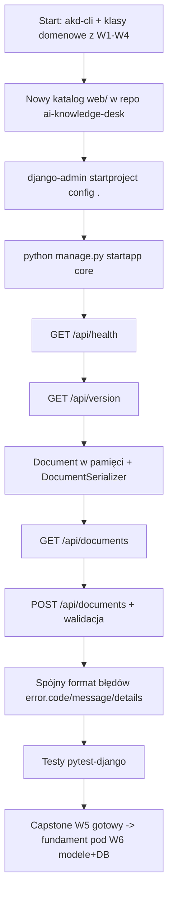
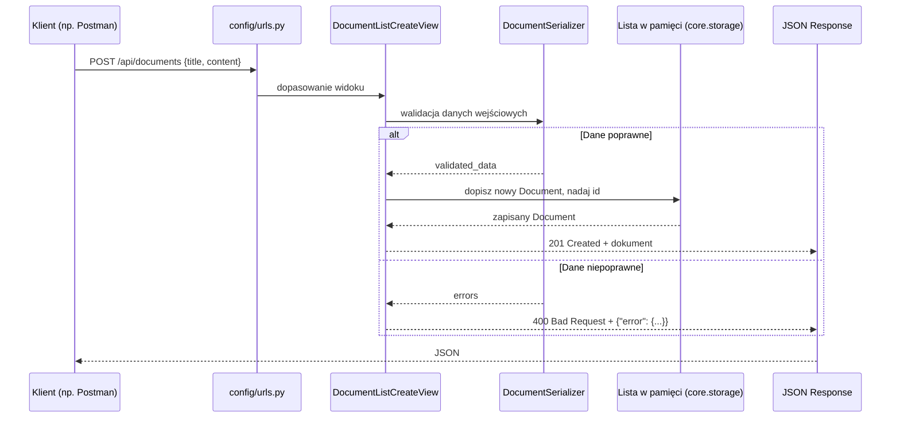

# 🚀 Weekend 5 — Capstone: pierwszy szkielet API w `ai-knowledge-desk`

> **Kurs:** AI Python Engineer
> **Blok:** Weekend 5
> **Temat:** Django + DRF — pierwszy szkielet backendu projektu końcowego
> **Typ pliku:** brief capstone / zadanie projektowe
> **Główny efekt:** działający katalog `web/` w repo `ai-knowledge-desk` z Django, pierwszym API i testami

---

## 🧭 Spis treści

1. [🎯 Cel capstone](#-cel-capstone)
2. [🏢 Kontekst biznesowy](#-kontekst-biznesowy)
3. [Kontekst](#kontekst)
4. [Co dochodzi do projektu](#co-dochodzi-do-projektu)
5. [🗺️ Mapa przyrostu](#️-mapa-przyrostu)
6. [📁 Struktura projektu](#-struktura-projektu)
7. [🧱 Encja `Document` w tym kroku](#-encja-document-w-tym-kroku)
8. [🔌 Endpointy](#-endpointy)
9. [⚠️ Format błędów](#️-format-błędów)
10. [Kroki](#kroki)
11. [🧪 Testy pytest-django](#-testy-pytest-django)
12. [Definition of Done](#definition-of-done)
13. [⛔ Czego świadomie NIE robimy w tym kroku](#-czego-świadomie-nie-robimy-w-tym-kroku)
14. [💼 Opis do portfolio](#-opis-do-portfolio)
15. [Co dopisać do README](#co-dopisać-do-readme)

---

## 🎯 Cel capstone

W tym kroku stawiasz **pierwszy szkielet backendu webowego** dla swojego projektu końcowego `ai-knowledge-desk`.

Do tej pory (Weekend 1–4) projekt istniał jako CLI (`akd-cli`) i zestaw prostych klas domenowych trzymanych w pamięci — bez serwera, bez API, bez requestów HTTP. Ten weekend to moment, w którym projekt dostaje **prawdziwy backend webowy**: Django + Django REST Framework, pierwsze dwa endpointy diagnostyczne i pierwszy zalążek API dla dokumentów.

> [!IMPORTANT]
> Ten capstone celowo **nie** dotyka bazy danych, migracji ani modeli Django. To zadanie Weekendu 6. Tutaj `Document` to na razie zwykła struktura danych w pamięci procesu — chodzi o to, żeby zrozumieć przepływ `request -> urls.py -> view -> serializer -> response`, zanim dołoży się ORM.

---

## 🏢 Kontekst biznesowy

`ai-knowledge-desk` to wewnętrzna baza wiedzy firmy: użytkownicy wgrywają dokumenty (umowy, notatki, raporty), system je indeksuje i docelowo pozwala pytać o nie przez czat z cytowaniami (RAG). Function calling, MCP i sam czat z LLM pojawią się w dużo późniejszych weekendach (W11–W13) — na razie budujemy fundament, po którym to wszystko będzie mogło stanąć.

Pierwsza rzecz, jaką backend musi umieć zrobić, to **przyjąć i zwrócić dokument** przez HTTP — stąd `GET/POST /api/documents`. Zanim to zadziała, potrzebujesz też dwóch endpointów operacyjnych, standardowych dla każdego serwisu produkcyjnego:

| Endpoint | Po co w realnym systemie? |
|---|---|
| `GET /api/health` | load balancer / orkiestrator (np. Kubernetes) sprawdza, czy proces żyje |
| `GET /api/version` | wsparcie/DevOps sprawdza, jaka wersja aplikacji faktycznie działa na środowisku |

To nie są "sztuczne ćwiczenia" — to dokładnie te same endpointy, które będziesz mieć w prawdziwej pracy.

---

## Kontekst

Po Weekendzie 4 `ai-knowledge-desk` to repo z `akd-cli` (moduły `io_utils.py`, `parsing.py`, `reporting.py`), prostymi klasami domenowymi w pamięci (`User`, `Document`, `KnowledgeBase`, `SupportTicket`) i pipeline'em CI (lint + test + coverage) — bez żadnego serwera HTTP; w tym kroku dochodzi do tego katalog `web/` z pierwszym działającym backendem Django/DRF.

---

## Co dochodzi do projektu

| Element | Zmiana | Szczegóły |
|---|---|---|
| Katalog | `web/` w repo `ai-knowledge-desk` | osobny podkatalog na backend Django, obok istniejącego `akd_cli`/`app` z W1–W4 |
| Projekt Django | `config` | `django-admin startproject config .` wewnątrz `web/` |
| Aplikacja Django | `core` | `python manage.py startapp core` |
| Endpoint | `GET /api/health` | zwraca `200` gdy proces żyje |
| Endpoint | `GET /api/version` | zwraca aktualną wersję/etykietę API |
| Endpoint | `GET /api/documents` | lista dokumentów trzymanych na razie w pamięci |
| Endpoint | `POST /api/documents` | tworzy nowy dokument w pamięci, z walidacją |
| Serializer | `DocumentSerializer` | pola `id`, `title`, `content` + walidacja |
| Format błędów | `{"error": {"code", "message", "details"}}` | jeden, spójny format na cały kurs — patrz sekcja niżej |
| Testy | `pytest-django` | health, version, list, create (happy path), create (błąd walidacji) |

---

## 🗺️ Mapa przyrostu



### 🔁 Przepływ requestu `POST /api/documents`



---

## 📁 Struktura projektu

Po tym kroku Twoje repo `ai-knowledge-desk` powinno wyglądać mniej więcej tak:

```text
ai-knowledge-desk/
├── README.md
├── app/                      # z W1 — smoke script, zostaje bez zmian
├── akd_cli/                  # z W2-W3 — CLI, zostaje bez zmian
├── tests/                    # testy CLI/klas domenowych z W4, zostają bez zmian
├── .github/workflows/        # CI z W4, zostaje bez zmian
└── web/                      # NOWOŚĆ w W5 — backend Django
    ├── manage.py
    ├── requirements.txt
    ├── pytest.ini
    ├── config/
    │   ├── __init__.py
    │   ├── settings.py
    │   ├── urls.py
    │   ├── asgi.py
    │   └── wsgi.py
    └── core/
        ├── __init__.py
        ├── apps.py
        ├── storage.py         # dokumenty w pamięci (bez DB, bez migracji)
        ├── serializers.py     # DocumentSerializer
        ├── exceptions.py      # wspólny format błędów
        ├── views.py           # health, version, documents
        ├── urls.py
        └── tests/
            ├── __init__.py
            ├── test_health.py
            ├── test_version.py
            └── test_documents.py
```

> [!TIP]
> `web/` jest w tym samym repo co `akd-cli` — to świadoma decyzja projektowa, żeby nie gubić historii i ciągłości projektu między weekendami. `akd_cli` z W2–W4 dalej działa i dalej ma swoje testy; nowy kod webowy po prostu obok niego dochodzi.

---

## 🧱 Encja `Document` w tym kroku

`Document` to encja, wokół której zbudowany jest cały `ai-knowledge-desk` — od tego weekendu aż do W13 (RAG). W tym kroku ma **tylko** trzy pola:

| Pole | Typ (Python/DRF) | Wymagane | Opis |
|---|---|---:|---|
| `id` | `int`, `read_only` | nie (nadawane automatycznie) | identyfikator dokumentu w pamięci procesu |
| `title` | `str` / `CharField` | tak | tytuł dokumentu |
| `content` | `str` / `CharField` (styl `textarea`) | tak | treść dokumentu |

> [!WARNING]
> Pola `workspace` (relacja do organizacji) i `status` (`draft`/`ready`) **celowo nie istnieją jeszcze w tym kroku**. Pojawią się dopiero w Weekendzie 6 razem z prawdziwym modelem Django `Document(models.Model)` i migracjami. Jeśli je teraz dodasz, poprawisz sobie ten capstone, ale rozjedziesz się z tym, co przygotowuje kolejny weekend — nie rób tego na tym etapie.

### Przykładowa reprezentacja w pamięci

Dokumenty nie mieszkają w bazie danych — mieszkają w zwykłej liście Pythona w procesie serwera (znika po restarcie `runserver`, i to jest OK na tym etapie):

```python
# core/storage.py
from itertools import count

_id_sequence = count(1)
DOCUMENTS: list[dict] = []


def add_document(title: str, content: str) -> dict:
    document = {
        "id": next(_id_sequence),
        "title": title,
        "content": content,
    }
    DOCUMENTS.append(document)
    return document


def list_documents() -> list[dict]:
    return DOCUMENTS
```

---

## 🔌 Endpointy

| Metoda | Endpoint | Cel | Status sukcesu | Status błędu |
|---|---|---|---:|---:|
| `GET` | `/api/health` | sprawdzenie, czy backend żyje | `200` | — |
| `GET` | `/api/version` | sprawdzenie aktualnej wersji API | `200` | — |
| `GET` | `/api/documents` | lista dokumentów z pamięci | `200` | — |
| `POST` | `/api/documents` | utworzenie dokumentu w pamięci | `201` | `400` (błąd walidacji) |

### Przykład `GET /api/health`

```json
{
  "status": "ok"
}
```

### Przykład `GET /api/version`

```json
{
  "version": "0.5.0",
  "week": "W5"
}
```

### Przykład `GET /api/documents`

```json
[
  {
    "id": 1,
    "title": "Polityka urlopowa",
    "content": "Pracownikowi przysługuje 26 dni urlopu rocznie..."
  }
]
```

### Przykład `POST /api/documents` — sukces

Request:

```json
{
  "title": "Onboarding checklist",
  "content": "Krok 1: załóż konto w systemie HR..."
}
```

Response `201 Created`:

```json
{
  "id": 2,
  "title": "Onboarding checklist",
  "content": "Krok 1: załóż konto w systemie HR..."
}
```

---

## ⚠️ Format błędów

To jest **jeden, ustalony raz format błędów, obowiązujący od tego weekendu przez cały kurs** (patrz "Założenia ogólne" w planie kursu). Każda odpowiedź błędu z API — niezależnie od tego, czy to błąd walidacji, brak zasobu, brak uprawnień czy błąd serwera — ma tę samą kopertę:

```json
{
  "error": {
    "code": "validation_error",
    "message": "Invalid input.",
    "details": {
      "title": ["This field is required."]
    }
  }
}
```

| Pole | Typ | Znaczenie |
|---|---|---|
| `error.code` | `str` | krótki, maszynowy identyfikator błędu, np. `validation_error`, `not_found`, `internal_error` |
| `error.message` | `str` | krótki, czytelny dla człowieka opis błędu |
| `error.details` | dowolny (obiekt / lista / `null`) | szczegóły, np. błędy walidacji per pole; może być `null`, jeśli nie ma nic więcej do dodania |

DRF domyślnie zwraca błędy walidacji jako płaski słownik `{"title": ["This field is required."]}` — to **nie** jest ten format. Żeby ujednolicić wszystkie odpowiedzi błędów bez ręcznego przerabiania każdego widoku, podepnij własny `EXCEPTION_HANDLER`:

```python
# core/exceptions.py
from rest_framework.views import exception_handler as drf_exception_handler


def api_exception_handler(exc, context):
    response = drf_exception_handler(exc, context)

    if response is None:
        # DRF nie potrafi obsłużyć tego wyjątku - Django zwróci 500
        return None

    if response.status_code == 400:
        code = "validation_error"
        message = "Invalid input."
    elif response.status_code == 404:
        code = "not_found"
        message = "Resource not found."
    elif response.status_code in (401, 403):
        code = "not_authorized"
        message = "You are not allowed to do this."
    else:
        code = "error"
        message = "Request failed."

    response.data = {
        "error": {
            "code": code,
            "message": message,
            "details": response.data,
        }
    }
    return response
```

```python
# config/settings.py
REST_FRAMEWORK = {
    "EXCEPTION_HANDLER": "core.exceptions.api_exception_handler",
}
```

> [!TIP]
> Zapamiętaj ten wzorzec — w Weekendzie 8 (auth) i dalszych blokach będziesz zwracać `401`/`403`/`500` z tego samego API i **musisz** trzymać się dokładnie tego samego kształtu `{"error": {...}}`, żeby frontend (a potem klient czatu z W9/W11) mógł go obsługiwać jednym kawałkiem kodu.

---

## Kroki

1. **Załóż katalog `web/`** w repo `ai-knowledge-desk`, obok istniejących `app/`/`akd_cli/`. Nie ruszaj kodu z W1–W4.
2. **Stwórz i aktywuj wirtualne środowisko** wewnątrz `web/` (albo użyj wspólnego `.venv` repo, jeśli tak masz zorganizowane).
   ```bash
   cd web
   python -m venv .venv
   source .venv/bin/activate   # Windows: .venv\Scripts\activate
   pip install django djangorestframework pytest pytest-django
   pip freeze > requirements.txt
   ```
3. **Załóż projekt Django o nazwie `config`** i aplikację `core`:
   ```bash
   django-admin startproject config .
   python manage.py startapp core
   ```
   Dodaj `"rest_framework"` i `"core"` do `INSTALLED_APPS` w `config/settings.py`.
4. **Dodaj endpoint `GET /api/health`** w `core/views.py` (funkcyjny widok albo `APIView` — Twój wybór) zwracający `{"status": "ok"}` ze statusem `200`.
5. **Dodaj endpoint `GET /api/version`** zwracający statyczny słownik z wersją, np. `{"version": "0.5.0", "week": "W5"}`. Wersję możesz na razie zaszyć na stałe w kodzie (w kolejnych weekendach można ją wyciągnąć z konfiguracji/env).
6. **Zbuduj magazyn dokumentów w pamięci** (`core/storage.py`) — lista + licznik `id`, tak jak w przykładzie w sekcji [Encja `Document`](#-encja-document-w-tym-kroku).
7. **Napisz `DocumentSerializer`** w `core/serializers.py` (`serializers.Serializer`, **nie** `ModelSerializer` — modelu jeszcze nie ma):
   ```python
   from rest_framework import serializers


   class DocumentSerializer(serializers.Serializer):
       id = serializers.IntegerField(read_only=True)
       title = serializers.CharField(max_length=255)
       content = serializers.CharField(style={"base_template": "textarea.html"})
   ```
8. **Dodaj widok `GET/POST /api/documents`** (`APIView` albo dwie funkcje z `@api_view`) w `core/views.py`:
   ```python
   from rest_framework.views import APIView
   from rest_framework.response import Response
   from rest_framework import status

   from core.serializers import DocumentSerializer
   from core.storage import add_document, list_documents


   class DocumentListCreateView(APIView):
       def get(self, request):
           serializer = DocumentSerializer(list_documents(), many=True)
           return Response(serializer.data, status=status.HTTP_200_OK)

       def post(self, request):
           serializer = DocumentSerializer(data=request.data)
           serializer.is_valid(raise_exception=True)
           document = add_document(**serializer.validated_data)
           return Response(
               DocumentSerializer(document).data,
               status=status.HTTP_201_CREATED,
           )
   ```
9. **Spajaj routing** w `core/urls.py` i podłącz go w `config/urls.py` pod prefiksem `/api/`.
10. **Podepnij spójny format błędów** — dodaj `core/exceptions.py` i ustaw `EXCEPTION_HANDLER` w `config/settings.py` (patrz sekcja [Format błędów](#️-format-błędów)).
11. **Skonfiguruj `pytest-django`** (`pytest.ini` + `DJANGO_SETTINGS_MODULE`) i napisz testy z sekcji [Testy pytest-django](#-testy-pytest-django).
12. **Sprawdź wszystko ręcznie** (`python manage.py runserver` + curl/Postman/Insomnia) i commitnij: `git add web/ && git commit -m "Add Django/DRF skeleton for ai-knowledge-desk (health, version, documents stub)"`.

---

## 🧪 Testy pytest-django

Minimalny zestaw — 5 testów. Wszystkie przez `rest_framework.test.APIClient`.

```ini
# pytest.ini
[pytest]
DJANGO_SETTINGS_MODULE = config.settings
python_files = test_*.py
```

```python
# core/tests/test_health.py
from rest_framework.test import APIClient


def test_health_returns_ok():
    client = APIClient()

    response = client.get("/api/health")

    assert response.status_code == 200
    assert response.data["status"] == "ok"
```

```python
# core/tests/test_version.py
from rest_framework.test import APIClient


def test_version_returns_version_field():
    client = APIClient()

    response = client.get("/api/version")

    assert response.status_code == 200
    assert "version" in response.data
```

```python
# core/tests/test_documents.py
from rest_framework.test import APIClient


def test_list_documents_returns_200():
    client = APIClient()

    response = client.get("/api/documents")

    assert response.status_code == 200
    assert isinstance(response.data, list)


def test_create_document_success_returns_201():
    client = APIClient()

    response = client.post(
        "/api/documents",
        {"title": "Onboarding checklist", "content": "Krok 1..."},
        format="json",
    )

    assert response.status_code == 201
    assert response.data["title"] == "Onboarding checklist"
    assert "id" in response.data


def test_create_document_without_title_returns_400_with_error_envelope():
    client = APIClient()

    response = client.post(
        "/api/documents",
        {"content": "Treść bez tytułu"},
        format="json",
    )

    assert response.status_code == 400
    assert response.data["error"]["code"] == "validation_error"
    assert "title" in response.data["error"]["details"]
```

### ✅ Checklista testów

- [ ] `GET /api/health` → `200`.
- [ ] `GET /api/version` → `200`, zawiera `version`.
- [ ] `GET /api/documents` → `200`, zwraca listę.
- [ ] `POST /api/documents` z poprawnymi danymi → `201`.
- [ ] `POST /api/documents` bez `title` → `400` w formacie `{"error": {...}}`.

---

## Definition of Done

Ten kawałek capstone jest gotowy, gdy:

- [ ] istnieje katalog `web/` w repo `ai-knowledge-desk`,
- [ ] `web/manage.py` działa, projekt Django nazywa się `config`,
- [ ] istnieje aplikacja `core`,
- [ ] `GET /api/health` zwraca `200`,
- [ ] `GET /api/version` zwraca `200` i pole `version`,
- [ ] istnieje `DocumentSerializer` z polami `id`, `title`, `content`,
- [ ] dokumenty są trzymane w pamięci (lista/prosta struktura), **bez** modelu Django i **bez** migracji,
- [ ] `GET /api/documents` zwraca listę dokumentów,
- [ ] `POST /api/documents` tworzy dokument i zwraca `201`,
- [ ] `POST /api/documents` z błędnymi danymi zwraca `400`,
- [ ] wszystkie błędy API mają kształt `{"error": {"code", "message", "details"}}`,
- [ ] istnieje minimum 5 testów `pytest-django` i wszystkie przechodzą,
- [ ] `requirements.txt` w `web/` jest aktualny,
- [ ] zmiany są zacommitowane,
- [ ] README głównego repo ma dopisaną sekcję o backendzie (patrz niżej).

---

## ⛔ Czego świadomie NIE robimy w tym kroku

| Nie rób tego teraz | Kiedy to przyjdzie? |
|---|---|
| Model Django `Document(models.Model)` i migracje | Weekend 6 |
| `Workspace` i relacja `Document.workspace` | Weekend 6 |
| Pole `status` (`draft`/`ready`) | Weekend 6 |
| `ModelSerializer` | Weekend 6 (dopiero gdy jest model) |
| `GET /api/documents/{id}` (detail), `PATCH`, `DELETE` | Weekend 7 |
| Logowanie, JWT, uprawnienia, `Workspace`-owa izolacja danych | Weekend 8 |
| Paginacja, filtrowanie, sortowanie, streaming/SSE | Weekend 9 |

> [!TIP]
> Jeśli w ćwiczeniach warsztatowych (`zadania_praktyczne.md`, `zadanie_domowe.md`) natrafisz na `GET /api/tasks/{id}/`, `PATCH` czy modele Django — to legalny, oznaczony jako opcjonalny podgląd kolejnych weekendów na neutralnej domenie `Task`. Twój właściwy capstone `ai-knowledge-desk` trzyma się wyłącznie tego, co opisano w tym pliku.

---

## 💼 Opis do portfolio

Po zakończeniu tego kroku możesz opisać przyrost w portfolio mniej więcej tak:

> W projekcie końcowym `ai-knowledge-desk` postawiłem szkielet backendu w Django + Django REST Framework: projekt `config`, aplikację `core`, endpointy diagnostyczne `/api/health` i `/api/version` oraz pierwszy zalążek API dla dokumentów (`GET/POST /api/documents`) z walidacją przez `DocumentSerializer` i spójnym, jednolitym formatem błędów `{"error": {"code", "message", "details"}}`. Całość pokryta testami `pytest-django` (`APIClient`), gotowa pod podłączenie prawdziwej bazy danych w kolejnym kroku.

---

## Co dopisać do README

Dopisz do głównego `README.md` swojego projektu `ai-knowledge-desk` (na końcu pliku albo w sekcji "Stan projektu") coś w tym stylu:

```markdown
## Backend (Weekend 5)

Od tego tygodnia projekt ma backend webowy w katalogu `web/` (Django + Django REST Framework).

- Projekt Django: `config`
- Aplikacja: `core`
- Endpointy:
  - `GET /api/health` — sprawdzenie, czy backend żyje
  - `GET /api/version` — aktualna wersja API
  - `GET /api/documents` — lista dokumentów (na razie w pamięci procesu, bez bazy danych)
  - `POST /api/documents` — utworzenie dokumentu (pola: `title`, `content`)
- Format błędów API (obowiązuje od teraz w całym projekcie):
  ```json
  {"error": {"code": "...", "message": "...", "details": ...}}
  ```

### Jak uruchomić backend lokalnie

\`\`\`bash
cd web
python -m venv .venv
source .venv/bin/activate
pip install -r requirements.txt
python manage.py runserver
\`\`\`

### Jak uruchomić testy backendu

\`\`\`bash
cd web
pytest
\`\`\`

### Co dalej

Weekend 6 doda prawdziwe modele Django (`Workspace`, `Document`, `DocumentChunk`), migracje i podłączenie `/api/documents` do bazy danych zamiast listy w pamięci.
```

> [!NOTE]
> Ta sekcja README będzie rosła co weekend — kolejny capstone (Weekend 6) doda do niej kawałek o modelach i migracjach, zamiast zastępować to, co już tu jest.
