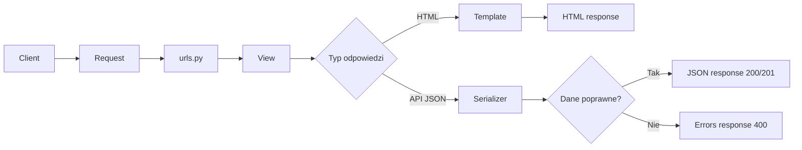

# ⚡ Weekend 5 — Django i Django REST Framework: cheat sheet

> **Kurs:** AI Python Engineer  
> **Blok:** Weekend 5 — Django: fundamenty web i API  
> **Typ pliku:** szybka ściąga do pracy na zajęciach i po zajęciach  
> **Cel:** mieć pod ręką najważniejsze komendy, schematy, fragmenty kodu i checklisty

---

## 🧭 Spis treści

- [Najważniejszy mentalny model](#-najważniejszy-mentalny-model)
- [Projekt Django vs aplikacja Django](#-projekt-django-vs-aplikacja-django)
- [Najważniejsze pliki](#-najważniejsze-pliki)
- [Start projektu Django](#-start-projektu-django)
- [Tworzenie aplikacji](#-tworzenie-aplikacji)
- [Endpoint zdrowia `/health/`](#-endpoint-zdrowia-health)
- [Prosty widok tekstowy](#-prosty-widok-tekstowy)
- [Prosty template HTML](#-prosty-template-html)
- [Dane przykładowe dla API](#-dane-przykładowe-dla-api)
- [Serializer DRF](#-serializer-drf)
- [Ręczne sprawdzenie serializera w shellu](#-ręczne-sprawdzenie-serializera-w-shellu)
- [APIView — GET i POST](#-apiview--get-i-post)
- [ViewSet](#-viewset)
- [Router DRF](#-router-drf)
- [APIView czy ViewSet?](#-apiview-czy-viewset)
- [Najważniejsze statusy HTTP](#-najważniejsze-statusy-http)
- [Przykładowe requesty](#-przykładowe-requesty)
- [Przykładowy sukces API](#-przykładowy-sukces-api)
- [Przykładowy błąd walidacji](#-przykładowy-błąd-walidacji)
- [Konfiguracja pytest-django](#-konfiguracja-pytest-django)
- [Test GET endpointu](#-test-get-endpointu)
- [Test POST — sukces](#-test-post--sukces)
- [Test POST — brak wymaganego pola](#-test-post--brak-wymaganego-pola)
- [Test POST — błędny status](#-test-post--błędny-status)
- [Endpoint szczegółów w ViewSet](#-endpoint-szczegółów-w-viewset)
- [Test endpointu szczegółów](#-test-endpointu-szczegółów)
- [Najczęstsze błędy](#-najczęstsze-błędy)
- [Minimalny kontrakt API](#-minimalny-kontrakt-api)
- [Minimalna dokumentacja API](#-minimalna-dokumentacja-api)
- [Komendy, które warto znać](#-komendy-które-warto-znać)
- [Checklist końcowy](#-checklist-końcowy)
- [Najważniejsze rzeczy do zapamiętania](#-najważniejsze-rzeczy-do-zapamiętania)

---

# 🧠 Najważniejszy mentalny model

Django obsługuje request według prostego przepływu:

```text
client -> request -> urls.py -> view -> response -> client
```

Dla API z Django REST Framework:

```text
client -> JSON request -> urls.py -> APIView/ViewSet -> serializer -> JSON response
```

Dla klasycznego HTML:

```text
browser -> request -> urls.py -> view -> template -> HTML response
```

---

## Mapa przepływu requestu



---

# 🏗️ Projekt Django vs aplikacja Django

| Pojęcie | Znaczenie | Przykład |
|---|---|---|
| **Projekt Django** | Konfiguracja całego backendu | `config` |
| **Aplikacja Django** | Moduł biznesowy | `tasks`, `users`, `orders`, `documents` |

Projekt zawiera konfigurację, np.:

- `settings.py`,
- `urls.py`,
- `asgi.py`,
- `wsgi.py`.

Aplikacja zawiera logikę konkretnej domeny, np.:

- modele,
- widoki,
- serializery,
- testy.

> [!TIP]  
> Myśl prosto: **projekt = konfiguracja**, **aplikacja = funkcja biznesowa**.

---

# 📁 Najważniejsze pliki

| Plik | Do czego służy? |
|---|---|
| `manage.py` | Uruchamianie komend Django |
| `config/settings.py` | Konfiguracja projektu |
| `config/urls.py` | Główny routing |
| `tasks/urls.py` | Routing aplikacji |
| `tasks/views.py` | Widoki Django i DRF |
| `tasks/serializers.py` | Serializery DRF |
| `tasks/models.py` | Modele bazy danych |
| `tasks/tests/` | Testy aplikacji |
| `templates/` | Szablony HTML |

---

# 🚀 Start projektu Django

```bash
mkdir weekend_05_django_api
cd weekend_05_django_api

python -m venv .venv
source .venv/bin/activate
```

Windows PowerShell:

```powershell
.venv\Scripts\activate
```

Instalacja zależności:

```bash
pip install django djangorestframework pytest pytest-django
pip freeze > requirements.txt
```

Start projektu:

```bash
django-admin startproject config .
python manage.py runserver
```

> [!IMPORTANT]  
> Kropka na końcu komendy `startproject` jest ważna. Dzięki niej `manage.py` powstaje w bieżącym katalogu.

---

# 🧱 Tworzenie aplikacji

```bash
python manage.py startapp tasks
```

Dodanie aplikacji w `config/settings.py`:

```python
INSTALLED_APPS = [
    "django.contrib.admin",
    "django.contrib.auth",
    "django.contrib.contenttypes",
    "django.contrib.sessions",
    "django.contrib.messages",
    "django.contrib.staticfiles",
    "rest_framework",
    "tasks",
]
```

---

# ❤️ Endpoint zdrowia `/health/`

## `tasks/views.py`

```python
from django.http import HttpResponse


def health_check(request):
    # Prosty endpoint techniczny do sprawdzania, czy backend działa.
    return HttpResponse("OK")
```

## `tasks/urls.py`

```python
from django.urls import path

from .views import health_check

urlpatterns = [
    path("health/", health_check, name="health-check"),
]
```

## `config/urls.py`

```python
from django.contrib import admin
from django.urls import include, path

urlpatterns = [
    path("admin/", admin.site.urls),
    path("", include("tasks.urls")),
]
```

Adres:

```text
http://127.0.0.1:8000/health/
```

Oczekiwany wynik:

```text
OK
```

---

# 🖥️ Prosty widok tekstowy

## `tasks/views.py`

```python
from django.http import HttpResponse


def tasks_list_text(request):
    # Na razie zwracamy zwykły tekst, bez API i bez bazy danych.
    content = "Tasks:\n- Create Django project\n- Add health endpoint\n- Prepare API"
    return HttpResponse(content, content_type="text/plain")
```

## `tasks/urls.py`

```python
from django.urls import path

from .views import health_check, tasks_list_text

urlpatterns = [
    path("health/", health_check, name="health-check"),
    path("tasks/", tasks_list_text, name="tasks-list-text"),
]
```

Adres:

```text
http://127.0.0.1:8000/tasks/
```

---

# 🧾 Prosty template HTML

## `tasks/views.py`

```python
from django.shortcuts import render


TASKS = [
    {"id": 1, "title": "Create Django project", "status": "todo", "priority": "high"},
    {"id": 2, "title": "Add health endpoint", "status": "in_progress", "priority": "medium"},
]


def home(request):
    context = {
        "page_title": "Task Manager",
        "tasks": TASKS,
        "tasks_count": len(TASKS),
    }
    return render(request, "home.html", context)
```

## `templates/home.html`

```html
<!DOCTYPE html>
<html lang="pl">
<head>
    <meta charset="UTF-8">
    <title>{{ page_title }}</title>
</head>
<body>
    <h1>{{ page_title }}</h1>
    <p>Liczba zadań: {{ tasks_count }}</p>

    <ul>
        
            <li>
                <strong>{{ task.title }}</strong>
                — status: {{ task.status }}, priorytet: {{ task.priority }}
            </li>
        
            <li>Brak zadań.</li>
        
    </ul>
</body>
</html>
```

Jeżeli Django nie widzi katalogu `templates`, sprawdź `config/settings.py`:

```python
"DIRS": [BASE_DIR / "templates"],
```

---

# 📦 Dane przykładowe dla API

```python
TASKS = [
    {
        "id": 1,
        "title": "Create Django project",
        "description": "Prepare initial backend structure",
        "status": "todo",
        "priority": "high",
    },
    {
        "id": 2,
        "title": "Add API endpoint",
        "description": "Create first DRF endpoint",
        "status": "in_progress",
        "priority": "medium",
    },
]
```

---

# 🧪 Serializer DRF

## `tasks/serializers.py`

```python
from rest_framework import serializers


class TaskSerializer(serializers.Serializer):
    id = serializers.IntegerField(read_only=True)
    title = serializers.CharField(max_length=120)
    description = serializers.CharField(required=False, allow_blank=True)
    status = serializers.ChoiceField(choices=["todo", "in_progress", "done"])
    priority = serializers.ChoiceField(choices=["low", "medium", "high"])
```

Serializer odpowiada za:

- walidację danych wejściowych,
- przygotowanie danych wyjściowych,
- kontrolę wymaganych pól,
- kontrolę dozwolonych wartości,
- format błędów API.

---

# 🔍 Ręczne sprawdzenie serializera w shellu

```bash
python manage.py shell
```

Poprawny payload:

```python
from tasks.serializers import TaskSerializer

payload = {
    "title": "Write first serializer",
    "description": "Validate task payload",
    "status": "todo",
    "priority": "high",
}

serializer = TaskSerializer(data=payload)
serializer.is_valid()
serializer.validated_data
serializer.errors
```

Błędny payload:

```python
payload = {
    "description": "Missing title and wrong categories",
    "status": "blocked",
    "priority": "urgent",
}

serializer = TaskSerializer(data=payload)
serializer.is_valid()
serializer.errors
```

---

# 🔌 APIView — GET i POST

## `tasks/views.py`

```python
from rest_framework import status
from rest_framework.response import Response
from rest_framework.views import APIView

from .serializers import TaskSerializer


TASKS = [
    {
        "id": 1,
        "title": "Create Django project",
        "description": "Prepare initial backend structure",
        "status": "todo",
        "priority": "high",
    }
]


class TaskListAPIView(APIView):
    def get(self, request):
        # GET /api/tasks/
        return Response(TASKS, status=status.HTTP_200_OK)

    def post(self, request):
        # POST /api/tasks/
        serializer = TaskSerializer(data=request.data)

        if serializer.is_valid():
            task = {
                "id": len(TASKS) + 1,
                **serializer.validated_data,
            }
            TASKS.append(task)
            return Response(task, status=status.HTTP_201_CREATED)

        return Response(serializer.errors, status=status.HTTP_400_BAD_REQUEST)
```

Routing:

```python
from django.urls import path

from .views import TaskListAPIView

urlpatterns = [
    path("api/tasks/", TaskListAPIView.as_view(), name="task-list"),
]
```

---

# 🧩 ViewSet

`ViewSet` grupuje operacje na zasobie.

```python
from rest_framework import status, viewsets
from rest_framework.response import Response

from .serializers import TaskSerializer


class TaskViewSet(viewsets.ViewSet):
    def list(self, request):
        # GET /api/tasks/
        return Response(TASKS, status=status.HTTP_200_OK)

    def create(self, request):
        # POST /api/tasks/
        serializer = TaskSerializer(data=request.data)

        if serializer.is_valid():
            task = {
                "id": len(TASKS) + 1,
                **serializer.validated_data,
            }
            TASKS.append(task)
            return Response(task, status=status.HTTP_201_CREATED)

        return Response(serializer.errors, status=status.HTTP_400_BAD_REQUEST)
```

---

# 🛣️ Router DRF

## `tasks/urls.py`

```python
from django.urls import include, path
from rest_framework.routers import DefaultRouter

from .views import TaskViewSet

router = DefaultRouter()
router.register("tasks", TaskViewSet, basename="tasks")

urlpatterns = [
    path("api/", include(router.urls)),
]
```

Wygenerowane endpointy:

```text
GET /api/tasks/
POST /api/tasks/
GET /api/tasks/{id}/
PUT /api/tasks/{id}/
PATCH /api/tasks/{id}/
DELETE /api/tasks/{id}/
```

> [!NOTE]  
> Nie wszystkie endpointy będą działać, dopóki nie dodasz odpowiednich metod w `ViewSet`.

---

# 🔀 APIView czy ViewSet?

| Sytuacja | Lepszy wybór |
|---|---|
| Nauka podstaw request/response | `APIView` |
| Niestandardowy endpoint | `APIView` |
| Standardowy CRUD | `ViewSet` |
| CRUD oparty o model Django | `ModelViewSet` |
| Chcesz pełnej kontroli nad metodami HTTP | `APIView` |
| Chcesz mniej ręcznego routingu | `ViewSet` + router |

---

# 📡 Najważniejsze statusy HTTP

| Status | Znaczenie | Typowy przypadek |
|---:|---|---|
| `200 OK` | Sukces | pobranie listy |
| `201 Created` | Utworzono zasób | poprawny POST |
| `204 No Content` | Sukces bez body | usunięcie zasobu |
| `400 Bad Request` | Błędne dane klienta | walidacja nie przeszła |
| `401 Unauthorized` | Brak logowania | brak tokena/sesji |
| `403 Forbidden` | Brak uprawnień | użytkownik zalogowany, ale bez dostępu |
| `404 Not Found` | Brak zasobu | obiekt o danym id nie istnieje |
| `500 Internal Server Error` | Błąd serwera | nieobsłużony wyjątek |

> [!IMPORTANT]  
> Błąd walidacji to `400`, nie `500`.

---

# 📨 Przykładowe requesty

GET:

```bash
curl http://127.0.0.1:8000/api/tasks/
```

POST poprawny:

```bash
curl -X POST http://127.0.0.1:8000/api/tasks/ \
  -H "Content-Type: application/json" \
  -d '{"title":"Write tests","description":"Cover API behavior","status":"todo","priority":"high"}'
```

POST błędny:

```bash
curl -X POST http://127.0.0.1:8000/api/tasks/ \
  -H "Content-Type: application/json" \
  -d '{"description":"Missing title","status":"blocked","priority":"urgent"}'
```

---

# ✅ Przykładowy sukces API

Request:

```json
{
  "title": "Write tests",
  "description": "Cover API behavior",
  "status": "todo",
  "priority": "high"
}
```

Response `201 Created`:

```json
{
  "id": 2,
  "title": "Write tests",
  "description": "Cover API behavior",
  "status": "todo",
  "priority": "high"
}
```

---

# ❌ Przykładowy błąd walidacji

Request:

```json
{
  "description": "Missing title",
  "status": "blocked",
  "priority": "urgent"
}
```

Response `400 Bad Request`:

```json
{
  "title": ["This field is required."],
  "status": ["\"blocked\" is not a valid choice."],
  "priority": ["\"urgent\" is not a valid choice."]
}
```

---

# ⚙️ Konfiguracja pytest-django

## `pytest.ini`

```ini
[pytest]
DJANGO_SETTINGS_MODULE = config.settings
python_files = tests.py test_*.py *_tests.py
```

Uruchomienie testów:

```bash
pytest
```

---

# 🧪 Test GET endpointu

## `tasks/tests/test_tasks_api.py`

```python
from rest_framework.test import APIClient


def test_tasks_list_returns_200():
    client = APIClient()

    response = client.get("/api/tasks/")

    assert response.status_code == 200
    assert isinstance(response.data, list)
```

---

# 🧪 Test POST — sukces

```python
from rest_framework.test import APIClient


def test_create_task_returns_201():
    client = APIClient()
    payload = {
        "title": "Write API test",
        "description": "Cover POST endpoint",
        "status": "todo",
        "priority": "high",
    }

    response = client.post("/api/tasks/", payload, format="json")

    assert response.status_code == 201
    assert response.data["title"] == "Write API test"
    assert response.data["status"] == "todo"
    assert response.data["priority"] == "high"
    assert "id" in response.data
```

---

# 🧪 Test POST — brak wymaganego pola

```python
from rest_framework.test import APIClient


def test_create_task_without_title_returns_400():
    client = APIClient()
    payload = {
        "description": "Missing required title",
        "status": "todo",
        "priority": "medium",
    }

    response = client.post("/api/tasks/", payload, format="json")

    assert response.status_code == 400
    assert "title" in response.data
```

---

# 🧪 Test POST — błędny status

```python
from rest_framework.test import APIClient


def test_create_task_with_invalid_status_returns_400():
    client = APIClient()
    payload = {
        "title": "Wrong status",
        "description": "Status is not allowed",
        "status": "blocked",
        "priority": "high",
    }

    response = client.post("/api/tasks/", payload, format="json")

    assert response.status_code == 400
    assert "status" in response.data
```

---

# 🔎 Endpoint szczegółów w ViewSet

```python
class TaskViewSet(viewsets.ViewSet):
    def list(self, request):
        return Response(TASKS, status=status.HTTP_200_OK)

    def retrieve(self, request, pk=None):
        try:
            task_id = int(pk)
        except (TypeError, ValueError):
            return Response(
                {"detail": "Invalid task id."},
                status=status.HTTP_400_BAD_REQUEST,
            )

        for task in TASKS:
            if task["id"] == task_id:
                return Response(task, status=status.HTTP_200_OK)

        return Response(
            {"detail": "Task not found."},
            status=status.HTTP_404_NOT_FOUND,
        )
```

---

# 🧪 Test endpointu szczegółów

```python
from rest_framework.test import APIClient


def test_task_detail_returns_200_for_existing_task():
    client = APIClient()

    response = client.get("/api/tasks/1/")

    assert response.status_code == 200
    assert response.data["id"] == 1
    assert "title" in response.data


def test_task_detail_returns_404_for_missing_task():
    client = APIClient()

    response = client.get("/api/tasks/999/")

    assert response.status_code == 404
    assert response.data["detail"] == "Task not found."
```

---

# 🧯 Najczęstsze błędy

## Django nie widzi aplikacji

Sprawdź `INSTALLED_APPS`:

```python
"tasks",
"rest_framework",
```

---

## URL zwraca 404

Sprawdź:

- czy ścieżka jest w `tasks/urls.py`,
- czy `config/urls.py` używa `include("tasks.urls")`,
- czy adres ma końcowy ukośnik,
- czy wchodzisz na właściwy URL.

---

## `ModuleNotFoundError`

Sprawdź:

- nazwę folderu,
- nazwę pliku,
- importy,
- aktywne środowisko `.venv`,
- katalog, z którego uruchamiasz komendę.

---

## Testy nie widzą Django

Sprawdź `pytest.ini`:

```ini
[pytest]
DJANGO_SETTINGS_MODULE = config.settings
python_files = tests.py test_*.py *_tests.py
```

---

## Serializer przyjmuje złe dane albo nie zwraca błędów

Sprawdź:

- czy pole jest wymagane,
- czy używasz `ChoiceField`,
- czy wywołujesz `serializer.is_valid()`,
- czy zwracasz `serializer.errors` dla błędów.

---

# 📜 Minimalny kontrakt API

## Endpoint listy

```text
GET /api/tasks/
Status: 200 OK
Response: lista zadań
```

## Endpoint tworzenia

```text
POST /api/tasks/
Status sukcesu: 201 Created
Status błędu walidacji: 400 Bad Request
Request body: JSON z danymi zadania
Response body: utworzone zadanie albo błędy walidacji
```

---

# 📝 Minimalna dokumentacja API

```markdown
# API Documentation

## GET /api/tasks/

Zwraca listę zadań.

Status sukcesu: 200 OK

## POST /api/tasks/

Tworzy nowe zadanie.

Status sukcesu: 201 Created

Przykładowy request:

{
  "title": "Write tests",
  "description": "Cover API behavior",
  "status": "todo",
  "priority": "high"
}

Błąd walidacji:

Status: 400 Bad Request
```

---

# 🧰 Komendy, które warto znać

```bash
python manage.py runserver
python manage.py startapp tasks
python manage.py shell
python manage.py migrate
python manage.py test
pytest
pip freeze > requirements.txt
```

---

## Miniściąga: co uruchomić, gdy coś nie działa?

| Problem | Komenda / miejsce do sprawdzenia |
|---|---|
| Serwer nie działa | `python manage.py runserver` |
| Nie wiesz, czy paczki są w środowisku | `pip freeze` |
| Chcesz sprawdzić serializer | `python manage.py shell` |
| Testy nie działają | `pytest` + `pytest.ini` |
| Endpoint nie istnieje | `config/urls.py` i `tasks/urls.py` |
| Django nie widzi aplikacji | `INSTALLED_APPS` |

---

# ✅ Checklist końcowy

```text
[ ] Mam projekt Django
[ ] Mam aplikację domenową
[ ] Aplikacja jest w INSTALLED_APPS
[ ] rest_framework jest w INSTALLED_APPS
[ ] Działa /health/
[ ] Działa prosty widok tekstowy albo HTML
[ ] Mam serializers.py
[ ] Serializer waliduje pola wymagane
[ ] Serializer waliduje kategorie
[ ] Działa GET /api/tasks/
[ ] Działa POST /api/tasks/
[ ] Poprawny POST zwraca 201
[ ] Błędny POST zwraca 400
[ ] Mam pytest.ini
[ ] Mam test GET
[ ] Mam test POST sukcesu
[ ] Mam test błędu walidacji
[ ] pytest przechodzi
[ ] Mam krótką dokumentację API
[ ] Zrobiłem commit w Git
```

---

## Checklist w wersji Markdown

- [ ] Mam projekt Django.
- [ ] Mam aplikację domenową.
- [ ] Aplikacja jest w `INSTALLED_APPS`.
- [ ] `rest_framework` jest w `INSTALLED_APPS`.
- [ ] Działa `/health/`.
- [ ] Działa prosty widok tekstowy albo HTML.
- [ ] Mam `serializers.py`.
- [ ] Serializer waliduje pola wymagane.
- [ ] Serializer waliduje kategorie.
- [ ] Działa `GET /api/tasks/`.
- [ ] Działa `POST /api/tasks/`.
- [ ] Poprawny `POST` zwraca `201`.
- [ ] Błędny `POST` zwraca `400`.
- [ ] Mam `pytest.ini`.
- [ ] Mam test `GET`.
- [ ] Mam test sukcesu `POST`.
- [ ] Mam test błędu walidacji.
- [ ] `pytest` przechodzi.
- [ ] Mam krótką dokumentację API.
- [ ] Zrobiłem/zrobiłam commit w Git.

---

# 🧠 Najważniejsze rzeczy do zapamiętania

1. `urls.py` decyduje, który widok obsłuży request.
2. Widok przyjmuje `request` i zwraca `response`.
3. Django może zwracać HTML, tekst albo JSON.
4. DRF ułatwia budowanie API.
5. Serializer waliduje dane wejściowe.
6. Status HTTP jest częścią kontraktu API.
7. `APIView` jest dobry do nauki i niestandardowych endpointów.
8. `ViewSet` porządkuje operacje CRUD.
9. Router automatyzuje URL-e dla ViewSetów.
10. Testy API powinny sprawdzać sukces i błędy.
11. Błąd walidacji to `400`, nie `500`.
12. Brak zasobu to `404`.
13. Dobre API ma przewidywalny format odpowiedzi.
14. Projekt capstone powinien być rozwijany małymi, stabilnymi krokami.

> [!IMPORTANT]  
> Najważniejszy skrót z tego bloku:  
> `request -> urls.py -> view -> serializer -> response`
