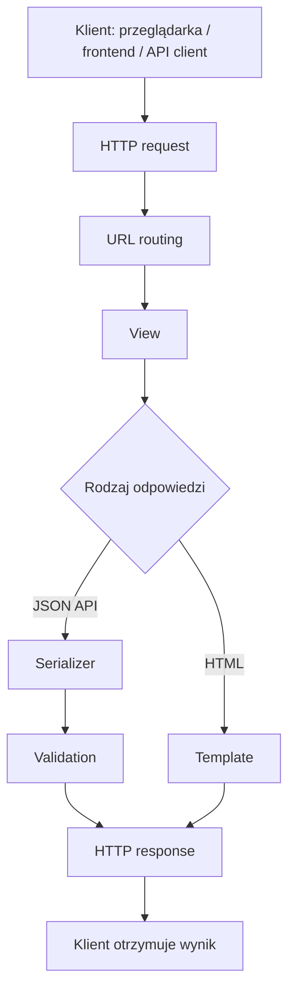
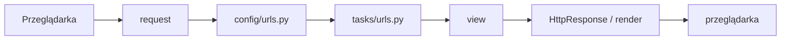
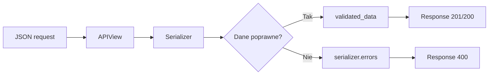

# 🧑‍🎓 Weekend 5 — Django: fundamenty web i API

> **README dla kursanta**  
> Kurs: **AI Python Engineer**  
> Moduł: **Backend web w Pythonie**  
> Czas: **2 dni / ok. 8 godzin**  
> Sobota: **Django — start projektu, routing, views, templates**  
> Niedziela: **Django REST Framework — pierwsze API, serializery, walidacja, testy**  
> Główny efekt: **pierwszy działający backend API w Django**

---

## 🧭 O czym jest ten weekend?

W tym weekendzie zaczynamy budować prawdziwy backend webowy w Pythonie.

Do tej pory Python był głównie językiem do pisania:

- skryptów,
- automatyzacji,
- logiki programu,
- prostych narzędzi,
- ćwiczeń z danych.

Teraz użyjemy go do stworzenia aplikacji, która działa jako serwer:

1. odbiera zapytania HTTP,
2. dopasowuje adres URL,
3. uruchamia odpowiedni widok,
4. przetwarza dane,
5. zwraca odpowiedź.

Przez dwa dni przejdziemy od pustego katalogu do pierwszego działającego API w Django i Django REST Framework.

---

## Spis treści

- [O czym jest ten weekend?](#-o-czym-jest-ten-weekend)
- [Plan weekendu](#-plan-weekendu)
- [Po tym weekendzie będziesz umieć](#-po-tym-weekendzie-będziesz-umieć)
- [Dlaczego to jest ważne?](#-dlaczego-to-jest-ważne)
- [Case biznesowy](#-case-biznesowy)
- [Wymagania wstępne](#-wymagania-wstępne)
- [Narzędzia](#-narzędzia)
- [Instalacja projektu](#-instalacja-projektu)
- [Tworzenie aplikacji Django](#-tworzenie-aplikacji-django)
- [Najważniejsze pliki Django](#-najważniejsze-pliki-django)
- [Przykładowa struktura projektu](#-przykładowa-struktura-projektu)
- [Sobota — Django: start projektu](#-sobota--django-start-projektu)
- [Niedziela — pierwsze API w Django REST Framework](#-niedziela--pierwsze-api-w-django-rest-framework)
- [Najważniejsze pojęcia](#-najważniejsze-pojęcia)
- [Przykładowe API, które zbudujemy](#-przykładowe-api-które-zbudujemy)
- [Testy API](#-testy-api)
- [Konfiguracja pytest](#-konfiguracja-pytest)
- [Praca z AI podczas tego bloku](#-praca-z-ai-podczas-tego-bloku)
- [Dobre praktyki od początku](#-dobre-praktyki-od-początku)
- [Najczęstsze problemy](#-najczęstsze-problemy)
- [Zadanie domowe dla chętnych](#-zadanie-domowe-dla-chętnych)
- [Jak ten weekend wspiera projekt końcowy?](#-jak-ten-weekend-wspiera-projekt-końcowy)
- [Checklist na koniec weekendu](#-checklist-na-koniec-weekendu)
- [Minimalny efekt końcowy](#-minimalny-efekt-końcowy)

---

# 🗓️ Plan weekendu

## Sobota — Django: start projektu

W sobotę pracujemy z klasycznym Django.

Zrobimy:

- start projektu,
- start aplikacji,
- konfigurację `settings.py`,
- pierwszy widok,
- routing URL,
- prosty endpoint `/health/`,
- prosty widok HTML z template,
- uporządkowanie struktury projektu.

Najważniejsze pytanie soboty:

> Co dzieje się w Django od momentu wejścia na adres w przeglądarce do momentu zobaczenia odpowiedzi?

---

## Niedziela — Django REST Framework

W niedzielę przechodzimy od strony HTML do API.

Zrobimy:

- instalację i konfigurację DRF,
- pierwszy serializer,
- endpoint `GET /api/tasks/`,
- endpoint `POST /api/tasks/`,
- obsługę walidacji,
- statusy HTTP,
- podstawowy `APIView`,
- lekkie wprowadzenie do `ViewSet` i `router`,
- testy endpointów przez `APIClient`,
- prostą dokumentację API.

Najważniejsze pytanie niedzieli:

> Jak stworzyć endpoint, który przyjmuje JSON, sprawdza dane i zwraca przewidywalną odpowiedź?

---

# ✅ Po tym weekendzie będziesz umieć

Po ukończeniu tego bloku będziesz umieć:

- utworzyć projekt Django od zera,
- uruchomić lokalny serwer developerski,
- wyjaśnić różnicę między projektem Django a aplikacją Django,
- wskazać rolę plików `manage.py`, `settings.py`, `urls.py`, `views.py`,
- stworzyć własną aplikację Django,
- podpiąć aplikację do `INSTALLED_APPS`,
- dodać własne URL-e,
- napisać prosty widok zwracający odpowiedź tekstową,
- wyrenderować prosty template HTML,
- zrozumieć przepływ `request -> URL routing -> view -> response`,
- stworzyć pierwsze API w Django REST Framework,
- użyć serializera do walidacji danych,
- obsłużyć metody `GET` i `POST`,
- zwrócić poprawne statusy HTTP, np. `200`, `201`, `400`, `404`,
- napisać podstawowe testy endpointów API,
- przygotować strukturę backendu pod projekt końcowy.

---

# 💡 Dlaczego to jest ważne?

Większość aplikacji webowych składa się z frontendu i backendu.

Frontend to część, którą widzi użytkownik:

- strona,
- formularze,
- przyciski,
- panel aplikacji,
- widoki danych.

Backend to część, która:

- przyjmuje zapytania,
- sprawdza dane,
- zapisuje i odczytuje dane z bazy,
- wykonuje logikę biznesową,
- komunikuje się z zewnętrznymi usługami,
- wystawia API dla frontendu, aplikacji mobilnej albo innych systemów.

Django jest jednym z najpopularniejszych frameworków backendowych w Pythonie.  
Django REST Framework, w skrócie **DRF**, jest standardowym narzędziem do budowania API w Django.

To będzie fundament pod kolejne weekendy:

- bazę danych,
- pełny CRUD,
- autoryzację,
- testy,
- Docker,
- deploy,
- integracje AI.

---

## Główna mapa mentalna



---

# 🛒 Case biznesowy

Podczas weekendu będziemy pracować na prostym przykładzie backendu do zarządzania zadaniami w projekcie zespołowym.

Przykładowa encja:

```text
Task
```

---

## Pola zadania

| Pole | Typ | Opis |
|---|---:|---|
| `id` | integer | unikalny identyfikator zadania |
| `title` | string | krótka nazwa zadania |
| `description` | string | dłuższy opis zadania |
| `status` | string | status zadania: `todo`, `in_progress`, `done` |
| `priority` | string | priorytet: `low`, `medium`, `high` |
| `created_at` | datetime | data utworzenia zadania |

---

## Gdzie spotkasz podobny schemat?

Taki prosty model przypomina realne systemy, np.:

- systemy ticketowe,
- CRM-y,
- systemy do obsługi zamówień,
- aplikacje do faktur,
- aplikacje HR,
- panele administracyjne,
- narzędzia do obsługi dokumentów,
- aplikacje z funkcjami AI.

---

# ✅ Wymagania wstępne

Przed tym weekendem warto umieć:

- uruchamiać komendy w terminalu,
- tworzyć i aktywować środowisko wirtualne `venv`,
- instalować paczki przez `pip`,
- pisać proste funkcje w Pythonie,
- rozumieć podstawy klas i importów,
- czytać podstawowe błędy w terminalu,
- pracować z plikami `.py`,
- rozumieć format JSON,
- znać podstawy testów w Pythonie.

Nie musisz znać wcześniej Django. Ten blok startuje od podstaw.

---

# 🛠️ Narzędzia

Potrzebujesz:

- Python 3.11 lub nowszy,
- edytor kodu, np. VS Code albo PyCharm,
- terminal,
- Git,
- przeglądarkę internetową,
- opcjonalnie: Postman, Insomnia albo rozszerzenie Thunder Client do VS Code.

W trakcie zajęć będziemy korzystać głównie z:

| Narzędzie | Rola |
|---|---|
| Django | framework backendowy |
| Django REST Framework | budowanie API |
| pytest | uruchamianie testów |
| pytest-django | testy Django w pytest |
| SQLite | lokalna baza developerska |
| Git | zapisywanie zmian |

---

# 🚀 Instalacja projektu

## 1. Utwórz katalog projektu

```bash
mkdir weekend_05_django_api
cd weekend_05_django_api
```

---

## 2. Utwórz środowisko wirtualne

```bash
python -m venv .venv
```

---

## 3. Aktywuj środowisko

Linux / macOS:

```bash
source .venv/bin/activate
```

Windows PowerShell:

```powershell
.venv\Scripts\activate
```

Jeśli środowisko jest aktywne, w terminalu powinno pojawić się coś w tym stylu:

```text
(.venv)
```

---

## 4. Zainstaluj potrzebne paczki

```bash
pip install django djangorestframework pytest pytest-django
```

Opcjonalnie zapisz zależności do pliku:

```bash
pip freeze > requirements.txt
```

---

## 5. Utwórz projekt Django

```bash
django-admin startproject config .
```

> [!IMPORTANT]  
> Kropka na końcu komendy jest ważna.  
> Dzięki niej `manage.py` powstanie w bieżącym katalogu, a projekt nie będzie niepotrzebnie zagnieżdżony.

---

## 6. Uruchom serwer

```bash
python manage.py runserver
```

Jeżeli wszystko działa, w terminalu zobaczysz adres podobny do:

```text
http://127.0.0.1:8000/
```

Otwórz go w przeglądarce.

---

# 🧱 Tworzenie aplikacji Django

Projekt Django to konfiguracja całego backendu.

Aplikacja Django to osobny moduł funkcjonalny, np.:

- `tasks`,
- `users`,
- `orders`,
- `invoices`,
- `products`,
- `documents`.

W tym bloku stworzymy aplikację:

```text
tasks
```

Komenda:

```bash
python manage.py startapp tasks
```

Następnie dodaj aplikację do `INSTALLED_APPS` w pliku:

```text
config/settings.py
```

Przykład:

```python
INSTALLED_APPS = [
    "django.contrib.admin",
    "django.contrib.auth",
    "django.contrib.contenttypes",
    "django.contrib.sessions",
    "django.contrib.messages",
    "django.contrib.staticfiles",
    "rest_framework",
    "tasks",
]
```

---

## Projekt vs aplikacja

| Pojęcie | Co oznacza? | Przykład |
|---|---|---|
| Projekt Django | konfiguracja całego backendu | `config` |
| Aplikacja Django | moduł funkcjonalny | `tasks`, `orders`, `users` |
| Widok | funkcja albo klasa obsługująca request | `task_list` |
| URL routing | mapa adresów na widoki | `urls.py` |

---

# 📄 Najważniejsze pliki Django

## `manage.py`

Plik do uruchamiania komend Django.

Przykłady:

```bash
python manage.py runserver
python manage.py startapp tasks
python manage.py migrate
python manage.py test
```

---

## `config/settings.py`

Główna konfiguracja projektu.

Znajdziesz tam między innymi:

- listę aplikacji w `INSTALLED_APPS`,
- konfigurację bazy danych,
- konfigurację języka i strefy czasowej,
- ustawienia plików statycznych,
- ustawienia bezpieczeństwa.

---

## `config/urls.py`

Główna mapa adresów URL.

To tutaj Django sprawdza, który widok ma obsłużyć dany adres.

---

## `tasks/views.py`

Tutaj tworzymy widoki, czyli funkcje lub klasy obsługujące request i zwracające response.

---

## `tasks/urls.py`

Lokalny routing aplikacji `tasks`.

Dzięki temu nie musimy trzymać wszystkich adresów w jednym dużym pliku `config/urls.py`.

---

## `tasks/serializers.py`

Plik używany w Django REST Framework.

Serializery odpowiadają za:

- zamianę danych Pythona na format JSON,
- walidację danych wejściowych,
- przygotowanie danych do zapisu lub odpowiedzi API.

Ten plik zwykle tworzymy samodzielnie.

---

# 🗂️ Przykładowa struktura projektu

Po zajęciach projekt może wyglądać mniej więcej tak:

```text
weekend_05_django_api/
├── manage.py
├── requirements.txt
├── pytest.ini
├── config/
│   ├── __init__.py
│   ├── settings.py
│   ├── urls.py
│   ├── asgi.py
│   └── wsgi.py
├── tasks/
│   ├── __init__.py
│   ├── apps.py
│   ├── models.py
│   ├── serializers.py
│   ├── urls.py
│   ├── views.py
│   └── tests/
│       ├── __init__.py
│       └── test_tasks_api.py
└── templates/
    └── home.html
```

W projekcie końcowym możesz użyć podobnej struktury, ale aplikacja `tasks` będzie zastąpiona Twoją domeną biznesową.

Przykłady domen:

- `expenses` dla aplikacji do wydatków,
- `documents` dla aplikacji do analizy dokumentów,
- `tickets` dla systemu zgłoszeń,
- `products` dla katalogu produktów,
- `leads` dla prostego CRM-a,
- `invoices` dla aplikacji fakturowej.

---

# 🗓️ Sobota — Django: start projektu

W sobotę skupimy się na klasycznym Django.

Zrobimy:

- start projektu,
- start aplikacji,
- konfigurację `settings.py`,
- pierwszy widok,
- routing URL,
- prosty endpoint `/health/`,
- prosty widok HTML z template,
- uporządkowanie struktury projektu.

Najważniejsze pytanie soboty:

> Co dzieje się w Django od momentu wejścia na adres w przeglądarce do momentu zobaczenia odpowiedzi?

---

## Schemat soboty



---

## Minimalny widok `/health/`

```python
from django.http import HttpResponse


def health_check(request):
    return HttpResponse("OK")
```

---

# 🗓️ Niedziela — pierwsze API w Django REST Framework

W niedzielę przejdziemy od strony HTML do API.

Zrobimy:

- instalację i konfigurację DRF,
- pierwszy serializer,
- endpoint `GET /api/tasks/`,
- endpoint `POST /api/tasks/`,
- obsługę walidacji,
- statusy HTTP,
- podstawowy `APIView`,
- lekkie wprowadzenie do `ViewSet` i `router`,
- testy endpointów przez `APIClient`,
- prostą dokumentację API.

Najważniejsze pytanie niedzieli:

> Jak stworzyć endpoint, który przyjmuje JSON, sprawdza dane i zwraca przewidywalną odpowiedź?

---

## Schemat API



---

# 🧠 Najważniejsze pojęcia

## Request

Request to zapytanie wysłane do serwera.

Może zawierać:

- metodę HTTP, np. `GET`, `POST`, `PUT`, `DELETE`,
- adres URL,
- nagłówki,
- dane w body, np. JSON.

---

## Response

Response to odpowiedź serwera.

Zawiera:

- status HTTP,
- dane odpowiedzi,
- nagłówki.

---

## Endpoint

Endpoint to konkretny adres API, np.:

```text
GET /api/tasks/
POST /api/tasks/
GET /api/tasks/1/
```

---

## Serializer

Serializer w DRF odpowiada za dane wejściowe i wyjściowe API.

Przykład odpowiedzialności serializera:

- sprawdza, czy `title` jest obecny,
- sprawdza, czy `status` ma jedną z dozwolonych wartości,
- zamienia dane Pythona na JSON,
- przygotowuje błędy walidacji.

---

## Status HTTP

Status HTTP mówi klientowi, co stało się z requestem.

Najważniejsze statusy na ten weekend:

| Status | Znaczenie |
|---:|---|
| `200 OK` | request zakończony sukcesem |
| `201 Created` | zasób został utworzony |
| `400 Bad Request` | klient wysłał błędne dane |
| `404 Not Found` | zasób nie istnieje |
| `500 Internal Server Error` | błąd po stronie serwera |

---

# 🔌 Przykładowe API, które zbudujemy

## Lista zadań

```text
GET /api/tasks/
```

Przykładowa odpowiedź:

```json
[
  {
    "id": 1,
    "title": "Prepare Django project",
    "description": "Create first backend structure",
    "status": "todo",
    "priority": "high"
  }
]
```

---

## Tworzenie zadania

```text
POST /api/tasks/
```

Przykładowy request:

```json
{
  "title": "Write API tests",
  "description": "Cover GET and POST endpoints",
  "status": "todo",
  "priority": "medium"
}
```

Przykładowa odpowiedź:

```json
{
  "id": 2,
  "title": "Write API tests",
  "description": "Cover GET and POST endpoints",
  "status": "todo",
  "priority": "medium"
}
```

---

## Przykład błędu walidacji

```json
{
  "title": ["This field is required."],
  "status": ["\"blocked\" is not a valid choice."]
}
```

---

# 🧪 Testy API

Testy endpointów są bardzo ważne, bo API zwykle jest używane przez inne części systemu:

- frontend,
- aplikację mobilną,
- inne backendy,
- automatyzacje,
- integracje AI,
- zewnętrzne systemy klientów.

W tym bloku nauczysz się pisać testy, które sprawdzają:

- czy endpoint działa,
- czy zwraca poprawny status,
- czy zwraca dane w oczekiwanym formacie,
- czy błędne dane powodują `400 Bad Request`.

---

## Przykładowy test

```python
import pytest
from rest_framework.test import APIClient


@pytest.mark.django_db
def test_create_task_returns_201():
    client = APIClient()

    response = client.post(
        "/api/tasks/",
        {
            "title": "Prepare API",
            "description": "Create first DRF endpoint",
            "status": "todo",
            "priority": "high",
        },
        format="json",
    )

    assert response.status_code == 201
    assert response.data["title"] == "Prepare API"
```

---

# ⚙️ Konfiguracja pytest

W katalogu głównym projektu utwórz plik:

```text
pytest.ini
```

Przykład:

```ini
[pytest]
DJANGO_SETTINGS_MODULE = config.settings
python_files = tests.py test_*.py *_tests.py
```

Testy uruchamiaj komendą:

```bash
pytest
```

---

# 🤖 Praca z AI podczas tego bloku

Możesz używać AI jako pomocnika, ale nie jako narzędzia do bezmyślnego kopiowania całego projektu.

---

## Dobre zastosowania AI

AI może pomóc w:

- wyjaśnieniu błędu z terminala,
- przygotowaniu przykładowego JSON-a do testowania endpointu,
- sprawdzeniu, czy nazwy endpointów są czytelne,
- zaproponowaniu przypadków testowych,
- wyjaśnieniu różnicy między `APIView` i `ViewSet`,
- review struktury katalogów.

---

## Przykładowe prompty

```text
Wyjaśnij mi ten błąd Django prostym językiem.
Nie podawaj całego gotowego projektu.
Wskaż, w którym pliku prawdopodobnie jest problem
i jakie 2 rzeczy mam sprawdzić.
```

```text
Mam endpoint POST /api/tasks/.
Dane wejściowe to title, description, status i priority.
Zaproponuj 5 przypadków testowych, w tym minimum 2 dla błędnych danych.
```

---

## Na co uważać?

Uważaj na sytuacje, w których AI generuje zbyt zaawansowany kod, np. z:

- autoryzacją,
- permissions,
- pagination,
- filtrami,
- klasami, których jeszcze nie omawialiśmy.

Najpierw zrozum prostą wersję.

---

# ✅ Dobre praktyki od początku

Podczas pracy trzymaj się kilku zasad:

## 1. Uruchamiaj projekt często

Nie pisz przez godzinę bez sprawdzania, czy aplikacja nadal działa.

---

## 2. Rób małe kroki

Najpierw:

1. endpoint `/health/`,
2. routing aplikacji,
3. widok,
4. serializer,
5. API.

---

## 3. Czytaj traceback od dołu

Ostatnie linie błędu często mówią najwięcej.

---

## 4. Nie ignoruj statusów HTTP

Dane to nie wszystko. Status odpowiedzi też jest częścią kontraktu API.

---

## 5. Testuj błędy, nie tylko sukces

Dobre API musi przewidywalnie reagować na błędne dane.

---

## 6. Trzymaj porządek w plikach

Nie wrzucaj całego kodu do jednego miejsca.

---

## 7. Commituj działające etapy

Po każdym większym kroku zapisz stabilny stan w Git.

---

# 🧯 Najczęstsze problemy

## Serwer nie startuje

Sprawdź:

- czy środowisko `.venv` jest aktywne,
- czy jesteś w katalogu z `manage.py`,
- czy Django jest zainstalowane,
- czy nie ma literówki w `settings.py`,
- czy port `8000` nie jest zajęty.

Możesz uruchomić serwer na innym porcie:

```bash
python manage.py runserver 8001
```

---

## Django nie widzi aplikacji

Sprawdź, czy aplikacja jest dodana do `INSTALLED_APPS`.

Przykład:

```python
INSTALLED_APPS = [
    ...
    "rest_framework",
    "tasks",
]
```

---

## URL zwraca 404

Sprawdź:

- czy adres jest dodany w `urls.py`,
- czy `config/urls.py` zawiera `include`,
- czy `tasks/urls.py` ma poprawny `urlpatterns`,
- czy wchodzisz na dobry adres w przeglądarce.

---

## ImportError albo ModuleNotFoundError

Sprawdź:

- nazwę pliku,
- nazwę katalogu,
- czy katalog ma plik `__init__.py`,
- czy aplikacja nie została przeniesiona bez zmiany importów,
- czy uruchamiasz komendę z katalogu głównego projektu.

---

## Testy nie widzą ustawień Django

Sprawdź plik `pytest.ini`.

Powinien zawierać:

```ini
[pytest]
DJANGO_SETTINGS_MODULE = config.settings
python_files = tests.py test_*.py *_tests.py
```

---

# 🏠 Zadanie domowe dla chętnych

Rozbuduj API `tasks`.

---

## Wersja podstawowa

1. Dodaj endpoint szczegółów zadania: `GET /api/tasks/{id}/`.
2. Dodaj obsługę sytuacji, gdy zadanie nie istnieje.
3. Zwracaj wtedy status `404`.
4. Dodaj test dla istniejącego zadania.
5. Dodaj test dla nieistniejącego zadania.
6. Uzupełnij prostą dokumentację API w `README.md`.

---

## Wersja rozszerzona

1. Dodaj model `Task`.
2. Zapisuj zadania w bazie SQLite.
3. Użyj `ModelSerializer`.
4. Dodaj migracje.
5. Dodaj test tworzenia zadania w bazie.
6. Dodaj endpoint zmiany statusu zadania.

---

# 🧩 Jak ten weekend wspiera projekt końcowy?

Po tym weekendzie masz fundament backendu do capstone.

W kolejnych blokach będziesz rozwijać ten projekt o:

- modele bazodanowe,
- relacje między tabelami,
- PostgreSQL,
- pełne CRUD API,
- filtrowanie i sortowanie,
- autoryzację,
- dokumentację OpenAPI,
- testy,
- Docker,
- CI/CD,
- deploy,
- integracje z LLM,
- funkcje AI,
- potencjalnie MCP i komunikację z narzędziami zewnętrznymi.

Najważniejsze, co masz wynieść z tego weekendu:

```text
request -> routing -> view -> serializer -> response
```

Jeżeli dobrze zrozumiesz ten przepływ, kolejne elementy Django i DRF będą dużo łatwiejsze.

---

# ✅ Checklist na koniec weekendu

Sprawdź, czy masz:

- [ ] działające środowisko `.venv`,
- [ ] zainstalowane Django i DRF,
- [ ] utworzony projekt Django,
- [ ] utworzoną aplikację `tasks`,
- [ ] dodane `rest_framework` do `INSTALLED_APPS`,
- [ ] dodaną aplikację `tasks` do `INSTALLED_APPS`,
- [ ] działający endpoint `/health/`,
- [ ] działający widok HTML lub tekstowy,
- [ ] działający endpoint `GET /api/tasks/`,
- [ ] działający endpoint `POST /api/tasks/`,
- [ ] serializer z walidacją danych,
- [ ] poprawne statusy HTTP,
- [ ] test przynajmniej jednego endpointu,
- [ ] test błędnych danych,
- [ ] uporządkowany kod w kilku plikach,
- [ ] zapisany commit w Git.

---

# 🏁 Minimalny efekt końcowy

Na koniec weekendu Twój projekt powinien uruchamiać się komendą:

```bash
python manage.py runserver
```

Powinien mieć co najmniej jeden działający endpoint API, np.:

```text
GET /api/tasks/
```

Oraz testy uruchamiane komendą:

```bash
pytest
```

To będzie Twoja pierwsza baza pod prawdziwy backend API w Django.

> [!IMPORTANT]  
> Nie musisz znać całego Django po tym weekendzie.  
> Masz rozumieć główny przepływ: `request -> routing -> view -> serializer -> response`.
