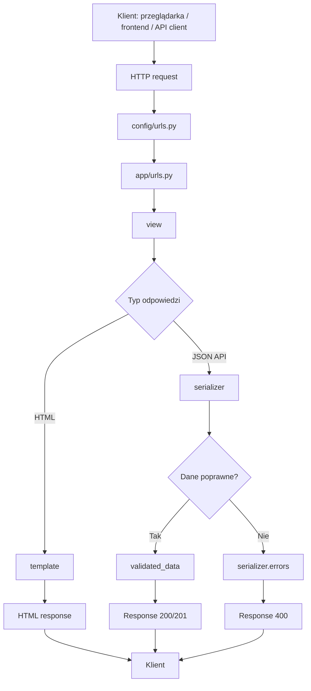
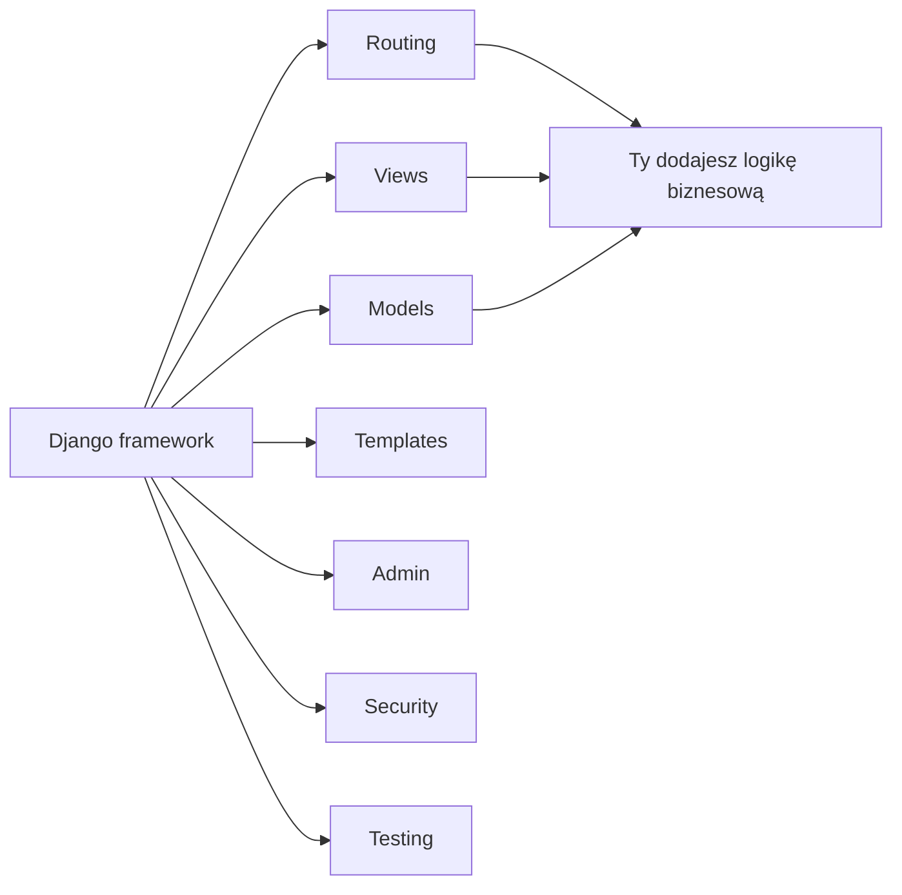
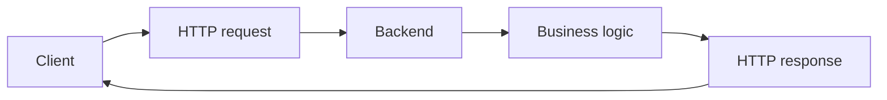
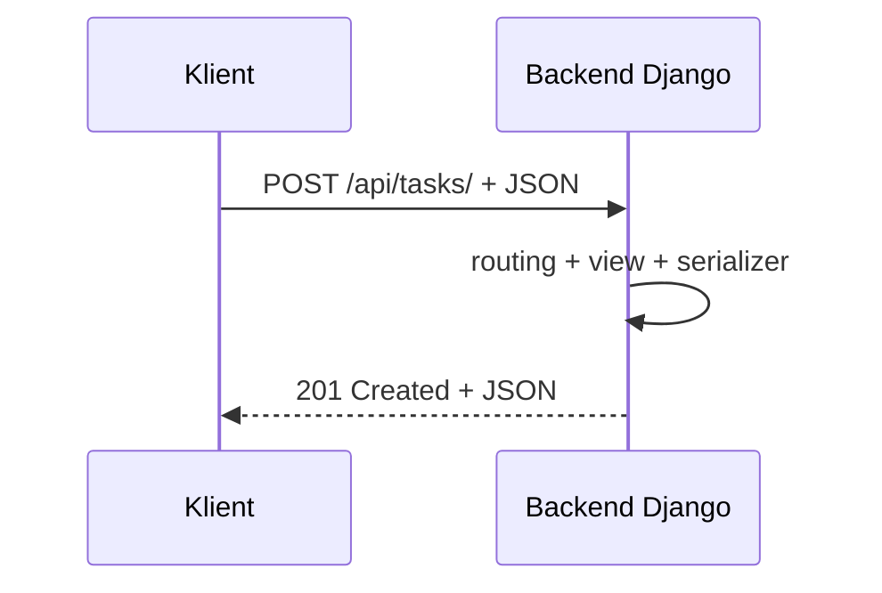
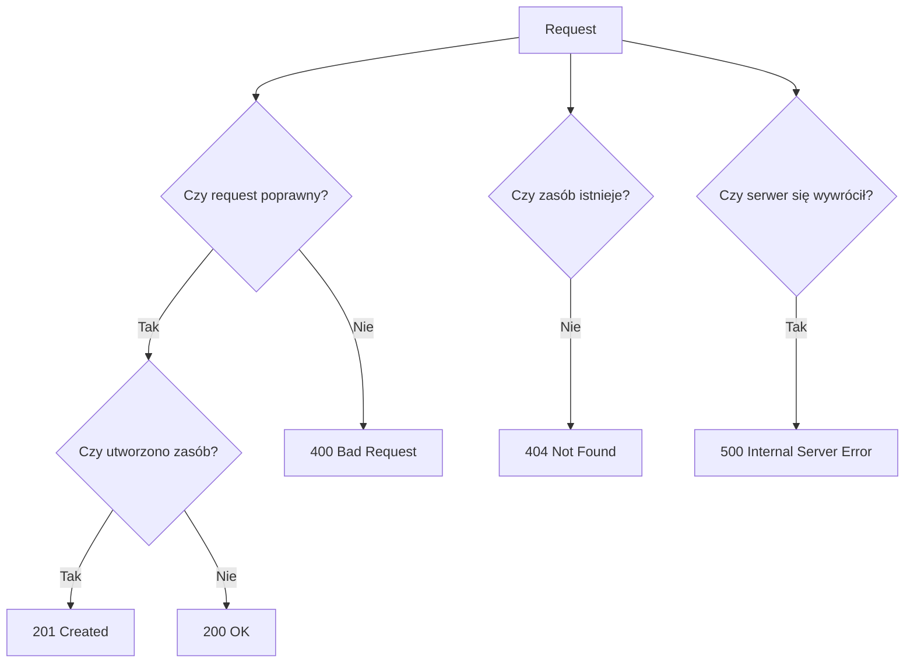
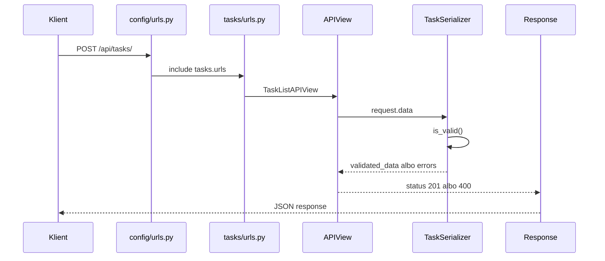
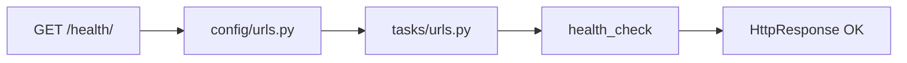
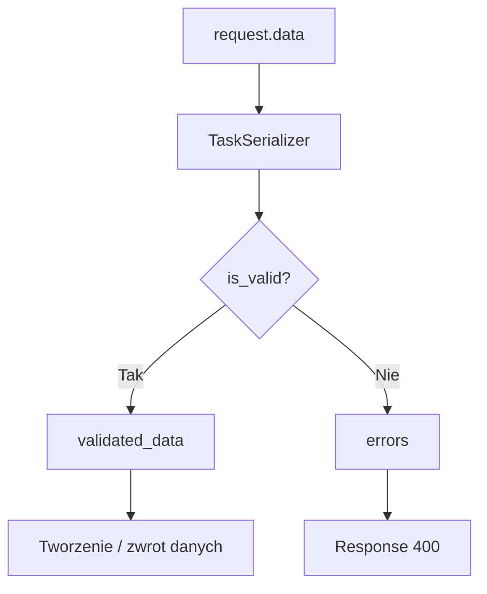

# 📚 Weekend 5 — Django: fundamenty web i API

> **Teoria do bloku**  
> Kurs: **AI Python Engineer**  
> Temat: **Django, HTTP, routing, views, templates, Django REST Framework i pierwsze API**  
> Poziom: **3/5**  
> Cel: zrozumieć przepływ `request -> urls.py -> view -> serializer -> response` i zbudować pierwszy backend API.

---

## 🧭 O czym jest ta teoria?

Ten materiał porządkuje podstawy Django i Django REST Framework.

Po jego przejściu masz rozumieć:

- po co używamy frameworka backendowego,
- czym różni się projekt Django od aplikacji Django,
- jak Django obsługuje request i zwraca response,
- gdzie znajdują się najważniejsze pliki projektu,
- czym jest routing URL,
- czym są widoki,
- kiedy Django zwraca HTML, a kiedy JSON,
- czym jest API,
- po co w DRF są serializery,
- jak działa walidacja danych wejściowych,
- czym różni się `APIView` od `ViewSet`,
- jak testować endpointy przez `APIClient`.

Najważniejszy model mentalny:

```text
request -> urls.py -> view -> serializer -> response
```

---

## Spis treści

- [O czym jest ta teoria?](#-o-czym-jest-ta-teoria)
- [Mapa mentalna Django i DRF](#-mapa-mentalna-django-i-drf)
- [1. Po co nam Django?](#1-po-co-nam-django)
- [2. Framework a biblioteka](#2-framework-a-biblioteka)
- [3. Backend webowy w dużym skrócie](#3-backend-webowy-w-dużym-skrócie)
- [4. Request i response](#4-request-i-response)
- [5. Metody HTTP](#5-metody-http)
- [6. Statusy HTTP](#6-statusy-http)
- [7. Czym jest API?](#7-czym-jest-api)
- [8. REST API — intuicyjnie](#8-rest-api--intuicyjnie)
- [9. JSON](#9-json)
- [10. Projekt Django a aplikacja Django](#10-projekt-django-a-aplikacja-django)
- [11. Najważniejsze pliki Django](#11-najważniejsze-pliki-django)
- [12. Przepływ requestu w Django](#12-przepływ-requestu-w-django)
- [13. Routing URL](#13-routing-url)
- [14. Widoki funkcyjne](#14-widoki-funkcyjne)
- [15. Templates — tylko podstawy](#15-templates--tylko-podstawy)
- [16. Django REST Framework](#16-django-rest-framework)
- [17. Serializer](#17-serializer)
- [18. Serializer a ModelSerializer](#18-serializer-a-modelserializer)
- [19. APIView](#19-apiview)
- [20. Response w DRF](#20-response-w-drf)
- [21. Format błędów API](#21-format-błędów-api)
- [22. ViewSet](#22-viewset)
- [23. Router DRF](#23-router-drf)
- [24. APIView czy ViewSet?](#24-apiview-czy-viewset)
- [25. Testowanie endpointów](#25-testowanie-endpointów)
- [26. pytest-django](#26-pytest-django)
- [27. APIClient](#27-apiclient)
- [28. Dokumentacja API light](#28-dokumentacja-api-light)
- [29. Struktura projektu pod capstone](#29-struktura-projektu-pod-capstone)
- [30. Typowe błędy początkujących](#30-typowe-błędy-początkujących)
- [31. AI jako pomocnik w Django](#31-ai-jako-pomocnik-w-django)
- [32. Minimalny mentalny model Django](#32-minimalny-mentalny-model-django)
- [33. Najważniejsze rzeczy do zapamiętania](#33-najważniejsze-rzeczy-do-zapamiętania)
- [34. Szybka ściąga komend](#34-szybka-ściąga-komend)
- [35. Podsumowanie](#35-podsumowanie)

---

## 🗺️ Mapa mentalna Django i DRF



---

# 1. Po co nam Django?

Django to framework backendowy dla Pythona.

Framework daje gotowy szkielet aplikacji i zestaw sprawdzonych narzędzi. Dzięki temu nie musimy od zera pisać mechanizmów takich jak:

- routing URL,
- obsługa requestów i response’ów,
- konfiguracja projektu,
- komunikacja z bazą danych,
- panel administracyjny,
- system aplikacji,
- obsługa formularzy,
- podstawowe mechanizmy bezpieczeństwa,
- testowanie.

W praktyce backend developer nie pisze całego serwera HTTP od zera. Korzysta z frameworka, który rozwiązuje powtarzalne problemy, a programista skupia się na logice biznesowej.

---

## Przykłady logiki biznesowej

W aplikacji backendowej logika biznesowa może oznaczać:

- utworzenie zadania,
- zmianę statusu zamówienia,
- zapisanie faktury,
- zwrócenie listy dokumentów,
- walidację danych klienta,
- uruchomienie analizy AI dla przesłanego tekstu,
- wygenerowanie odpowiedzi dla użytkownika,
- przygotowanie danych dla frontendu.

---

## Django pomaga oddzielić odpowiedzialności



---

# 2. Framework a biblioteka

Biblioteka to narzędzie, które wywołujesz w swoim kodzie.

Framework to szkielet aplikacji, który określa:

- gdzie umieszczasz kod,
- jak aplikacja ma działać,
- jaki jest główny przepływ programu.

---

## Biblioteka

To Ty kontrolujesz przepływ i w wybranym momencie wywołujesz bibliotekę.

```python
import requests

response = requests.get("https://example.com")
```

---

## Framework

W frameworku to framework kontroluje główny przepływ, a Ty uzupełniasz konkretne miejsca własnym kodem.

```text
Django uruchamia aplikację,
sprawdza URL,
wybiera widok,
przekazuje request,
odbiera response
i odsyła go do klienta.
```

---

## Proste porównanie

| Cecha | Biblioteka | Framework |
|---|---|---|
| Kto kontroluje przepływ? | Ty | Framework |
| Jak używasz? | Wywołujesz funkcję | Wypełniasz ustalone miejsca |
| Przykład | `requests`, `pandas` | Django |
| Metafora | narzędzie w skrzynce | szkielet budynku |

---

# 3. Backend webowy w dużym skrócie

Backend webowy to program działający po stronie serwera.

Jego zadania to między innymi:

- odbieranie requestów HTTP,
- sprawdzanie danych wejściowych,
- wykonywanie logiki biznesowej,
- komunikacja z bazą danych,
- zwracanie response’ów,
- obsługa błędów,
- integracje z innymi systemami,
- udostępnianie API.

---

## Typowy przepływ backendowy

```text
client -> HTTP request -> backend -> business logic -> HTTP response -> client
```

W formie diagramu:



---

## Kto może być klientem?

Klientem backendu może być:

- przeglądarka,
- frontend React,
- aplikacja mobilna,
- inny backend,
- skrypt automatyzujący,
- system AI,
- narzędzie MCP,
- klient API typu Postman, Insomnia albo Thunder Client.

---

# 4. Request i response

## Request

Request to zapytanie wysłane do serwera.

Request zwykle zawiera:

- metodę HTTP,
- adres URL,
- nagłówki,
- parametry query string,
- dane w body,
- informacje o użytkowniku lub sesji.

---

## Przykład requestu

```text
POST /api/tasks/
Content-Type: application/json

{
  "title": "Prepare API tests",
  "status": "todo",
  "priority": "high"
}
```

---

## Response

Response to odpowiedź serwera.

Response zwykle zawiera:

- status HTTP,
- dane odpowiedzi,
- nagłówki,
- ewentualnie komunikat błędu.

---

## Przykład response’u

```text
HTTP/1.1 201 Created
Content-Type: application/json

{
  "id": 1,
  "title": "Prepare API tests",
  "status": "todo",
  "priority": "high"
}
```

---

## Request/response jako rozmowa



---

# 5. Metody HTTP

Metoda HTTP mówi, jaką operację klient chce wykonać.

| Metoda | Znaczenie | Przykład |
|---|---|---|
| `GET` | pobranie danych | pobierz listę zadań |
| `POST` | utworzenie zasobu | utwórz nowe zadanie |
| `PUT` | pełna aktualizacja zasobu | zastąp całe zadanie nową wersją |
| `PATCH` | częściowa aktualizacja zasobu | zmień tylko status zadania |
| `DELETE` | usunięcie zasobu | usuń zadanie |

---

## Przykładowe endpointy

```text
GET /api/tasks/
POST /api/tasks/
GET /api/tasks/12/
PATCH /api/tasks/12/
DELETE /api/tasks/12/
```

W tym weekendzie skupiamy się głównie na:

```text
GET
POST
```

---

# 6. Statusy HTTP

Status HTTP to liczba informująca klienta, jak zakończył się request.

| Status | Nazwa | Znaczenie |
|---:|---|---|
| `200` | OK | request zakończony sukcesem |
| `201` | Created | zasób został utworzony |
| `204` | No Content | operacja zakończona sukcesem, brak body |
| `400` | Bad Request | klient wysłał błędne dane |
| `401` | Unauthorized | brak poprawnego uwierzytelnienia |
| `403` | Forbidden | użytkownik nie ma dostępu |
| `404` | Not Found | zasób nie istnieje |
| `500` | Internal Server Error | błąd po stronie serwera |

---

## Ważna zasada

```text
Błąd walidacji danych użytkownika to zwykle 400, a nie 500.
```

`500` oznacza, że serwer się wywrócił albo nie obsłużył sytuacji poprawnie.

---

## Mapa statusów



---

# 7. Czym jest API?

API, czyli **Application Programming Interface**, to sposób komunikacji między programami.

W kontekście backendu webowego API to zestaw endpointów, które pozwalają innym aplikacjom pobierać i wysyłać dane.

---

## Przykład endpointu

```text
GET /api/tasks/
```

Może oznaczać:

```text
Zwróć listę zadań w formacie JSON.
```

---

## Przykład odpowiedzi API

```json
[
  {
    "id": 1,
    "title": "Create Django project",
    "status": "todo",
    "priority": "high"
  },
  {
    "id": 2,
    "title": "Write API tests",
    "status": "in_progress",
    "priority": "medium"
  }
]
```

---

## API jako kontrakt

API jest kontraktem między backendem a klientem.

Kontrakt określa:

| Element kontraktu | Przykład |
|---|---|
| adres endpointu | `/api/tasks/` |
| metoda HTTP | `GET`, `POST` |
| dane wejściowe | JSON z `title`, `status`, `priority` |
| format odpowiedzi | JSON |
| możliwe statusy | `200`, `201`, `400`, `404` |
| format błędów | obiekt JSON z błędami pól |

---

# 8. REST API — intuicyjnie

REST to styl projektowania API.

Na tym etapie nie trzeba znać całej teorii REST. Wystarczy kilka praktycznych zasad:

- zasoby reprezentujemy rzeczownikami, np. `tasks`, `orders`, `users`,
- operacje wyrażamy metodami HTTP,
- odpowiedzi zwracamy zwykle jako JSON,
- status HTTP informuje o wyniku operacji,
- endpointy powinny być przewidywalne.

---

## Dobre nazewnictwo

```text
GET /api/tasks/
POST /api/tasks/
GET /api/tasks/1/
PATCH /api/tasks/1/
DELETE /api/tasks/1/
```

---

## Mniej dobre nazewnictwo

```text
GET /api/getTasks/
POST /api/createNewTask/
POST /api/deleteTask/
```

W REST nie wkładamy akcji w nazwę URL-a, jeśli można ją wyrazić metodą HTTP.

---

# 9. JSON

JSON to popularny format wymiany danych między aplikacjami.

```json
{
  "title": "Prepare API tests",
  "status": "todo",
  "priority": "high",
  "description": "Add tests for GET and POST endpoints"
}
```

JSON przypomina słownik w Pythonie, ale ma kilka różnic:

| Element | Python | JSON |
|---|---|---|
| tekst | `"text"` albo `'text'` | `"text"` |
| prawda | `True` | `true` |
| fałsz | `False` | `false` |
| brak wartości | `None` | `null` |
| komentarze | możliwe w kodzie Pythona | niedozwolone |

---

## Python dict

```python
task = {
    "title": "Prepare API tests",
    "status": "todo",
    "priority": "high",
    "is_done": False,
    "assignee": None,
}
```

---

## JSON

```json
{
  "title": "Prepare API tests",
  "status": "todo",
  "priority": "high",
  "is_done": false,
  "assignee": null
}
```

---

# 10. Projekt Django a aplikacja Django

To jedna z najważniejszych różnic.

---

## Projekt Django

Projekt to konfiguracja całego backendu.

Zawiera między innymi:

- `settings.py`,
- główne `urls.py`,
- konfigurację bazy danych,
- konfigurację aplikacji,
- konfigurację middleware,
- pliki `asgi.py` i `wsgi.py`.

Przykładowa nazwa projektu:

```text
config
```

---

## Aplikacja Django

Aplikacja to moduł funkcjonalny.

Przykłady aplikacji:

```text
tasks
users
orders
invoices
documents
products
reports
```

Jedna aplikacja powinna zwykle odpowiadać za jeden obszar biznesowy.

---

## Proste porównanie

| Element | Rola |
|---|---|
| Projekt Django | cały backend i jego konfiguracja |
| Aplikacja Django | moduł biznesowy |
| `config` | często nazwa projektu z ustawieniami |
| `tasks` | przykładowa aplikacja biznesowa |

W projekcie końcowym warto myśleć tak:

```text
Projekt Django = cały backend
Aplikacja Django = jeden moduł biznesowy
```

---

# 11. Najważniejsze pliki Django

## `manage.py`

Plik `manage.py` służy do uruchamiania komend Django.

```bash
python manage.py runserver
python manage.py startapp tasks
python manage.py migrate
python manage.py createsuperuser
python manage.py test
```

Nie edytujemy go na początku kursu. Używamy go jako wejścia do narzędzi Django.

---

## `settings.py`

Plik z konfiguracją projektu.

Najważniejsze sekcje:

- `INSTALLED_APPS`,
- `MIDDLEWARE`,
- `ROOT_URLCONF`,
- `TEMPLATES`,
- `DATABASES`,
- `LANGUAGE_CODE`,
- `TIME_ZONE`,
- `STATIC_URL`.

To w `settings.py` dodajemy aplikację i DRF:

```python
INSTALLED_APPS = [
    "django.contrib.admin",
    "django.contrib.auth",
    "django.contrib.contenttypes",
    "django.contrib.sessions",
    "django.contrib.messages",
    "django.contrib.staticfiles",
    "rest_framework",
    "tasks",
]
```

---

## `urls.py`

Plik `urls.py` mapuje adresy URL na widoki.

```python
from django.urls import path
from tasks.views import health_check

urlpatterns = [
    path("health/", health_check),
]
```

Oznacza to:

```text
Jeżeli przyjdzie request na /health/,
uruchom funkcję health_check.
```

---

## `views.py`

Widok to funkcja albo klasa, która przyjmuje request i zwraca response.

```python
from django.http import HttpResponse


def health_check(request):
    return HttpResponse("OK")
```

---

## `models.py`

Modele opisują dane przechowywane w bazie.

Na tym weekendzie modele mogą być tylko krótko pokazane. Głębiej wrócimy do nich przy bazach danych i ORM.

```python
from django.db import models


class Task(models.Model):
    title = models.CharField(max_length=120)
    description = models.TextField(blank=True)
    status = models.CharField(max_length=20)
    priority = models.CharField(max_length=20)
    created_at = models.DateTimeField(auto_now_add=True)
```

---

## `serializers.py`

Ten plik tworzymy zwykle sami w aplikacjach DRF.

Serializer odpowiada za:

- walidację danych wejściowych,
- przygotowanie danych wyjściowych,
- zamianę obiektów Pythona na dane gotowe do JSON-a,
- komunikaty błędów.

```python
from rest_framework import serializers


class TaskSerializer(serializers.Serializer):
    id = serializers.IntegerField(read_only=True)
    title = serializers.CharField(max_length=120)
    description = serializers.CharField(required=False, allow_blank=True)
    status = serializers.ChoiceField(choices=["todo", "in_progress", "done"])
    priority = serializers.ChoiceField(choices=["low", "medium", "high"])
```

---

## Szybka tabela plików

| Plik | Do czego służy? |
|---|---|
| `manage.py` | komendy Django |
| `settings.py` | konfiguracja projektu |
| `urls.py` | mapowanie adresów na widoki |
| `views.py` | obsługa requestów |
| `models.py` | struktura danych w bazie |
| `serializers.py` | walidacja i format danych API |
| `tests/` | testy aplikacji |

---

# 12. Przepływ requestu w Django

Najważniejszy schemat tego weekendu:

```text
client
  -> request
  -> config/urls.py
  -> app/urls.py
  -> view
  -> serializer or business logic
  -> response
  -> client
```

---

## Przykład klasycznego widoku

```text
Przeglądarka wysyła GET /health/
Django sprawdza config/urls.py
Django znajduje widok health_check
Widok zwraca HttpResponse("OK")
Przeglądarka pokazuje OK
```

---

## Przykład API

```text
Klient wysyła POST /api/tasks/
Django znajduje widok obsługujący zadania
Widok przekazuje dane do serializera
Serializer sprawdza poprawność danych
Widok zwraca 201 albo 400
Klient dostaje JSON
```

---

## Diagram requestu API



---

# 13. Routing URL

Routing to mechanizm, który decyduje, jaki kod obsłuży dany adres.

W większym projekcie nie chcemy trzymać wszystkich URL-i w jednym pliku. Dlatego zwykle mamy:

- główny routing projektu,
- routing konkretnej aplikacji.

---

## Główny `config/urls.py`

```python
from django.contrib import admin
from django.urls import include, path

urlpatterns = [
    path("admin/", admin.site.urls),
    path("", include("tasks.urls")),
]
```

---

## Lokalny `tasks/urls.py`

```python
from django.urls import path
from .views import health_check, home

urlpatterns = [
    path("", home, name="home"),
    path("health/", health_check, name="health-check"),
]
```

Dzięki temu aplikacja `tasks` sama zarządza swoimi adresami.

---

## Routing jako mapa



---

# 14. Widoki funkcyjne

Najprostszy widok w Django to funkcja.

```python
from django.http import HttpResponse


def health_check(request):
    return HttpResponse("OK")
```

Widok zawsze przyjmuje przynajmniej argument `request`.

`request` zawiera informacje o zapytaniu:

- metodę,
- nagłówki,
- dane,
- użytkownika,
- ścieżkę,
- parametry.

Możemy sprawdzić metodę:

```python
from django.http import HttpResponse


def method_check(request):
    return HttpResponse(f"Method: {request.method}")
```

---

# 15. Templates — tylko podstawy

Django może zwracać HTML.

Do tego służą templates, czyli szablony HTML.

---

## Widok z template

```python
from django.shortcuts import render


def home(request):
    context = {
        "page_title": "Task Manager",
        "tasks_count": 3,
    }

    return render(request, "home.html", context)
```

---

## Template `home.html`

```html
<!DOCTYPE html>
<html>
<head>
    <title>{{ page_title }}</title>
</head>
<body>
    <h1>{{ page_title }}</h1>
    <p>Liczba zadań: {{ tasks_count }}</p>
</body>
</html>
```

W tym kursie templates traktujemy lekko. Naszym głównym celem jest API, ale warto wiedzieć, że Django potrafi też renderować strony HTML.

---

## HTML vs API

| Typ odpowiedzi | Mechanizm | Przykład |
|---|---|---|
| HTML | `render()` + template | strona w przeglądarce |
| tekst | `HttpResponse()` | `/health/` |
| JSON API | DRF `Response()` | `/api/tasks/` |

---

# 16. Django REST Framework

Django REST Framework, czyli DRF, to biblioteka do budowania API w Django.

Django samo potrafi zwracać JSON, ale DRF daje gotowe narzędzia do:

- serializerów,
- walidacji,
- widoków API,
- obsługi statusów HTTP,
- parsowania requestów JSON,
- browsable API,
- routerów,
- ViewSetów,
- testowania API,
- autoryzacji,
- paginacji,
- filtrowania,
- dokumentowania API.

W tym weekendzie skupiamy się na:

- serializerach,
- `APIView`,
- `ViewSet`,
- routerach,
- statusach HTTP,
- testach API.

---

# 17. Serializer

Serializer to jedna z najważniejszych koncepcji w DRF.

Serializer może robić dwie rzeczy:

1. Przygotować dane do odpowiedzi API.
2. Sprawdzić dane wejściowe od klienta.

---

## Przykład serializera

```python
from rest_framework import serializers


class TaskSerializer(serializers.Serializer):
    id = serializers.IntegerField(read_only=True)
    title = serializers.CharField(max_length=120)
    description = serializers.CharField(required=False, allow_blank=True)
    status = serializers.ChoiceField(choices=["todo", "in_progress", "done"])
    priority = serializers.ChoiceField(choices=["low", "medium", "high"])
```

---

## Walidacja danych

```python
data = {
    "title": "Write tests",
    "status": "todo",
    "priority": "high",
}

serializer = TaskSerializer(data=data)

if serializer.is_valid():
    validated_data = serializer.validated_data
else:
    errors = serializer.errors
```

`serializer.is_valid()` sprawdza dane.

Jeśli dane są poprawne, dostajemy:

```python
serializer.validated_data
```

Jeśli dane są błędne, dostajemy:

```python
serializer.errors
```

---

## Przykład błędów

```json
{
  "title": ["This field is required."],
  "status": ["\"blocked\" is not a valid choice."]
}
```

---

## Co robi serializer?



---

# 18. Serializer a ModelSerializer

Na początku można używać zwykłego `Serializer`.

```python
class TaskSerializer(serializers.Serializer):
    title = serializers.CharField(max_length=120)
    status = serializers.ChoiceField(choices=["todo", "in_progress", "done"])
```

Gdy mamy model Django, często używamy `ModelSerializer`.

```python
class TaskModelSerializer(serializers.ModelSerializer):
    class Meta:
        model = Task
        fields = ["id", "title", "description", "status", "priority", "created_at"]
```

---

## Różnica

| Typ | Kiedy używać |
|---|---|
| `Serializer` | gdy chcemy ręcznie zdefiniować pola i walidację |
| `ModelSerializer` | gdy serializer ma bazować na modelu Django |

Na tym etapie ważniejsze jest zrozumienie walidacji niż automatyzacja.

---

# 19. APIView

`APIView` to klasa DRF, która pozwala pisać endpointy API.

---

## Przykład GET

```python
from rest_framework.response import Response
from rest_framework.views import APIView
from rest_framework import status


class TaskListAPIView(APIView):
    def get(self, request):
        tasks = [
            {
                "id": 1,
                "title": "Create Django project",
                "status": "todo",
                "priority": "high",
            }
        ]

        return Response(tasks, status=status.HTTP_200_OK)
```

Metoda `get` obsługuje request `GET`.

Metoda `post` obsługuje request `POST`.

---

## Przykład GET + POST z danymi w pamięci

```python
from rest_framework.response import Response
from rest_framework.views import APIView
from rest_framework import status

from .serializers import TaskSerializer


TASKS = []


class TaskListAPIView(APIView):
    def get(self, request):
        return Response(TASKS, status=status.HTTP_200_OK)

    def post(self, request):
        serializer = TaskSerializer(data=request.data)

        if serializer.is_valid():
            task = {
                "id": len(TASKS) + 1,
                **serializer.validated_data,
            }
            TASKS.append(task)
            return Response(task, status=status.HTTP_201_CREATED)

        return Response(serializer.errors, status=status.HTTP_400_BAD_REQUEST)
```

To nie jest jeszcze idealne rozwiązanie produkcyjne, bo dane trzymamy w pamięci. Jest jednak bardzo dobre do zrozumienia przepływu API.

---

# 20. Response w DRF

W czystym Django możemy używać:

- `HttpResponse`,
- `JsonResponse`.

W DRF używamy najczęściej:

```python
from rest_framework.response import Response
```

Przykład:

```python
return Response({"message": "OK"})
```

DRF sam zajmuje się przygotowaniem odpowiedzi w odpowiednim formacie, zwykle JSON.

---

## Response ze statusem

```python
from rest_framework import status

return Response(
    {"message": "Task created"},
    status=status.HTTP_201_CREATED,
)
```

Zamiast pisać `201`, warto używać stałych DRF:

```python
status.HTTP_200_OK
status.HTTP_201_CREATED
status.HTTP_400_BAD_REQUEST
status.HTTP_404_NOT_FOUND
```

Kod jest wtedy bardziej czytelny.

---

# 21. Format błędów API

Dobre API powinno zwracać błędy w przewidywalnym formacie.

---

## Błąd walidacji

```json
{
  "title": ["This field is required."],
  "priority": ["\"urgent\" is not a valid choice."]
}
```

---

## Błąd dla nieistniejącego zasobu

```json
{
  "detail": "Task not found."
}
```

---

## Zła praktyka

```text
Coś poszło nie tak
```

Dlaczego to problem?

- frontend nie wie, które pole jest błędne,
- testy są trudniejsze,
- integracje nie mogą automatycznie obsłużyć błędu,
- użytkownik dostaje niejasny komunikat.

---

# 22. ViewSet

`ViewSet` to klasa DRF, która grupuje operacje na zasobie.

Zamiast pisać osobne widoki dla listy, szczegółu, tworzenia i usuwania, możemy użyć ViewSetu.

```python
from rest_framework import viewsets
from rest_framework.response import Response


class TaskViewSet(viewsets.ViewSet):
    def list(self, request):
        return Response([])

    def create(self, request):
        return Response({"message": "Task created"})
```

---

## Metody w ViewSet

| Metoda ViewSet | Typowy HTTP | Znaczenie |
|---|---|---|
| `list` | `GET /tasks/` | lista zasobów |
| `retrieve` | `GET /tasks/{id}/` | szczegóły zasobu |
| `create` | `POST /tasks/` | utworzenie zasobu |
| `update` | `PUT /tasks/{id}/` | pełna aktualizacja |
| `partial_update` | `PATCH /tasks/{id}/` | częściowa aktualizacja |
| `destroy` | `DELETE /tasks/{id}/` | usunięcie |

Na tym weekendzie wystarczy rozumieć, że ViewSet porządkuje typowe operacje CRUD.

---

# 23. Router DRF

Router automatycznie tworzy URL-e dla ViewSetu.

```python
from rest_framework.routers import DefaultRouter
from .views import TaskViewSet

router = DefaultRouter()
router.register("tasks", TaskViewSet, basename="tasks")

urlpatterns = router.urls
```

Dzięki temu DRF tworzy adresy podobne do:

```text
GET /tasks/
POST /tasks/
GET /tasks/{id}/
PUT /tasks/{id}/
PATCH /tasks/{id}/
DELETE /tasks/{id}/
```

Router zmniejsza ilość ręcznego kodu w `urls.py`.

---

# 24. APIView czy ViewSet?

Na początku `APIView` jest łatwiejszy do zrozumienia, bo bezpośrednio widzimy metody HTTP:

```python
def get(self, request):
    ...

def post(self, request):
    ...
```

`ViewSet` jest wygodniejszy przy standardowym CRUD:

```python
def list(self, request):
    ...

def create(self, request):
    ...
```

---

## Praktyczna zasada

| Sytuacja | Wybór |
|---|---|
| Niestandardowy endpoint | `APIView` |
| Prosty CRUD na zasobie | `ViewSet` lub `ModelViewSet` |
| Nauka podstaw request/response | `APIView` |
| Produkcyjne API z modelami | często `ModelViewSet` |

Na tym etapie warto najpierw dobrze zrozumieć `APIView`, a dopiero potem przejść do `ViewSet`.

---

# 25. Testowanie endpointów

Testy API sprawdzają zachowanie backendu z perspektywy klienta.

Nie testujemy tego, czy widok ma konkretną implementację. Testujemy, czy endpoint zachowuje się zgodnie z kontraktem.

---

## Przykładowe pytania testowe

- Czy `GET /api/tasks/` zwraca `200`?
- Czy odpowiedź jest listą?
- Czy `POST /api/tasks/` z poprawnymi danymi zwraca `201`?
- Czy `POST /api/tasks/` bez `title` zwraca `400`?
- Czy błędny `status` daje błąd walidacji?
- Czy nieistniejący zasób zwraca `404`?

---

# 26. pytest-django

`pytest-django` pozwala uruchamiać testy Django przez `pytest`.

Minimalny plik `pytest.ini`:

```ini
[pytest]
DJANGO_SETTINGS_MODULE = config.settings
python_files = tests.py test_*.py *_tests.py
```

Dzięki temu `pytest` wie, gdzie są ustawienia Django.

Testy uruchamiamy:

```bash
pytest
```

Jeśli test używa bazy danych, dodajemy:

```python
import pytest


@pytest.mark.django_db
def test_something():
    ...
```

Na początku część testów może działać bez bazy, ale warto znać ten marker, bo w kolejnych blokach będzie potrzebny bardzo często.

---

# 27. APIClient

`APIClient` z DRF pozwala testować endpointy API.

---

## Test GET

```python
from rest_framework.test import APIClient


def test_tasks_list_returns_200():
    client = APIClient()

    response = client.get("/api/tasks/")

    assert response.status_code == 200
```

---

## Test POST

```python
from rest_framework.test import APIClient


def test_create_task_returns_201():
    client = APIClient()

    response = client.post(
        "/api/tasks/",
        {
            "title": "Write API tests",
            "description": "Cover happy path",
            "status": "todo",
            "priority": "high",
        },
        format="json",
    )

    assert response.status_code == 201
    assert response.data["title"] == "Write API tests"
```

---

## Test błędnych danych

```python
from rest_framework.test import APIClient


def test_create_task_without_title_returns_400():
    client = APIClient()

    response = client.post(
        "/api/tasks/",
        {
            "description": "Missing title",
            "status": "todo",
            "priority": "high",
        },
        format="json",
    )

    assert response.status_code == 400
    assert "title" in response.data
```

---

# 28. Dokumentacja API light

Dokumentacja API nie musi na początku być skomplikowana.

Minimalnie powinna zawierać:

- adres endpointu,
- metodę HTTP,
- opis działania,
- przykład requestu,
- przykład response’u,
- możliwe statusy.

---

## Przykład dokumentacji

### `POST /api/tasks/`

Tworzy nowe zadanie.

Request:

```json
{
  "title": "Write tests",
  "description": "Add API tests",
  "status": "todo",
  "priority": "medium"
}
```

Response `201 Created`:

```json
{
  "id": 1,
  "title": "Write tests",
  "description": "Add API tests",
  "status": "todo",
  "priority": "medium"
}
```

Response `400 Bad Request`:

```json
{
  "title": ["This field is required."]
}
```

W kolejnych blokach można przejść do automatycznej dokumentacji OpenAPI, np. przez `drf-spectacular`.

---

# 29. Struktura projektu pod capstone

W projekcie końcowym ważna będzie czytelna struktura.

---

## Prosty wariant

```text
backend/
├── manage.py
├── requirements.txt
├── pytest.ini
├── config/
│   ├── settings.py
│   └── urls.py
└── tasks/
    ├── models.py
    ├── serializers.py
    ├── views.py
    ├── urls.py
    └── tests/
        └── test_tasks_api.py
```

---

## Bardziej uporządkowany wariant

```text
backend/
├── manage.py
├── requirements.txt
├── pytest.ini
├── config/
│   ├── settings.py
│   └── urls.py
└── apps/
    └── tasks/
        ├── models.py
        ├── serializers.py
        ├── views.py
        ├── urls.py
        └── tests/
            └── test_tasks_api.py
```

Wariant z `apps/` jest dobry dla większych projektów, ale może wymagać większej ostrożności przy importach.

Na początku najważniejsze jest:

- projekt działa,
- kod jest czytelny,
- endpointy są testowane,
- łatwo dodać kolejne aplikacje.

---

# 30. Typowe błędy początkujących

## Brak kropki w `startproject`

Komenda:

```bash
django-admin startproject config
```

utworzy dodatkowy katalog.

Często wygodniej użyć:

```bash
django-admin startproject config .
```

---

## Brak aplikacji w `INSTALLED_APPS`

Jeśli utworzysz aplikację:

```bash
python manage.py startapp tasks
```

dodaj ją do `INSTALLED_APPS`.

---

## Brak `include`

Jeśli chcesz mieć osobny `tasks/urls.py`, główny routing musi go dołączyć:

```python
from django.urls import include, path

urlpatterns = [
    path("", include("tasks.urls")),
]
```

---

## Literówki w URL-ach

Adres:

```text
/api/tasks/
```

to nie to samo co:

```text
/api/task/
```

Django traktuje je jako różne ścieżki.

---

## Brak ukośnika na końcu

Django domyślnie często oczekuje końcowego ukośnika:

```text
/api/tasks/
```

a nie:

```text
/api/tasks
```

---

## Mylenie `request.data` i `request.GET`

W DRF:

- `request.data` zawiera dane z body, np. JSON w `POST`,
- `request.GET` zawiera query params z URL-a.

Przykład query params:

```text
/api/tasks/?status=todo
```

---

## Testowanie tylko poprawnych danych

Dobre testy obejmują również błędy.

Minimum:

- jeden test sukcesu,
- jeden test błędnych danych.

---

# 31. AI jako pomocnik w Django

AI może bardzo pomóc w nauce Django, ale trzeba używać go ostrożnie.

---

## Dobre zastosowania

AI może pomóc w:

- wyjaśnieniu tracebacka,
- przygotowaniu przykładowego requestu JSON,
- zaproponowaniu przypadków testowych,
- sprawdzeniu, czy nazwy endpointów są REST-owe,
- krótkim porównaniu `APIView` i `ViewSet`,
- pomocy w debugowaniu importów.

---

## Dobry prompt

```text
Mam taki błąd w Django.
Wyjaśnij go prostym językiem i wskaż 3 rzeczy, które powinienem sprawdzić.
Nie generuj całego projektu od zera.
```

---

## Zły prompt

```text
Napisz mi cały backend Django z API, testami, autoryzacją i bazą danych.
```

Problem z takim promptem polega na tym, że AI może wygenerować dużo kodu, którego jeszcze nie rozumiesz.

W pracy programisty najważniejsze jest umieć utrzymać, debugować i rozwijać kod, a nie tylko go wkleić.

---

# 32. Minimalny mentalny model Django

Po tym weekendzie najważniejsze jest zapamiętanie jednego przepływu:

```text
request
  -> urls.py
  -> view
  -> serializer
  -> response
```

Dla klasycznego widoku HTML:

```text
request
  -> urls.py
  -> view
  -> template
  -> HTML response
```

Dla API:

```text
request JSON
  -> urls.py
  -> APIView or ViewSet
  -> serializer validation
  -> JSON response with HTTP status
```

Jeżeli ten model jest jasny, kolejne tematy Django będą dużo łatwiejsze:

- modele,
- migracje,
- PostgreSQL,
- CRUD,
- relacje,
- autoryzacja,
- permissions,
- filtrowanie,
- dokumentacja OpenAPI,
- Docker,
- deploy,
- integracje AI.

---

# 33. Najważniejsze rzeczy do zapamiętania

1. Django to framework backendowy.
2. Projekt Django to konfiguracja całego backendu.
3. Aplikacja Django to moduł biznesowy.
4. `settings.py` zawiera konfigurację.
5. `urls.py` mapuje adresy na widoki.
6. Widok przyjmuje request i zwraca response.
7. Template służy do HTML.
8. API zwykle zwraca JSON.
9. DRF ułatwia budowanie API.
10. Serializer waliduje dane i przygotowuje odpowiedzi.
11. Status HTTP jest częścią kontraktu API.
12. `APIView` dobrze pokazuje przepływ request/response.
13. `ViewSet` pomaga uporządkować CRUD.
14. Router automatycznie tworzy URL-e dla ViewSetu.
15. Testy API sprawdzają zachowanie endpointów.
16. Dobre API obsługuje zarówno sukces, jak i błędy.
17. Czytelna struktura projektu ułatwia rozwój capstone.
18. AI jest pomocnikiem, ale nie zastępuje rozumienia kodu.

---

# 34. Szybka ściąga komend

## Środowisko

```bash
python -m venv .venv
source .venv/bin/activate
```

Windows PowerShell:

```powershell
.venv\Scripts\activate
```

---

## Instalacja

```bash
pip install django djangorestframework pytest pytest-django
```

---

## Start projektu

```bash
django-admin startproject config .
```

---

## Start aplikacji

```bash
python manage.py startapp tasks
```

---

## Uruchomienie serwera

```bash
python manage.py runserver
```

---

## Migracje

```bash
python manage.py makemigrations
python manage.py migrate
```

---

## Testy

```bash
pytest
```

---

## Przykładowe requesty `curl`

GET:

```bash
curl http://127.0.0.1:8000/api/tasks/
```

POST:

```bash
curl -X POST http://127.0.0.1:8000/api/tasks/ \
  -H "Content-Type: application/json" \
  -d '{"title":"Write tests","status":"todo","priority":"high"}'
```

---

# 35. Podsumowanie

Ten blok jest pierwszym dużym krokiem w stronę backend developmentu w Pythonie.

Najważniejsze nie jest zapamiętanie wszystkich klas i plików Django.  
Najważniejsze jest zrozumienie przepływu:

```text
request -> routing -> view -> serializer -> response
```

Po tym weekendzie masz bazę do kolejnych tematów:

- modele,
- migracje,
- PostgreSQL,
- pełny CRUD,
- autoryzacja,
- testy endpointów,
- dokumentacja OpenAPI,
- Docker,
- deploy,
- integracje z AI.

> [!IMPORTANT]  
> Django i DRF są duże. Nie próbuj opanować wszystkiego naraz.  
> Najpierw zrozum przepływ request/response i zbuduj jedno działające API.
