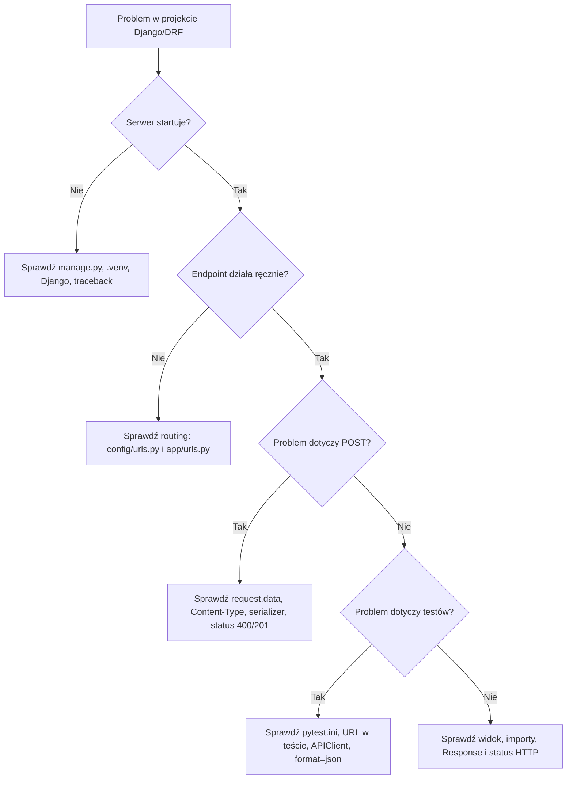
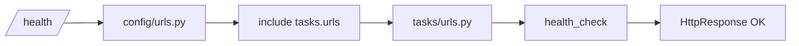
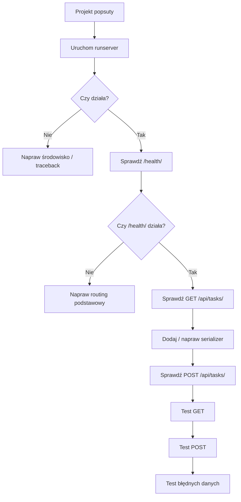

# 🧯 Weekend 5 — Troubleshooting: Django, DRF, routing i testy API

> **Kurs:** AI Python Engineer  
> **Blok:** Weekend 5 — Django: fundamenty web i API  
> **Typ pliku:** szybka pomoc diagnostyczna  
> **Cel:** szybko ustalić, czy problem jest w środowisku, routingu, widoku, serializerze, routerze, requestcie czy teście

---

## 🧭 Jak korzystać z tego pliku?

Ten plik pomaga diagnozować najczęstsze problemy podczas pracy z pierwszym projektem Django i Django REST Framework.

Używaj go wtedy, gdy:

- serwer Django nie startuje,
- endpoint zwraca `404`,
- Django nie widzi aplikacji,
- serializer nie waliduje danych tak, jak oczekujesz,
- testy API nie przechodzą,
- widzisz `ImportError`, `ModuleNotFoundError` albo długi traceback,
- nie wiesz, czy problem jest w URL-u, widoku, serializerze czy teście.

---

## Najważniejsza zasada

```text
Nie zmieniaj wielu rzeczy naraz.
Zmień jedną rzecz, uruchom projekt, sprawdź efekt.
```

Najgorszy scenariusz to poprawianie naraz:

- `settings.py`,
- `urls.py`,
- `views.py`,
- `serializers.py`,
- testów,
- struktury katalogów.

Wtedy nie wiadomo, która zmiana pomogła albo co zepsuło projekt.

---

## Spis treści

- [Jak korzystać z tego pliku?](#-jak-korzystać-z-tego-pliku)
- [Szybka mapa diagnostyczna](#-szybka-mapa-diagnostyczna)
- [Drzewko decyzyjne: gdzie jest problem?](#-drzewko-decyzyjne-gdzie-jest-problem)
- [1. Serwer Django nie startuje](#1-serwer-django-nie-startuje)
- [2. Port 8000 jest zajęty](#2-port-8000-jest-zajęty)
- [3. Django nie widzi aplikacji](#3-django-nie-widzi-aplikacji)
- [4. Endpoint `/health/` zwraca 404](#4-endpoint-health-zwraca-404)
- [5. `ModuleNotFoundError: No module named 'tasks.urls'`](#5-modulenotfounderror-no-module-named-tasksurls)
- [6. `ImportError: cannot import name ...`](#6-importerror-cannot-import-name-)
- [7. Django nie widzi template `home.html`](#7-django-nie-widzi-template-homehtml)
- [8. DRF nie działa albo import `rest_framework` się wywala](#8-drf-nie-działa-albo-import-rest_framework-się-wywala)
- [9. `APIView` zwraca błąd zamiast JSON-a](#9-apiview-zwraca-błąd-zamiast-json-a)
- [10. `POST /api/tasks/` zwraca 405 Method Not Allowed](#10-post-apitasks-zwraca-405-method-not-allowed)
- [11. Serializer nie zgłasza błędu dla pustego `description`](#11-serializer-nie-zgłasza-błędu-dla-pustego-description)
- [12. Serializer przyjmuje status, którego nie chcesz](#12-serializer-przyjmuje-status-którego-nie-chcesz)
- [13. Błędny POST zwraca 500 zamiast 400](#13-błędny-post-zwraca-500-zamiast-400)
- [14. `request.data` jest puste](#14-requestdata-jest-puste)
- [15. Router DRF nie generuje `/api/tasks/`](#15-router-drf-nie-generuje-apitasks)
- [16. ViewSet zwraca 405 dla GET albo POST](#16-viewset-zwraca-405-dla-get-albo-post)
- [17. Testy nie uruchamiają Django](#17-testy-nie-uruchamiają-django)
- [18. Test GET zwraca 404](#18-test-get-zwraca-404)
- [19. Test POST zwraca 400 zamiast 201](#19-test-post-zwraca-400-zamiast-201)
- [20. Test POST zwraca 415 Unsupported Media Type](#20-test-post-zwraca-415-unsupported-media-type)
- [21. Test sprawdza zbyt dokładny tekst błędu](#21-test-sprawdza-zbyt-dokładny-tekst-błędu)
- [22. Dane w `TASKS` zmieniają się między testami](#22-dane-w-tasks-zmieniają-się-między-testami)
- [23. Błąd z `csrf` przy POST](#23-błąd-z-csrf-przy-post)
- [24. `response.data` nie istnieje](#24-responsedata-nie-istnieje)
- [25. Kiedy używać `HttpResponse`, `JsonResponse` i `Response`](#25-kiedy-używać-httpresponse-jsonresponse-i-response)
- [26. Problem z końcowym ukośnikiem w URL](#26-problem-z-końcowym-ukośnikiem-w-url)
- [27. Błąd po przeniesieniu aplikacji do katalogu `apps/`](#27-błąd-po-przeniesieniu-aplikacji-do-katalogu-apps)
- [28. Minimalna procedura debugowania tracebacka](#28-minimalna-procedura-debugowania-tracebacka)
- [29. Minimalna procedura debugowania endpointu API](#29-minimalna-procedura-debugowania-endpointu-api)
- [30. Minimalna procedura debugowania testu API](#30-minimalna-procedura-debugowania-testu-api)
- [31. Checklista przed pytaniem AI o pomoc](#31-checklista-przed-pytaniem-ai-o-pomoc)
- [32. Co można bezpiecznie zignorować na tym etapie](#32-co-można-bezpiecznie-zignorować-na-tym-etapie)
- [33. Najważniejsze poprawne wzorce](#33-najważniejsze-poprawne-wzorce)
- [34. Ostatnia deska ratunku](#34-ostatnia-deska-ratunku)
- [35. Podsumowanie](#35-podsumowanie)

---

# 🗺️ Szybka mapa diagnostyczna

## Problem z adresem URL

```text
config/urls.py -> include("tasks.urls") -> tasks/urls.py -> view
```

## Problem z API

```text
URL -> APIView/ViewSet -> serializer -> Response -> status HTTP
```

## Problem z testami

```text
pytest.ini -> APIClient -> URL -> response.status_code -> response.data
```

---

## Diagram diagnostyczny



---

# 🧠 Drzewko decyzyjne: gdzie jest problem?

## Jeśli widzisz `404`

Najczęściej problem jest w:

- `config/urls.py`,
- `tasks/urls.py`,
- końcowym ukośniku,
- złym adresie w teście lub przeglądarce.

---

## Jeśli widzisz `ModuleNotFoundError`

Najczęściej problem jest w:

- nazwie aplikacji,
- strukturze katalogów,
- imporcie,
- `include("tasks.urls")`,
- przeniesieniu aplikacji do `apps/`.

---

## Jeśli widzisz `405 Method Not Allowed`

Najczęściej problem jest w:

- braku `post()` w `APIView`,
- braku `create()` w `ViewSet`,
- pomyleniu metod `get/post` z `list/create`.

---

## Jeśli POST zwraca `400`, a oczekujesz `201`

Najczęściej problem jest w:

- payloadzie,
- `ChoiceField`,
- brakującym polu wymaganym,
- złej wartości `status` lub `priority`.

---

## Jeśli POST zwraca `500`

Najczęściej problem jest w kodzie widoku:

- używasz `serializer.validated_data` przed `serializer.is_valid()`,
- nie obsługujesz przypadku błędnych danych,
- zwracasz zwykłą listę zamiast `Response`.

---

# 1. Serwer Django nie startuje

## Objawy

Po komendzie:

```bash
python manage.py runserver
```

pojawia się błąd albo komenda nie działa.

---

## Co sprawdzić?

### 1. Czy jesteś w katalogu z `manage.py`?

Linux / macOS:

```bash
ls
```

Windows:

```powershell
dir
```

W katalogu powinien być plik:

```text
manage.py
```

---

### 2. Czy środowisko `.venv` jest aktywne?

W terminalu powinno być widać coś podobnego:

```text
(.venv)
```

---

### 3. Czy Django jest zainstalowane?

```bash
pip show django
```

Jeżeli nic się nie wyświetla, zainstaluj Django:

```bash
pip install django
```

---

### 4. Czy nie masz literówki w `settings.py`, `urls.py` albo `views.py`?

Czytaj traceback od dołu.

Ostatnie linie najczęściej mówią, gdzie jest problem.

---

## Typowa poprawka

Linux / macOS:

```bash
source .venv/bin/activate
python manage.py runserver
```

Windows PowerShell:

```powershell
.venv\Scripts\activate
python manage.py runserver
```

---

# 2. Port 8000 jest zajęty

## Objawy

Django pokazuje komunikat podobny do:

```text
That port is already in use.
```

---

## Przyczyna

Inny proces używa portu `8000`.

Najczęściej jest to drugi uruchomiony serwer Django.

---

## Szybka poprawka

Uruchom serwer na innym porcie:

```bash
python manage.py runserver 8001
```

Potem wejdź na:

```text
http://127.0.0.1:8001/
```

---

# 3. Django nie widzi aplikacji

## Objawy

Aplikacja została utworzona przez:

```bash
python manage.py startapp tasks
```

ale Django zachowuje się tak, jakby jej nie było.

---

## Co sprawdzić?

W `config/settings.py` sprawdź `INSTALLED_APPS`.

Powinno zawierać:

```python
INSTALLED_APPS = [
    "django.contrib.admin",
    "django.contrib.auth",
    "django.contrib.contenttypes",
    "django.contrib.sessions",
    "django.contrib.messages",
    "django.contrib.staticfiles",
    "rest_framework",
    "tasks",
]
```

---

## Typowa przyczyna

Brakuje:

```python
"tasks",
```

albo:

```python
"rest_framework",
```

---

## Poprawka

Dodaj aplikację do `INSTALLED_APPS`, zapisz plik i zrestartuj serwer.

---

# 4. Endpoint `/health/` zwraca 404

## Objawy

Wchodzisz na:

```text
http://127.0.0.1:8000/health/
```

i widzisz:

```text
Page not found (404)
```

---

## Co sprawdzić?

### Krok 1 — `config/urls.py`

Powinien zawierać `include`:

```python
from django.contrib import admin
from django.urls import include, path

urlpatterns = [
    path("admin/", admin.site.urls),
    path("", include("tasks.urls")),
]
```

---

### Krok 2 — `tasks/urls.py`

Powinien istnieć plik:

```text
tasks/urls.py
```

Przykład:

```python
from django.urls import path

from .views import health_check

urlpatterns = [
    path("health/", health_check, name="health-check"),
]
```

---

### Krok 3 — `tasks/views.py`

Powinien istnieć widok:

```python
from django.http import HttpResponse


def health_check(request):
    return HttpResponse("OK")
```

---

### Krok 4 — adres w przeglądarce

Sprawdź, czy używasz końcowego ukośnika:

```text
/health/
```

a nie:

```text
/health
```

---

## Szybka mapa



---

# 5. `ModuleNotFoundError: No module named 'tasks.urls'`

## Objawy

Po uruchomieniu serwera widzisz błąd:

```text
ModuleNotFoundError: No module named 'tasks.urls'
```

---

## Najczęstsze przyczyny

- nie istnieje plik `tasks/urls.py`,
- aplikacja nazywa się inaczej niż `tasks`,
- jest literówka w `include("tasks.urls")`,
- folder `tasks` jest w innym miejscu,
- aplikacja została przeniesiona do `apps/tasks`, ale importy nie zostały zmienione.

---

## Poprawka dla prostej struktury

Jeżeli aplikacja jest bezpośrednio w katalogu projektu:

```text
backend/
├── manage.py
├── config/
└── tasks/
```

w `config/urls.py` użyj:

```python
path("", include("tasks.urls")),
```

---

## Poprawka dla struktury z `apps/`

Jeżeli aplikacja jest tutaj:

```text
backend/
├── manage.py
├── config/
└── apps/
    └── tasks/
```

wtedy import może wymagać:

```python
path("", include("apps.tasks.urls")),
```

oraz poprawnego `apps.py`:

```python
from django.apps import AppConfig


class TasksConfig(AppConfig):
    default_auto_field = "django.db.models.BigAutoField"
    name = "apps.tasks"
```

> [!TIP]  
> Na tym etapie kursu prostsza struktura `tasks/` bez katalogu `apps/` jest bezpieczniejsza dla początkujących.

---

# 6. `ImportError: cannot import name ...`

## Objawy

Błąd wygląda podobnie:

```text
ImportError: cannot import name 'health_check' from 'tasks.views'
```

---

## Co sprawdzić?

1. Czy funkcja naprawdę nazywa się `health_check`?
2. Czy import w `tasks/urls.py` ma tę samą nazwę?
3. Czy plik `views.py` jest zapisany?
4. Czy nie masz literówki, np. `healt_check`?
5. Czy nie masz dwóch plików o podobnych nazwach?

---

## Przykład poprawnego zestawu

`tasks/views.py`:

```python
from django.http import HttpResponse


def health_check(request):
    return HttpResponse("OK")
```

`tasks/urls.py`:

```python
from django.urls import path

from .views import health_check

urlpatterns = [
    path("health/", health_check, name="health-check"),
]
```

---

# 7. Django nie widzi template `home.html`

## Objawy

Błąd:

```text
TemplateDoesNotExist at /
home.html
```

---

## Co sprawdzić?

### 1. Czy istnieje plik?

```text
templates/home.html
```

---

### 2. Czy katalog `templates` jest w katalogu z `manage.py`?

Poprawna struktura:

```text
backend/
├── manage.py
├── config/
├── tasks/
└── templates/
    └── home.html
```

---

### 3. Czy `config/settings.py` ma poprawne `DIRS`?

```python
"DIRS": [BASE_DIR / "templates"],
```

---

## Typowa poprawka

W `config/settings.py` znajdź `TEMPLATES` i ustaw:

```python
TEMPLATES = [
    {
        "BACKEND": "django.template.backends.django.DjangoTemplates",
        "DIRS": [BASE_DIR / "templates"],
        "APP_DIRS": True,
        "OPTIONS": {
            "context_processors": [
                "django.template.context_processors.request",
                "django.contrib.auth.context_processors.auth",
                "django.contrib.messages.context_processors.messages",
            ],
        },
    },
]
```

---

# 8. DRF nie działa albo import `rest_framework` się wywala

## Objawy

Błąd:

```text
ModuleNotFoundError: No module named 'rest_framework'
```

---

## Co sprawdzić?

1. Czy środowisko `.venv` jest aktywne?
2. Czy paczka została zainstalowana?

```bash
pip show djangorestframework
```

3. Czy `rest_framework` jest w `INSTALLED_APPS`?

```python
"rest_framework",
```

---

## Poprawka

```bash
pip install djangorestframework
```

Potem w `settings.py`:

```python
INSTALLED_APPS = [
    ...
    "rest_framework",
    "tasks",
]
```

---

# 9. `APIView` zwraca błąd zamiast JSON-a

## Objawy

Endpoint API nie zwraca danych, tylko traceback.

---

## Co sprawdzić?

### 1. Czy importujesz właściwe klasy?

```python
from rest_framework import status
from rest_framework.response import Response
from rest_framework.views import APIView
```

---

### 2. Czy widok dziedziczy po `APIView`?

```python
class TaskListAPIView(APIView):
    ...
```

---

### 3. Czy w `urls.py` używasz `.as_view()`?

```python
path("api/tasks/", TaskListAPIView.as_view(), name="task-list"),
```

---

### 4. Czy zwracasz `Response`, a nie samą listę?

Źle:

```python
return TASKS
```

Dobrze:

```python
return Response(TASKS, status=status.HTTP_200_OK)
```

---

# 10. `POST /api/tasks/` zwraca 405 Method Not Allowed

## Objawy

`GET` działa, ale `POST` zwraca:

```text
405 Method Not Allowed
```

---

## Przyczyna

Widok obsługuje `get`, ale nie ma metody `post`.

---

## Poprawka dla `APIView`

```python
class TaskListAPIView(APIView):
    def get(self, request):
        return Response(TASKS, status=status.HTTP_200_OK)

    def post(self, request):
        serializer = TaskSerializer(data=request.data)

        if serializer.is_valid():
            task = {
                "id": len(TASKS) + 1,
                **serializer.validated_data,
            }
            TASKS.append(task)
            return Response(task, status=status.HTTP_201_CREATED)

        return Response(serializer.errors, status=status.HTTP_400_BAD_REQUEST)
```

---

## Poprawka dla `ViewSet`

Jeżeli używasz `ViewSet`, musisz mieć metodę:

```python
def create(self, request):
    ...
```

---

# 11. Serializer nie zgłasza błędu dla pustego `description`

## To może być poprawne

Jeśli masz:

```python
description = serializers.CharField(required=False, allow_blank=True)
```

to `description`:

- nie musi być podany,
- może być pustym tekstem.

Dla pola opisu to często dobre zachowanie.

---

## Jeśli chcesz wymagać opisu

Ustaw:

```python
description = serializers.CharField(required=True, allow_blank=False)
```

W tym weekendzie rekomendowane jest jednak, aby `description` było opcjonalne.

---

# 12. Serializer przyjmuje status, którego nie chcesz

## Objawy

Wysyłasz:

```json
{
  "title": "Test",
  "status": "blocked",
  "priority": "high"
}
```

a serializer nie zwraca błędu.

---

## Przyczyna

Prawdopodobnie `status` jest zwykłym `CharField`.

Źle:

```python
status = serializers.CharField(max_length=20)
```

Dobrze:

```python
status = serializers.ChoiceField(choices=["todo", "in_progress", "done"])
```

Dla `priority` analogicznie:

```python
priority = serializers.ChoiceField(choices=["low", "medium", "high"])
```

---

# 13. Błędny POST zwraca 500 zamiast 400

## Objawy

Przy błędnych danych API zwraca błąd serwera.

---

## Przyczyna

Najczęściej kod nie obsługuje przypadku:

```python
serializer.is_valid() == False
```

---

## Zła wersja

```python
def post(self, request):
    serializer = TaskSerializer(data=request.data)
    task = {
        "id": len(TASKS) + 1,
        **serializer.validated_data,
    }
    TASKS.append(task)
    return Response(task, status=status.HTTP_201_CREATED)
```

Problem: używasz `validated_data`, zanim sprawdzisz `is_valid()`.

---

## Dobra wersja

```python
def post(self, request):
    serializer = TaskSerializer(data=request.data)

    if serializer.is_valid():
        task = {
            "id": len(TASKS) + 1,
            **serializer.validated_data,
        }
        TASKS.append(task)
        return Response(task, status=status.HTTP_201_CREATED)

    return Response(serializer.errors, status=status.HTTP_400_BAD_REQUEST)
```

---

# 14. `request.data` jest puste

## Objawy

Wysyłasz POST, ale backend nie widzi danych.

---

## Co sprawdzić?

1. Czy wysyłasz JSON?
2. Czy nagłówek ma `Content-Type: application/json`?
3. Czy w `curl` JSON jest poprawnie zapisany?
4. Czy w teście używasz `format="json"`?

---

## Poprawny test

```python
response = client.post("/api/tasks/", payload, format="json")
```

---

## Poprawny curl

```bash
curl -X POST http://127.0.0.1:8000/api/tasks/ \
  -H "Content-Type: application/json" \
  -d '{"title":"Write tests","status":"todo","priority":"high"}'
```

---

# 15. Router DRF nie generuje `/api/tasks/`

## Objawy

Używasz `ViewSet`, ale `/api/tasks/` zwraca `404`.

---

## Co sprawdzić?

`tasks/urls.py` powinien zawierać:

```python
from django.urls import include, path
from rest_framework.routers import DefaultRouter

from .views import TaskViewSet

router = DefaultRouter()
router.register("tasks", TaskViewSet, basename="tasks")

urlpatterns = [
    path("api/", include(router.urls)),
]
```

Wtedy adres to:

```text
/api/tasks/
```

a nie:

```text
/tasks/
```

---

## Częsty błąd

Jeśli masz:

```python
router.register("api/tasks", TaskViewSet, basename="tasks")
```

to mieszasz prefiks routera z nazwą zasobu.

Lepszy wzorzec:

```python
router.register("tasks", TaskViewSet, basename="tasks")
path("api/", include(router.urls))
```

---

# 16. ViewSet zwraca 405 dla GET albo POST

## Objawy

Router działa, ale metoda zwraca `405`.

---

## Co sprawdzić?

Dla `GET /api/tasks/` w `ViewSet` potrzebujesz:

```python
def list(self, request):
    ...
```

Dla `POST /api/tasks/` potrzebujesz:

```python
def create(self, request):
    ...
```

Nie pisz w `ViewSet`:

```python
def get(self, request):
    ...
```

ani:

```python
def post(self, request):
    ...
```

To styl dla `APIView`, nie dla `ViewSet`.

---

# 17. Testy nie uruchamiają Django

## Objawy

Po komendzie:

```bash
pytest
```

widzisz problem z ustawieniami Django.

---

## Co sprawdzić?

Czy istnieje plik `pytest.ini` obok `manage.py`?

Poprawna zawartość:

```ini
[pytest]
DJANGO_SETTINGS_MODULE = config.settings
python_files = tests.py test_*.py *_tests.py
```

---

## Częsty błąd

Literówka w nazwie projektu.

Źle:

```ini
DJANGO_SETTINGS_MODULE = settings
```

Dobrze:

```ini
DJANGO_SETTINGS_MODULE = config.settings
```

---

# 18. Test GET zwraca 404

## Objawy

Test:

```python
response = client.get("/api/tasks/")
assert response.status_code == 200
```

zwraca `404`.

---

## Co sprawdzić?

1. Czy ręcznie w przeglądarce działa `/api/tasks/`?
2. Czy w URL-u jest końcowy ukośnik?
3. Czy używasz `APIView` czy routera?
4. Czy `config/urls.py` podłącza `tasks.urls`?
5. Czy `tasks/urls.py` zawiera endpoint API?

---

## Poprawny URL w teście

```python
response = client.get("/api/tasks/")
```

Nie zapomnij o ukośniku na końcu.

---

# 19. Test POST zwraca 400 zamiast 201

## Objawy

Test oczekuje `201`, ale dostaje `400`.

---

## Najczęstsza przyczyna

Payload nie spełnia walidacji serializera.

---

## Serializer

```python
class TaskSerializer(serializers.Serializer):
    id = serializers.IntegerField(read_only=True)
    title = serializers.CharField(max_length=120)
    description = serializers.CharField(required=False, allow_blank=True)
    status = serializers.ChoiceField(choices=["todo", "in_progress", "done"])
    priority = serializers.ChoiceField(choices=["low", "medium", "high"])
```

---

## Payload poprawny

```python
payload = {
    "title": "Write API test",
    "description": "Cover POST endpoint",
    "status": "todo",
    "priority": "high",
}
```

---

## Payload niepoprawny

```python
payload = {
    "title": "Write API test",
    "description": "Cover POST endpoint",
    "status": "blocked",
    "priority": "urgent",
}
```

---

# 20. Test POST zwraca 415 Unsupported Media Type

## Objawy

Test albo request nie jest poprawnie traktowany jako JSON.

---

## Poprawka w teście

Dodaj:

```python
response = client.post("/api/tasks/", payload, format="json")
```

---

## Poprawka w `curl`

Dodaj nagłówek:

```bash
-H "Content-Type: application/json"
```

---

# 21. Test sprawdza zbyt dokładny tekst błędu

## Problem

Taki test jest kruchy:

```python
assert response.data["title"][0] == "This field is required."
```

Tekst błędu może zależeć od wersji biblioteki albo konfiguracji języka.

---

## Lepszy test

```python
assert response.status_code == 400
assert "title" in response.data
```

Testujemy kontrakt API, a nie dokładne brzmienie komunikatu.

---

# 22. Dane w `TASKS` zmieniają się między testami

## Objawy

Jeden test dodaje zadanie, a kolejny test widzi zmienioną listę.

---

## Przyczyna

`TASKS` jest globalną listą w pamięci.

To uproszczenie dydaktyczne.

---

## Co zrobić na tym etapie?

Na Weekendzie 5 to akceptowalne, ale testy mogą zależeć od kolejności.

Możliwe proste rozwiązania:

- nie sprawdzaj dokładnej długości listy,
- sprawdzaj status i strukturę odpowiedzi,
- unikaj testów zależnych od konkretnego stanu po innych testach.

W kolejnych blokach dane będą w bazie testowej, a problem będzie rozwiązany przez transakcje i fixture’y.

---

# 23. Błąd z `csrf` przy POST

## Objawy

Przy POST widzisz błąd CSRF.

---

## Kontekst

W DRF i `APIClient` zwykle nie powinno to blokować prostych testów API, ale może wystąpić przy klasycznych widokach Django albo formularzach.

---

## Co sprawdzić?

- Czy testujesz endpoint DRF, czy klasyczny widok Django?
- Czy używasz `APIClient`, a nie zwykłego klienta Django?
- Czy endpoint jest faktycznie klasą `APIView` albo `ViewSet`?

Na tym etapie unikaj mieszania klasycznych formularzy HTML z API.

---

# 24. `response.data` nie istnieje

## Objawy

W teście:

```python
response.data
```

powoduje błąd.

---

## Przyczyna

Prawdopodobnie testujesz zwykły `HttpResponse`, a nie response z DRF.

---

## Przykład

Endpoint `/health/` zwraca:

```python
return HttpResponse("OK")
```

Dla takiej odpowiedzi użyj:

```python
response.content
```

Dla endpointu DRF:

```python
return Response(...)
```

możesz używać:

```python
response.data
```

---

# 25. Kiedy używać `HttpResponse`, `JsonResponse` i `Response`

| Typ | Skąd | Kiedy |
|---|---|---|
| `HttpResponse` | Django | prosty tekst lub HTML |
| `JsonResponse` | Django | prosty JSON bez DRF |
| `Response` | DRF | endpointy API w DRF |

W tym weekendzie:

- `/health/` może używać `HttpResponse`,
- widok HTML używa `render`,
- `/api/tasks/` powinno używać `Response` z DRF.

---

# 26. Problem z końcowym ukośnikiem w URL

## Objawy

Jeden adres działa, drugi nie:

```text
/api/tasks/
```

działa, ale:

```text
/api/tasks
```

nie działa albo przekierowuje.

---

## Praktyczna zasada

W tym kursie używaj końcowych ukośników:

```text
/health/
/api/tasks/
/api/tasks/1/
```

W testach też używaj ukośników.

---

# 27. Błąd po przeniesieniu aplikacji do katalogu `apps/`

## Objawy

Po zmianie struktury pojawiają się błędy importów.

---

## Rekomendacja

Jeśli jesteś na początku, nie przenoś aplikacji do `apps/`, dopóki nie rozumiesz dobrze importów.

Prosta struktura jest wystarczająca:

```text
backend/
├── manage.py
├── config/
└── tasks/
```

Bardziej zaawansowana struktura:

```text
backend/
├── manage.py
├── config/
└── apps/
    └── tasks/
```

wymaga zmian w:

- `INSTALLED_APPS`,
- `apps.py`,
- importach,
- `include`.

---

# 28. Minimalna procedura debugowania tracebacka

Gdy widzisz długi błąd:

1. Przewiń na sam dół.
2. Znajdź nazwę błędu, np. `ImportError`, `ModuleNotFoundError`, `TemplateDoesNotExist`.
3. Znajdź ostatni plik z Twojego projektu.
4. Sprawdź numer linii.
5. Przeczytaj 3–5 linii powyżej błędu.
6. Nie poprawiaj losowo plików.
7. Zrób jedną zmianę i uruchom ponownie.

---

## Format notatki diagnostycznej

```text
Błąd:
Plik:
Linia:
Co zmieniłem:
Efekt po uruchomieniu:
```

To pomaga nie kręcić się w kółko.

---

# 29. Minimalna procedura debugowania endpointu API

Jeśli endpoint nie działa, sprawdź po kolei:

```text
1. Czy URL istnieje w tasks/urls.py?
2. Czy tasks.urls jest podłączone w config/urls.py?
3. Czy widok jest poprawnie zaimportowany?
4. Czy dla APIView używasz .as_view()?
5. Czy dla ViewSet używasz routera?
6. Czy serializer importuje się poprawnie?
7. Czy zwracasz Response?
8. Czy status HTTP jest poprawny?
9. Czy test używa właściwego adresu?
```

---

## Diagram

```mermaid
flowchart TD
    A[Endpoint nie działa] --> B[Sprawdź URL]
    B --> C[Sprawdź include]
    C --> D[Sprawdź import widoku]
    D --> E{APIView czy ViewSet?}
    E -- APIView --> F[Sprawdź .as_view()]
    E -- ViewSet --> G[Sprawdź router]
    F --> H[Sprawdź serializer]
    G --> H
    H --> I[Sprawdź Response]
    I --> J[Sprawdź status HTTP]
```

---

# 30. Minimalna procedura debugowania testu API

Jeśli test nie przechodzi:

1. Sprawdź rzeczywisty status:

```python
print(response.status_code)
print(response.data)
```

2. Sprawdź, czy URL w teście działa ręcznie.
3. Sprawdź, czy payload pasuje do serializera.
4. Sprawdź, czy używasz `format="json"`.
5. Sprawdź, czy oczekiwany status jest właściwy.
6. Sprawdź `pytest.ini`.
7. Usuń `print` po naprawieniu testu.

---

## Ważne

`print(response.data)` działa tylko dla odpowiedzi DRF.

Dla zwykłego `HttpResponse` użyj:

```python
print(response.content)
```

---

# 31. Checklista przed pytaniem AI o pomoc

Zanim wkleisz błąd do AI, przygotuj:

```text
[ ] pełny traceback
[ ] adres URL, który wywołujesz
[ ] config/urls.py
[ ] tasks/urls.py
[ ] odpowiedni fragment views.py
[ ] serializer, jeśli problem dotyczy POST
[ ] test, jeśli problem dotyczy pytest
[ ] informację, czy używasz APIView czy ViewSet
```

---

## Dobry prompt

```text
Buduję pierwsze API w Django REST Framework.
Mam błąd 404 dla GET /api/tasks/.

Oto moje:
- config/urls.py
- tasks/urls.py
- views.py

Pomóż mi znaleźć problem krok po kroku, bez generowania całego projektu.
```

---

# 32. Co można bezpiecznie zignorować na tym etapie

Na Weekendzie 5 nie musisz jeszcze rozwiązywać tematów:

- produkcyjne ustawienia bezpieczeństwa,
- autoryzacja i logowanie,
- permissions,
- pagination,
- filtrowanie,
- pełne modele bazodanowe,
- migracje w szczegółach,
- PostgreSQL,
- Docker,
- deploy,
- OpenAPI/Swagger,
- cache,
- asynchroniczność.

Jeśli AI proponuje te rzeczy, poproś o prostszą wersję zgodną z poziomem Weekendu 5.

---

# 33. Najważniejsze poprawne wzorce

## `config/urls.py`

```python
from django.contrib import admin
from django.urls import include, path

urlpatterns = [
    path("admin/", admin.site.urls),
    path("", include("tasks.urls")),
]
```

---

## `tasks/urls.py` dla APIView

```python
from django.urls import path

from .views import TaskListAPIView, health_check

urlpatterns = [
    path("health/", health_check, name="health-check"),
    path("api/tasks/", TaskListAPIView.as_view(), name="task-list"),
]
```

---

## `tasks/urls.py` dla ViewSet

```python
from django.urls import include, path
from rest_framework.routers import DefaultRouter

from .views import TaskViewSet, health_check

router = DefaultRouter()
router.register("tasks", TaskViewSet, basename="tasks")

urlpatterns = [
    path("health/", health_check, name="health-check"),
    path("api/", include(router.urls)),
]
```

---

## Serializer

```python
from rest_framework import serializers


class TaskSerializer(serializers.Serializer):
    id = serializers.IntegerField(read_only=True)
    title = serializers.CharField(max_length=120)
    description = serializers.CharField(required=False, allow_blank=True)
    status = serializers.ChoiceField(choices=["todo", "in_progress", "done"])
    priority = serializers.ChoiceField(choices=["low", "medium", "high"])
```

---

## Test POST

```python
from rest_framework.test import APIClient


def test_create_task_returns_201():
    client = APIClient()
    payload = {
        "title": "Write API test",
        "description": "Cover POST endpoint",
        "status": "todo",
        "priority": "high",
    }

    response = client.post("/api/tasks/", payload, format="json")

    assert response.status_code == 201
    assert response.data["title"] == "Write API test"
```

---

# 34. Ostatnia deska ratunku

Jeśli projekt jest bardzo popsuty:

1. Nie usuwaj wszystkiego.
2. Zrób commit albo kopię obecnego stanu.
3. Sprawdź, czy działa `/health/`.
4. Jeśli nie działa, napraw routing podstawowy.
5. Dopiero potem wróć do API.
6. Najpierw uruchom `GET /api/tasks/`.
7. Dopiero potem dodaj `POST`.
8. Dopiero potem dodaj testy.
9. Na końcu dodaj `ViewSet`/router, jeśli `APIView` działa.

---

## Kolejność ratunkowa

```text
runserver
-> /health/
-> /api/tasks/ GET
-> serializer
-> /api/tasks/ POST
-> test GET
-> test POST
-> test błędnych danych
```

---

## Diagram ratunkowy



---

# 35. Podsumowanie

Najwięcej błędów w tym bloku wynika z:

- literówek w importach,
- braku aplikacji w `INSTALLED_APPS`,
- braku `include("tasks.urls")`,
- pomylenia `APIView` i `ViewSet`,
- zapomnienia `.as_view()`,
- braku `format="json"` w testach,
- payloadu niezgodnego z serializerem,
- oczekiwania złego statusu HTTP.

Najważniejsze pytanie diagnostyczne:

```text
Czy problem jest w routingu, widoku, serializerze, czy teście?
```

Gdy umiesz odpowiedzieć na to pytanie, debugowanie Django staje się dużo prostsze.

> [!IMPORTANT]  
> Nie poprawiaj wszystkiego naraz.  
> Najpierw ustal, w której warstwie jest problem: środowisko, URL, widok, serializer, router albo test.
