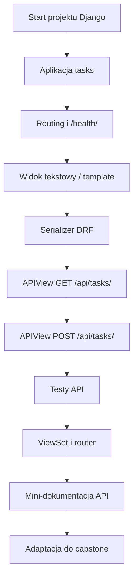
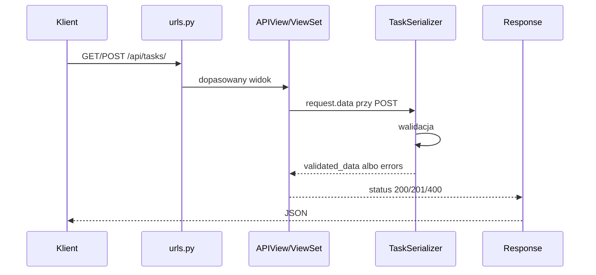
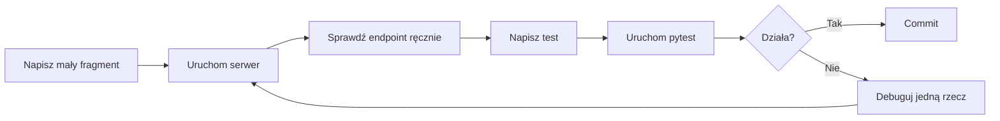

# 🧪 Weekend 5 — Zadania praktyczne: Django, fundamenty web i API

> **Kurs:** AI Python Engineer  
> **Blok:** Weekend 5 — Django: fundamenty web i API  
> **Typ pliku:** zestaw zadań praktycznych  
> **Czas praktyki:** ok. 6–7 godzin  
> **Główny efekt:** pierwszy działający backend Django + API w Django REST Framework

---

## 🧭 Cel zestawu

Ten plik zawiera pełny zestaw zadań praktycznych do Weekendu 5.

W trakcie pracy zbudujesz krok po kroku prosty backend dla aplikacji do zarządzania zadaniami projektowymi zespołu.

Zakres praktyki:

- start projektu Django,
- struktura projektu,
- routing URL,
- views,
- templates light,
- Django REST Framework,
- serializers,
- APIView,
- ViewSet,
- routers,
- statusy HTTP,
- testy endpointów,
- mini-dokumentacja API,
- przygotowanie pod capstone.

Najważniejszy przepływ, który ćwiczymy:

```text
request -> urls.py -> view -> serializer -> response
```

---

## Spis treści

- [Cel zestawu](#-cel-zestawu)
- [Case biznesowy](#-case-biznesowy)
- [Mapa pracy](#️-mapa-pracy)
- [Zasady pracy](#-zasady-pracy)
- [Szybka lista zadań](#-szybka-lista-zadań)
- [Część 1 — Start projektu Django](#-część-1--start-projektu-django)
- [Część 2 — Routing i views](#-część-2--routing-i-views)
- [Część 3 — Django REST Framework](#-część-3--django-rest-framework)
- [Część 4 — ViewSet i router](#-część-4--viewset-i-router)
- [Część 5 — Testy API](#-część-5--testy-api)
- [Część 6 — Dokumentacja i capstone](#-część-6--dokumentacja-i-capstone)
- [Mini-projekt 1 — API zadań projektowych](#-mini-projekt-1--api-zadań-projektowych)
- [Mini-projekt 2 — Adaptacja do własnej domeny capstone](#-mini-projekt-2--adaptacja-do-własnej-domeny-capstone)
- [Checklista końcowa](#-checklista-końcowa)
- [Podsumowanie praktyki](#-podsumowanie-praktyki)

---

# 🛒 Case biznesowy

Budujesz backend dla aplikacji do zarządzania zadaniami projektowymi zespołu.

Główna encja:

```text
Task
```

---

## Pola encji `Task`

| Pole | Typ | Opis biznesowy |
|---|---:|---|
| `id` | integer | Unikalny identyfikator zadania |
| `title` | string | Krótka nazwa zadania |
| `description` | string | Dłuższy opis zadania |
| `status` | string | Status: `todo`, `in_progress`, `done` |
| `priority` | string | Priorytet: `low`, `medium`, `high` |

---

## Docelowe API

Po wykonaniu zadań API powinno obsługiwać:

| Metoda | Endpoint | Cel | Oczekiwany status |
|---|---|---|---:|
| `GET` | `/health/` | sprawdzenie, czy backend działa | `200` |
| `GET` | `/tasks/` | prosty widok tekstowy lub HTML | `200` |
| `GET` | `/api/tasks/` | pobranie listy zadań | `200` |
| `POST` | `/api/tasks/` | utworzenie zadania | `201` |
| `POST` | `/api/tasks/` | błędne dane wejściowe | `400` |
| `GET` | `/api/tasks/{id}/` | szczegóły zadania, wersja rozszerzona | `200` / `404` |

---

# 🗺️ Mapa pracy



---

## Model request-response



---

# ✅ Zasady pracy

Pracuj małymi krokami:

1. Napisz minimalny kod.
2. Uruchom serwer.
3. Sprawdź endpoint ręcznie.
4. Dopiero potem pisz test.
5. Po stabilnym etapie zrób commit.

---

## Czego nie robić?

Nie kopiuj dużych fragmentów kodu naraz bez uruchamiania projektu.

Nie naprawiaj pięciu plików jednocześnie.

Nie przechodź do testów, jeśli endpoint nie działa ręcznie.

Nie przechodź do ViewSetu, jeśli nie rozumiesz jeszcze APIView.

---

## Dobra pętla pracy



---

# 📋 Szybka lista zadań

| Nr | Zadanie | Sekcja | Czas | Trudność |
|---:|---|---|---:|---:|
| 1 | Katalog projektu | Start projektu | 10 min | 1/5 |
| 2 | Środowisko wirtualne | Start projektu | 15 min | 1/5 |
| 3 | Instalacja zależności | Start projektu | 15 min | 1/5 |
| 4 | Start projektu Django | Start projektu | 20 min | 2/5 |
| 5 | Analiza plików projektu | Start projektu | 15 min | 1/5 |
| 6 | Aplikacja `tasks` | Start projektu | 20 min | 2/5 |
| 7 | Endpoint `/health/` | Routing i views | 20 min | 1/5 |
| 8 | Lokalny routing aplikacji | Routing i views | 25 min | 2/5 |
| 9 | Widok tekstowy listy zadań | Routing i views | 20 min | 1/5 |
| 10 | Prosty template HTML | Routing i views | 35 min | 2/5 |
| 11 | Lista zadań w template | Routing i views | 30 min | 2/5 |
| 12 | Debugging routingu | Routing i views | 20 min | 2/5 |
| 13 | Konfiguracja DRF | DRF | 10 min | 1/5 |
| 14 | Pierwszy serializer | DRF | 30 min | 2/5 |
| 15 | Test serializera w shellu | DRF | 25 min | 2/5 |
| 16 | Endpoint `GET /api/tasks/` | DRF | 35 min | 2/5 |
| 17 | Routing dla APIView | DRF | 20 min | 2/5 |
| 18 | Endpoint `POST /api/tasks/` | DRF | 45 min | 3/5 |
| 19 | Ręczne testowanie API | DRF | 30 min | 2/5 |
| 20 | Format błędów walidacji | DRF | 20 min | 2/5 |
| 21 | Quiz statusów HTTP | DRF | 15 min | 2/5 |
| 22 | Pierwszy `TaskViewSet` | ViewSet/router | 40 min | 3/5 |
| 23 | Router DRF | ViewSet/router | 30 min | 3/5 |
| 24 | Porównanie APIView i ViewSet | ViewSet/router | 20 min | 2/5 |
| 25 | Konfiguracja `pytest-django` | Testy API | 20 min | 2/5 |
| 26 | Test `GET /api/tasks/` | Testy API | 30 min | 2/5 |
| 27 | Test `POST /api/tasks/` — sukces | Testy API | 35 min | 3/5 |
| 28 | Test braku `title` | Testy API | 25 min | 3/5 |
| 29 | Test błędnego `status` | Testy API | 25 min | 3/5 |
| 30 | Test błędnego `priority` | Testy API | 25 min | 3/5 |
| 31 | Mini-dokumentacja API | Dokumentacja/capstone | 30 min | 2/5 |
| 32 | Endpoint szczegółów zadania | Dokumentacja/capstone | 40 min | 3/5 |
| 33 | Test endpointu szczegółów | Dokumentacja/capstone | 30 min | 3/5 |
| 34 | Dopasowanie do własnego capstone | Dokumentacja/capstone | 45 min | 3/5 |
| 35 | Commit stabilnej wersji | Dokumentacja/capstone | 20 min | 1/5 |

---

# 🚀 Część 1 — Start projektu Django

---

## Zadanie 1 — Katalog projektu

> **Cel biznesowy:** rozpoczynasz nowy backend dla aplikacji projektowej.  
> **Cel techniczny:** utworzyć katalog projektu i wejść do niego w terminalu.  
> **Trudność:** 1/5  
> **Czas:** 10 min

### Polecenie

Utwórz katalog:

```bash
mkdir weekend_05_django_api
cd weekend_05_django_api
```

### Wskazówki

- Użyj `mkdir`.
- Sprawdź aktualny katalog komendą `pwd` albo `cd`.
- Nie twórz projektu w przypadkowym katalogu systemowym.

### Kryterium akceptacji

- [ ] W terminalu jesteś w katalogu `weekend_05_django_api`.

---

## Zadanie 2 — Środowisko wirtualne

> **Cel biznesowy:** projekt backendowy powinien mieć własne zależności.  
> **Cel techniczny:** utworzyć i aktywować `.venv`.  
> **Trudność:** 1/5  
> **Czas:** 15 min

### Polecenie

Utwórz środowisko wirtualne:

```bash
python -m venv .venv
```

Aktywuj je.

Linux / macOS:

```bash
source .venv/bin/activate
```

Windows PowerShell:

```powershell
.venv\Scripts\activate
```

### Wskazówki

- Po aktywacji terminal powinien pokazać `(.venv)`.
- Jeżeli komenda nie działa, sprawdź wersję Pythona.
- Wszystkie kolejne komendy `pip` wykonuj w aktywnym `.venv`.

### Kryterium akceptacji

- [ ] Terminal pokazuje aktywne środowisko `.venv`.

---

## Zadanie 3 — Instalacja zależności

> **Cel biznesowy:** backend potrzebuje Django, DRF i narzędzi testowych.  
> **Cel techniczny:** zainstalować paczki i zapisać `requirements.txt`.  
> **Trudność:** 1/5  
> **Czas:** 15 min

### Polecenie

```bash
pip install django djangorestframework pytest pytest-django
pip freeze > requirements.txt
```

### Wskazówki

- Sprawdź `pip show django`.
- Sprawdź `pip show djangorestframework`.
- Plik `requirements.txt` powinien powstać w katalogu projektu.

### Kryterium akceptacji

- [ ] W katalogu istnieje `requirements.txt`.
- [ ] Django jest zainstalowane.
- [ ] DRF jest zainstalowane.

---

## Zadanie 4 — Start projektu Django

> **Cel biznesowy:** tworzysz główną konfigurację backendu.  
> **Cel techniczny:** utworzyć projekt Django `config`.  
> **Trudność:** 2/5  
> **Czas:** 20 min

### Polecenie

```bash
django-admin startproject config .
python manage.py runserver
```

### Wskazówki

- Kropka na końcu komendy jest ważna.
- `manage.py` powinien być w katalogu głównym.
- Otwórz `http://127.0.0.1:8000/`.

### Kryterium akceptacji

- [ ] Django start page działa w przeglądarce.
- [ ] Plik `manage.py` jest w katalogu głównym.

---

## Zadanie 5 — Analiza plików projektu

> **Cel biznesowy:** zanim rozbudujesz backend, musisz wiedzieć, gdzie co się znajduje.  
> **Cel techniczny:** opisać role podstawowych plików Django.  
> **Trudność:** 1/5  
> **Czas:** 15 min

### Polecenie

Własnymi słowami opisz:

- `manage.py`,
- `config/settings.py`,
- `config/urls.py`,
- `config/asgi.py`,
- `config/wsgi.py`.

### Wskazówki

- Nie musisz znać wszystkich szczegółów.
- Najważniejsze są `settings.py` i `urls.py`.
- Opisz pliki tak, jakbyś tłumaczył je osobie początkującej.

### Miejsce na notatkę

```text
manage.py:

settings.py:

urls.py:

asgi.py:

wsgi.py:
```

### Kryterium akceptacji

- [ ] Masz krótką notatkę z rolą każdego pliku.

---

## Zadanie 6 — Aplikacja `tasks`

> **Cel biznesowy:** zadania projektowe powinny mieć własny moduł biznesowy.  
> **Cel techniczny:** utworzyć aplikację Django.  
> **Trudność:** 2/5  
> **Czas:** 20 min

### Polecenie

```bash
python manage.py startapp tasks
```

Dodaj do `INSTALLED_APPS` w `config/settings.py`:

```python
"rest_framework",
"tasks",
```

### Wskazówki

- Aplikację dodajesz w `config/settings.py`.
- Nie zapomnij o przecinku.
- Po zmianie zrestartuj serwer.

### Kryterium akceptacji

- [ ] Serwer nadal startuje.
- [ ] `tasks` jest w `INSTALLED_APPS`.
- [ ] `rest_framework` jest w `INSTALLED_APPS`.

---

# 🧭 Część 2 — Routing i views

---

## Zadanie 7 — Endpoint `/health/`

> **Cel biznesowy:** aplikacja potrzebuje prostego endpointu technicznego do sprawdzania, czy backend działa.  
> **Cel techniczny:** stworzyć widok zwracający `OK`.  
> **Trudność:** 1/5  
> **Czas:** 20 min

### Polecenie

W `tasks/views.py` dodaj widok `health_check`.

```python
from django.http import HttpResponse


def health_check(request):
    return HttpResponse("OK")
```

### Wskazówki

- Użyj `HttpResponse`.
- Widok powinien przyjmować `request`.
- Zwróć tekst `OK`.

### Kryterium akceptacji

- [ ] Adres `/health/` zwraca `OK`.

---

## Zadanie 8 — Lokalny routing aplikacji

> **Cel biznesowy:** większy backend powinien mieć uporządkowane URL-e w aplikacjach.  
> **Cel techniczny:** utworzyć `tasks/urls.py` i podłączyć go w `config/urls.py`.  
> **Trudność:** 2/5  
> **Czas:** 25 min

### Polecenie

Utwórz `tasks/urls.py`.

```python
from django.urls import path

from .views import health_check

urlpatterns = [
    path("health/", health_check, name="health-check"),
]
```

Podłącz go w `config/urls.py` przez `include`.

```python
from django.contrib import admin
from django.urls import include, path

urlpatterns = [
    path("admin/", admin.site.urls),
    path("", include("tasks.urls")),
]
```

### Wskazówki

- W `tasks/urls.py` potrzebujesz `urlpatterns`.
- W `config/urls.py` potrzebujesz `include`.
- Sprawdź końcowy ukośnik w adresie `/health/`.

### Kryterium akceptacji

- [ ] `http://127.0.0.1:8000/health/` działa przez routing aplikacji.

---

## Zadanie 9 — Widok tekstowy listy zadań

> **Cel biznesowy:** zanim zrobisz API, pokaż prostą listę zadań jako tekst.  
> **Cel techniczny:** stworzyć endpoint `/tasks/` zwracający tekst.  
> **Trudność:** 1/5  
> **Czas:** 20 min

### Polecenie

Dodaj widok `tasks_list_text`.

```python
from django.http import HttpResponse


def tasks_list_text(request):
    content = "Tasks:\n- Create backend\n- Add API\n- Write tests"
    return HttpResponse(content, content_type="text/plain")
```

Dodaj URL:

```python
path("tasks/", tasks_list_text, name="tasks-list-text"),
```

### Wskazówki

- Użyj `HttpResponse`.
- Zwróć kilka zadań jako zwykły tekst.
- Ustaw `content_type="text/plain"`.

### Kryterium akceptacji

- [ ] `/tasks/` zwraca tekstową listę zadań.

---

## Zadanie 10 — Prosty template HTML

> **Cel biznesowy:** backend może zwrócić prosty panel HTML.  
> **Cel techniczny:** użyć `render`, `templates/home.html` i `context`.  
> **Trudność:** 2/5  
> **Czas:** 35 min

### Polecenie

Dodaj widok `home`, który renderuje `home.html`.

```python
from django.shortcuts import render


def home(request):
    context = {
        "page_title": "Task Manager",
        "message": "Django is running",
    }

    return render(request, "home.html", context)
```

Utwórz plik:

```text
templates/home.html
```

Minimalna zawartość:

```html
<!DOCTYPE html>
<html>
<head>
    <title>{{ page_title }}</title>
</head>
<body>
    <h1>{{ page_title }}</h1>
    <p>{{ message }}</p>
</body>
</html>
```

### Wskazówki

- Utwórz katalog `templates`.
- Dodaj `templates/home.html`.
- W `settings.py` ustaw `"DIRS": [BASE_DIR / "templates"]`, jeśli Django nie widzi template.

### Kryterium akceptacji

- [ ] Strona główna `/` renderuje HTML z tytułem aplikacji.

---

## Zadanie 11 — Lista zadań w template

> **Cel biznesowy:** prosty panel powinien pokazać zadania zespołu.  
> **Cel techniczny:** przekazać listę słowników do template.  
> **Trudność:** 2/5  
> **Czas:** 30 min

### Polecenie

Utwórz listę `TASKS` i przekaż ją do `home.html`.

```python
TASKS = [
    {
        "id": 1,
        "title": "Create Django project",
        "status": "todo",
        "priority": "high",
    },
    {
        "id": 2,
        "title": "Add API endpoint",
        "status": "in_progress",
        "priority": "medium",
    },
]
```

W widoku:

```python
def home(request):
    context = {
        "page_title": "Task Manager",
        "tasks": TASKS,
    }

    return render(request, "home.html", context)
```

W template:

```html
<ul>
    
        <li>{{ task.title }} — {{ task.status }} — {{ task.priority }}</li>
    
        <li>Brak zadań.</li>
    
</ul>
```

### Wskazówki

- W widoku użyj `context`.
- W template użyj ``.
- Dodaj obsługę pustej listy przez ``.

### Kryterium akceptacji

- [ ] Na stronie `/` widać listę zadań.

---

## Zadanie 12 — Debugging routingu

> **Cel biznesowy:** backend developer często naprawia błędy URL-i i importów.  
> **Cel techniczny:** świadomie wywołać i naprawić błąd routingu.  
> **Trudność:** 2/5  
> **Czas:** 20 min

### Polecenie

Celowo zepsuj jedną nazwę widoku albo URL, zobacz błąd i napraw go.

### Przykłady kontrolowanego błędu

Zmień:

```python
from .views import health_check
```

na:

```python
from .views import health_chek
```

albo zmień URL z:

```python
path("health/", health_check, name="health-check")
```

na:

```python
path("healt/", health_check, name="health-check")
```

### Wskazówki

- Zmieniaj tylko jedną rzecz naraz.
- Czytaj traceback od dołu.
- Po naprawie sprawdź `/health/`.

### Kryterium akceptacji

- [ ] Umiesz wskazać, co było zepsute.
- [ ] Umiesz wyjaśnić, jak to naprawiłeś/naprawiłaś.

---

# 🔌 Część 3 — Django REST Framework

---

## Zadanie 13 — Konfiguracja DRF

> **Cel biznesowy:** API będzie zbudowane z użyciem Django REST Framework.  
> **Cel techniczny:** upewnić się, że `rest_framework` jest aktywne.  
> **Trudność:** 1/5  
> **Czas:** 10 min

### Polecenie

Sprawdź `INSTALLED_APPS`.

```python
"rest_framework",
```

### Wskazówki

- `rest_framework` musi być dodane jako string.
- Po zmianie zrestartuj serwer.
- Jeśli import nie działa, sprawdź `.venv`.

### Kryterium akceptacji

- [ ] Możesz zaimportować klasy z `rest_framework`.

---

## Zadanie 14 — Pierwszy serializer

> **Cel biznesowy:** API musi wiedzieć, jakie dane zadania są poprawne.  
> **Cel techniczny:** utworzyć `TaskSerializer`.  
> **Trudność:** 2/5  
> **Czas:** 30 min

### Polecenie

Utwórz `tasks/serializers.py` i dodaj serializer z polami:

- `id`,
- `title`,
- `description`,
- `status`,
- `priority`.

```python
from rest_framework import serializers


class TaskSerializer(serializers.Serializer):
    id = serializers.IntegerField(read_only=True)
    title = serializers.CharField(max_length=120)
    description = serializers.CharField(required=False, allow_blank=True)
    status = serializers.ChoiceField(choices=["todo", "in_progress", "done"])
    priority = serializers.ChoiceField(choices=["low", "medium", "high"])
```

### Wskazówki

- Użyj `serializers.Serializer`.
- `id` powinno być `read_only=True`.
- Dla `status` i `priority` użyj `ChoiceField`.

### Kryterium akceptacji

- [ ] Serializer waliduje wymagane pola.
- [ ] Serializer waliduje dozwolone kategorie.

---

## Zadanie 15 — Test serializera w shellu

> **Cel biznesowy:** zanim podłączysz API, sprawdź walidację danych.  
> **Cel techniczny:** użyć `python manage.py shell`.  
> **Trudność:** 2/5  
> **Czas:** 25 min

### Polecenie

Uruchom:

```bash
python manage.py shell
```

Sprawdź poprawny payload:

```python
from tasks.serializers import TaskSerializer

payload = {
    "title": "Write serializer",
    "description": "Validate task payload",
    "status": "todo",
    "priority": "high",
}

serializer = TaskSerializer(data=payload)
serializer.is_valid()
serializer.validated_data
serializer.errors
```

Sprawdź błędny payload:

```python
payload = {
    "description": "Missing title and wrong categories",
    "status": "blocked",
    "priority": "urgent",
}

serializer = TaskSerializer(data=payload)
serializer.is_valid()
serializer.errors
```

### Wskazówki

- Użyj `serializer.is_valid()`.
- Sprawdź `serializer.validated_data`.
- Sprawdź `serializer.errors`.

### Kryterium akceptacji

- [ ] Wiesz, jakie błędy zwraca serializer dla niepoprawnych danych.

---

## Zadanie 16 — Endpoint `GET /api/tasks/`

> **Cel biznesowy:** frontend potrzebuje pobrać listę zadań.  
> **Cel techniczny:** stworzyć `APIView` z metodą `get`.  
> **Trudność:** 2/5  
> **Czas:** 35 min

### Polecenie

Dodaj `TaskListAPIView`, który zwraca `TASKS`.

```python
from rest_framework import status
from rest_framework.response import Response
from rest_framework.views import APIView

from .serializers import TaskSerializer


TASKS = [
    {
        "id": 1,
        "title": "Create Django project",
        "description": "Prepare initial backend structure",
        "status": "todo",
        "priority": "high",
    },
    {
        "id": 2,
        "title": "Add API endpoint",
        "description": "Create first DRF endpoint",
        "status": "in_progress",
        "priority": "medium",
    },
]


class TaskListAPIView(APIView):
    def get(self, request):
        return Response(TASKS, status=status.HTTP_200_OK)
```

### Wskazówki

- Użyj `APIView`.
- Użyj `Response`.
- Zwróć `status.HTTP_200_OK`.

### Kryterium akceptacji

- [ ] `GET /api/tasks/` zwraca listę zadań.
- [ ] Status odpowiedzi to `200`.

---

## Zadanie 17 — Routing dla APIView

> **Cel biznesowy:** API powinno mieć przewidywalny adres.  
> **Cel techniczny:** podłączyć `TaskListAPIView` do URL-i.  
> **Trudność:** 2/5  
> **Czas:** 20 min

### Polecenie

Dodaj ścieżkę:

```text
/api/tasks/
```

W `tasks/urls.py`:

```python
from django.urls import path

from .views import TaskListAPIView, health_check, home, tasks_list_text

urlpatterns = [
    path("", home, name="home"),
    path("health/", health_check, name="health-check"),
    path("tasks/", tasks_list_text, name="tasks-list-text"),
    path("api/tasks/", TaskListAPIView.as_view(), name="task-list"),
]
```

### Wskazówki

- Dla klasy użyj `.as_view()`.
- Sprawdź końcowy ukośnik.
- Użyj `name="task-list"`.

### Kryterium akceptacji

- [ ] Adres `/api/tasks/` działa w przeglądarce albo browsable API DRF.

---

## Zadanie 18 — Endpoint `POST /api/tasks/`

> **Cel biznesowy:** użytkownik chce utworzyć nowe zadanie przez API.  
> **Cel techniczny:** obsłużyć `POST`, walidację i tworzenie obiektu w pamięci.  
> **Trudność:** 3/5  
> **Czas:** 45 min

### Polecenie

Dodaj metodę `post` w `TaskListAPIView`.

```python
class TaskListAPIView(APIView):
    def get(self, request):
        return Response(TASKS, status=status.HTTP_200_OK)

    def post(self, request):
        serializer = TaskSerializer(data=request.data)

        if serializer.is_valid():
            task = {
                "id": len(TASKS) + 1,
                **serializer.validated_data,
            }
            TASKS.append(task)
            return Response(task, status=status.HTTP_201_CREATED)

        return Response(serializer.errors, status=status.HTTP_400_BAD_REQUEST)
```

### Wskazówki

- Użyj `TaskSerializer(data=request.data)`.
- Najpierw wywołaj `serializer.is_valid()`.
- Dla sukcesu zwróć `201`.
- Dla błędów zwróć `400`.

### Kryterium akceptacji

- [ ] Poprawny `POST /api/tasks/` zwraca `201`.
- [ ] Poprawny `POST /api/tasks/` zwraca nowe zadanie.

---

## Zadanie 19 — Ręczne testowanie API

> **Cel biznesowy:** przed testami automatycznymi sprawdź API jak użytkownik techniczny.  
> **Cel techniczny:** wysłać poprawny i błędny request.  
> **Trudność:** 2/5  
> **Czas:** 30 min

### Polecenie

Przetestuj endpoint przez browsable API, Postmana, Thunder Clienta albo `curl`.

### GET

```bash
curl http://127.0.0.1:8000/api/tasks/
```

### POST poprawny

```bash
curl -X POST http://127.0.0.1:8000/api/tasks/ \
  -H "Content-Type: application/json" \
  -d '{"title":"Write tests","description":"Cover API behavior","status":"todo","priority":"high"}'
```

### POST błędny

```bash
curl -X POST http://127.0.0.1:8000/api/tasks/ \
  -H "Content-Type: application/json" \
  -d '{"description":"Missing title","status":"blocked","priority":"urgent"}'
```

### Wskazówki

- Sprawdź `GET`.
- Sprawdź poprawny `POST`.
- Sprawdź błędny `POST`.

### Kryterium akceptacji

- [ ] Wiesz, jakie statusy i odpowiedzi zwraca API.

---

## Zadanie 20 — Format błędów walidacji

> **Cel biznesowy:** frontend musi wiedzieć, które pola formularza są błędne.  
> **Cel techniczny:** sprawdzić odpowiedź `400`.  
> **Trudność:** 2/5  
> **Czas:** 20 min

### Polecenie

Wyślij payload:

- bez `title`,
- ze `status="blocked"`,
- z `priority="urgent"`.

### Oczekiwany efekt

Status:

```text
400 Bad Request
```

Przykładowy response:

```json
{
  "title": ["This field is required."],
  "status": ["\"blocked\" is not a valid choice."],
  "priority": ["\"urgent\" is not a valid choice."]
}
```

### Wskazówki

- Oczekuj statusu `400`.
- Sprawdź, czy błędy są przypisane do pól.
- Nie dopuszczaj do statusu `500`.

### Kryterium akceptacji

- [ ] Błędne dane zwracają przewidywalny JSON z błędami.

---

## Zadanie 21 — Quiz statusów HTTP

> **Cel biznesowy:** status HTTP jest częścią kontraktu API.  
> **Cel techniczny:** dopasować statusy do sytuacji biznesowych.  
> **Trudność:** 2/5  
> **Czas:** 15 min

### Polecenie

Dopasuj status:

| Sytuacja | Status |
|---|---|
| Pobranie listy zadań | `200 OK` |
| Utworzenie zadania | `201 Created` |
| Brak wymaganego pola | `400 Bad Request` |
| Nieistniejące zadanie | `404 Not Found` |
| Błąd serwera | `500 Internal Server Error` |

### Wskazówki

- Lista zwykle zwraca `200`.
- Tworzenie zwykle zwraca `201`.
- Błąd walidacji to `400`.

### Kryterium akceptacji

- [ ] Umiesz wyjaśnić, dlaczego wybrałeś/wybrałaś dany status.

---

# 🧩 Część 4 — ViewSet i router

---

## Zadanie 22 — Pierwszy `TaskViewSet`

> **Cel biznesowy:** operacje na zasobie warto uporządkować w jednej klasie.  
> **Cel techniczny:** stworzyć `ViewSet` z metodami `list` i `create`.  
> **Trudność:** 3/5  
> **Czas:** 40 min

### Polecenie

Przepisz APIView na `TaskViewSet`.

```python
from rest_framework import status, viewsets
from rest_framework.response import Response

from .serializers import TaskSerializer


class TaskViewSet(viewsets.ViewSet):
    def list(self, request):
        return Response(TASKS, status=status.HTTP_200_OK)

    def create(self, request):
        serializer = TaskSerializer(data=request.data)

        if serializer.is_valid():
            task = {
                "id": len(TASKS) + 1,
                **serializer.validated_data,
            }
            TASKS.append(task)
            return Response(task, status=status.HTTP_201_CREATED)

        return Response(serializer.errors, status=status.HTTP_400_BAD_REQUEST)
```

### Wskazówki

- `list` odpowiada za `GET`.
- `create` odpowiada za `POST`.
- Nie używaj `get` i `post` w `ViewSet`.

### Kryterium akceptacji

- [ ] `TaskViewSet` ma działające `list`.
- [ ] `TaskViewSet` ma działające `create`.

---

## Zadanie 23 — Router DRF

> **Cel biznesowy:** router automatyzuje tworzenie URL-i dla standardowych zasobów.  
> **Cel techniczny:** użyć `DefaultRouter`.  
> **Trudność:** 3/5  
> **Czas:** 30 min

### Polecenie

Zarejestruj `TaskViewSet` w routerze.

```python
from django.urls import include, path
from rest_framework.routers import DefaultRouter

from .views import TaskViewSet, health_check, home, tasks_list_text

router = DefaultRouter()
router.register("tasks", TaskViewSet, basename="tasks")

urlpatterns = [
    path("", home, name="home"),
    path("health/", health_check, name="health-check"),
    path("tasks/", tasks_list_text, name="tasks-list-text"),
    path("api/", include(router.urls)),
]
```

### Wskazówki

- Użyj `DefaultRouter`.
- Zarejestruj zasób jako `"tasks"`.
- Podłącz router pod prefiksem `"api/"`.

### Kryterium akceptacji

- [ ] `GET /api/tasks/` działa przez router.
- [ ] `POST /api/tasks/` działa przez router.

---

## Zadanie 24 — Porównanie APIView i ViewSet

> **Cel biznesowy:** w pracy trzeba rozumieć, kiedy wybrać prosty widok, a kiedy ViewSet.  
> **Cel techniczny:** porównać oba podejścia.  
> **Trudność:** 2/5  
> **Czas:** 20 min

### Polecenie

Wypisz różnice:

| Obszar | APIView | ViewSet |
|---|---|---|
| Metody | `get`, `post` | `list`, `create` |
| Routing | ręczny `path(...)` | router |
| Czytelność | bardzo jawny przepływ HTTP | lepszy przy CRUD |
| Dobre do nauki | tak | po zrozumieniu podstaw |
| Dobre do CRUD | tak, ale więcej kodu | tak, mniej routingu |

### Wskazówki

- APIView jest bardziej jawne.
- ViewSet jest wygodny przy CRUD.
- Router zmniejsza ilość ręcznego routingu.

### Kryterium akceptacji

- [ ] Umiesz powiedzieć, czym różni się APIView od ViewSet.

---

# 🧪 Część 5 — Testy API

---

## Zadanie 25 — Konfiguracja `pytest-django`

> **Cel biznesowy:** projekt backendowy powinien mieć automatyczne testy.  
> **Cel techniczny:** utworzyć `pytest.ini`.  
> **Trudność:** 2/5  
> **Czas:** 20 min

### Polecenie

Utwórz plik `pytest.ini`:

```ini
[pytest]
DJANGO_SETTINGS_MODULE = config.settings
python_files = tests.py test_*.py *_tests.py
```

### Wskazówki

- Plik powinien być obok `manage.py`.
- Uruchom `pytest`.
- Na początku może nie znaleźć testów — to normalne.

### Kryterium akceptacji

- [ ] `pytest` uruchamia się bez błędu konfiguracji Django.

---

## Zadanie 26 — Test `GET /api/tasks/`

> **Cel biznesowy:** frontend musi mieć pewność, że lista zadań jest dostępna.  
> **Cel techniczny:** napisać test statusu i formatu odpowiedzi.  
> **Trudność:** 2/5  
> **Czas:** 30 min

### Polecenie

Utwórz `tasks/tests/test_tasks_api.py` i dodaj test GET.

```python
from rest_framework.test import APIClient


def test_tasks_list_returns_200():
    client = APIClient()

    response = client.get("/api/tasks/")

    assert response.status_code == 200
    assert isinstance(response.data, list)
```

### Wskazówki

- Użyj `APIClient`.
- Sprawdź status `200`.
- Sprawdź, że `response.data` jest listą.

### Kryterium akceptacji

- [ ] Test GET przechodzi.

---

## Zadanie 27 — Test `POST /api/tasks/` — sukces

> **Cel biznesowy:** użytkownik powinien móc utworzyć zadanie.  
> **Cel techniczny:** przetestować poprawny payload.  
> **Trudność:** 3/5  
> **Czas:** 35 min

### Polecenie

Dodaj test tworzenia zadania.

```python
def test_create_task_returns_201():
    client = APIClient()
    payload = {
        "title": "Write API test",
        "description": "Cover POST endpoint",
        "status": "todo",
        "priority": "high",
    }

    response = client.post("/api/tasks/", payload, format="json")

    assert response.status_code == 201
    assert response.data["title"] == "Write API test"
    assert response.data["status"] == "todo"
    assert response.data["priority"] == "high"
    assert "id" in response.data
```

### Wskazówki

- Użyj `client.post(..., format="json")`.
- Oczekuj `201`.
- Sprawdź `title`, `status`, `priority` i obecność `id`.

### Kryterium akceptacji

- [ ] Poprawny POST przechodzi w teście.

---

## Zadanie 28 — Test braku `title`

> **Cel biznesowy:** zadanie bez tytułu nie powinno zostać przyjęte.  
> **Cel techniczny:** przetestować błąd walidacji.  
> **Trudność:** 3/5  
> **Czas:** 25 min

### Polecenie

Wyślij payload bez `title`.

```python
def test_create_task_without_title_returns_400():
    client = APIClient()
    payload = {
        "description": "Missing required title",
        "status": "todo",
        "priority": "medium",
    }

    response = client.post("/api/tasks/", payload, format="json")

    assert response.status_code == 400
    assert "title" in response.data
```

### Wskazówki

- Oczekuj `400`.
- Sprawdź, że `"title"` jest w `response.data`.
- Nie sprawdzaj całego tekstu błędu.

### Kryterium akceptacji

- [ ] Test braku `title` przechodzi.

---

## Zadanie 29 — Test błędnego `status`

> **Cel biznesowy:** status musi pochodzić z ustalonego procesu pracy.  
> **Cel techniczny:** przetestować `ChoiceField`.  
> **Trudność:** 3/5  
> **Czas:** 25 min

### Polecenie

Wyślij `status="blocked"`.

```python
def test_create_task_with_invalid_status_returns_400():
    client = APIClient()
    payload = {
        "title": "Wrong status",
        "description": "Status is not allowed",
        "status": "blocked",
        "priority": "high",
    }

    response = client.post("/api/tasks/", payload, format="json")

    assert response.status_code == 400
    assert "status" in response.data
```

### Wskazówki

- Oczekuj `400`.
- Sprawdź, że `"status"` jest w `response.data`.
- Upewnij się, że serializer używa `ChoiceField`.

### Kryterium akceptacji

- [ ] Test błędnego statusu przechodzi.

---

## Zadanie 30 — Test błędnego `priority`

> **Cel biznesowy:** priorytet powinien mieć tylko wartości obsługiwane przez aplikację.  
> **Cel techniczny:** przetestować walidację pola `priority`.  
> **Trudność:** 3/5  
> **Czas:** 25 min

### Polecenie

Wyślij `priority="urgent"`.

```python
def test_create_task_with_invalid_priority_returns_400():
    client = APIClient()
    payload = {
        "title": "Wrong priority",
        "description": "Priority is not allowed",
        "status": "todo",
        "priority": "urgent",
    }

    response = client.post("/api/tasks/", payload, format="json")

    assert response.status_code == 400
    assert "priority" in response.data
```

### Wskazówki

- Dozwolone wartości to `low`, `medium`, `high`.
- Oczekuj `400`.
- Sprawdź obecność `"priority"` w `response.data`.

### Kryterium akceptacji

- [ ] Test błędnego priorytetu przechodzi.

---

# 📝 Część 6 — Dokumentacja i capstone

---

## Zadanie 31 — Mini-dokumentacja API

> **Cel biznesowy:** frontend developer musi wiedzieć, jak używać API.  
> **Cel techniczny:** opisać endpointy w Markdown.  
> **Trudność:** 2/5  
> **Czas:** 30 min

### Polecenie

Dodaj dokumentację dla:

- `GET /api/tasks/`,
- `POST /api/tasks/`.

### Szablon dokumentacji

```markdown
# API Documentation

## GET /api/tasks/

Zwraca listę zadań.

Status sukcesu: 200 OK

Przykładowa odpowiedź:

[
  {
    "id": 1,
    "title": "Create Django project",
    "description": "Prepare initial backend structure",
    "status": "todo",
    "priority": "high"
  }
]

## POST /api/tasks/

Tworzy nowe zadanie.

Status sukcesu: 201 Created

Przykładowy request:

{
  "title": "Write tests",
  "description": "Cover API behavior",
  "status": "todo",
  "priority": "high"
}

Status błędu walidacji: 400 Bad Request
```

### Wskazówki

- Podaj przykładowy request.
- Podaj przykładowy response.
- Opisz statusy `200`, `201`, `400`.

### Kryterium akceptacji

- [ ] Dokumentacja pozwala innej osobie ręcznie przetestować API.

---

> [!NOTE]
> **Zadania 32–33 wykraczają poza zakres Weekend 5 — to podgląd tego, co zbudujemy w Weekend 7 (pełny CRUD, w tym `GET /api/tasks/{id}/` i obsługa `404`). Potraktuj je jako opcjonalne rozszerzenie, nie wymagany zakres tego weekendu.** Weekend 5 kończy się na `GET`/`POST` dla listy zasobów (patrz `capstone.md`).

## Zadanie 32 — Endpoint szczegółów zadania

> **Cel biznesowy:** użytkownik chce zobaczyć jedno konkretne zadanie.  
> **Cel techniczny:** dodać `GET /api/tasks/{id}/`.  
> **Trudność:** 3/5  
> **Czas:** 40 min

### Polecenie

Dodaj obsługę szczegółów zadania.

W `ViewSet` użyj metody `retrieve`.

```python
def retrieve(self, request, pk=None):
    try:
        task_id = int(pk)
    except (TypeError, ValueError):
        return Response(
            {"detail": "Invalid task id."},
            status=status.HTTP_400_BAD_REQUEST,
        )

    for task in TASKS:
        if task["id"] == task_id:
            return Response(task, status=status.HTTP_200_OK)

    return Response(
        {"detail": "Task not found."},
        status=status.HTTP_404_NOT_FOUND,
    )
```

### Wskazówki

- W `ViewSet` użyj metody `retrieve`.
- Jeśli zadanie istnieje, zwróć `200`.
- Jeśli nie istnieje, zwróć `404`.

### Kryterium akceptacji

- [ ] `GET /api/tasks/1/` zwraca zadanie.
- [ ] `GET /api/tasks/999/` zwraca `404`.

---

## Zadanie 33 — Test endpointu szczegółów

> **Cel biznesowy:** API powinno przewidywalnie obsługiwać istniejące i brakujące zadania.  
> **Cel techniczny:** dodać testy dla `retrieve`.  
> **Trudność:** 3/5  
> **Czas:** 30 min

### Polecenie

Dodaj dwa testy:

- istniejące zadanie zwraca `200`,
- nieistniejące zadanie zwraca `404`.

```python
def test_task_detail_returns_200_for_existing_task():
    client = APIClient()

    response = client.get("/api/tasks/1/")

    assert response.status_code == 200
    assert response.data["id"] == 1
    assert "title" in response.data


def test_task_detail_returns_404_for_missing_task():
    client = APIClient()

    response = client.get("/api/tasks/999/")

    assert response.status_code == 404
    assert response.data["detail"] == "Task not found."
```

### Wskazówki

- Użyj `APIClient`.
- Testuj status i minimalną strukturę odpowiedzi.
- Nie zależ od kolejności testów.

### Kryterium akceptacji

- [ ] Oba testy przechodzą.

---

## Zadanie 34 — Dopasowanie do własnego capstone

> **Cel biznesowy:** projekt weekendowy powinien przełożyć się na Twój projekt końcowy.  
> **Cel techniczny:** zamienić `tasks` na własną domenę.  
> **Trudność:** 3/5  
> **Czas:** 45 min

### Polecenie

Wybierz domenę i zaprojektuj:

- nazwę aplikacji,
- nazwę encji,
- 5 pól,
- statusy lub kategorie,
- endpointy API.

### Przykłady

| Domena | Aplikacja | Encja | Endpoint |
|---|---|---|---|
| CRM | `leads` | `Lead` | `/api/leads/` |
| Dokumenty AI | `documents` | `Document` | `/api/documents/` |
| Helpdesk | `tickets` | `Ticket` | `/api/tickets/` |
| Produkty | `products` | `Product` | `/api/products/` |
| Wydatki | `expenses` | `Expense` | `/api/expenses/` |

### Wskazówki

- Przykład: `documents`, `Document`, `document_type`, `status`.
- Przykład: `leads`, `Lead`, `source`, `status`.
- Zachowaj nazwy pól po angielsku.

### Kryterium akceptacji

- [ ] Masz opis pierwszej encji capstone.
- [ ] Masz plan endpointów.
- [ ] Masz pola i wartości słownikowe do serializera.

---

## Zadanie 35 — Commit stabilnej wersji

> **Cel biznesowy:** w pracy zespołowej zapisuje się stabilne etapy projektu.  
> **Cel techniczny:** sprawdzić projekt, testy i zapisać commit.  
> **Trudność:** 1/5  
> **Czas:** 20 min

### Polecenie

Uruchom:

```bash
pytest
git status
git add .
git commit -m "Add initial Django API foundation"
```

### Wskazówki

- Nie commituj niedziałającego projektu.
- Przed commitem sprawdź `/health/`.
- Przed commitem sprawdź `/api/tasks/`.

### Kryterium akceptacji

- [ ] Projekt ma commit z działającym backendem i testami.

---

# 🧩 Mini-projekt 1 — API zadań projektowych

## Opis

Zbuduj minimalne API dla zadań projektowych.

---

## Wymagania funkcjonalne

API powinno obsługiwać:

- pobranie listy zadań,
- utworzenie zadania,
- walidację wymaganych pól,
- walidację statusu,
- walidację priorytetu,
- opcjonalnie pobranie szczegółów zadania.

---

## Wymagania techniczne

Użyj:

- Django,
- Django REST Framework,
- `Serializer`,
- `APIView` albo `ViewSet`,
- testów `APIClient`,
- statusów HTTP: `200`, `201`, `400`, opcjonalnie `404`.

---

## Kryteria akceptacji

- [ ] `GET /api/tasks/` zwraca `200`.
- [ ] `POST /api/tasks/` z poprawnymi danymi zwraca `201`.
- [ ] `POST /api/tasks/` bez `title` zwraca `400`.
- [ ] `POST /api/tasks/` ze złym statusem zwraca `400`.
- [ ] `POST /api/tasks/` ze złym priorytetem zwraca `400`.
- [ ] Testy przechodzą.
- [ ] API jest krótko opisane w README.

---

# 🧩 Mini-projekt 2 — Adaptacja do własnej domeny capstone

## Opis

Przenieś wzorzec zadań na własną domenę projektu końcowego.

---

## Przykłady

| Domena | Aplikacja | Encja | Endpoint |
|---|---|---|---|
| CRM | `leads` | `Lead` | `/api/leads/` |
| Dokumenty AI | `documents` | `Document` | `/api/documents/` |
| Helpdesk | `tickets` | `Ticket` | `/api/tickets/` |
| Produkty | `products` | `Product` | `/api/products/` |
| Wydatki | `expenses` | `Expense` | `/api/expenses/` |

---

## Wymagania

Dla własnej domeny przygotuj:

1. Serializer.
2. Listę danych w pamięci.
3. Endpoint GET.
4. Endpoint POST.
5. Walidację minimum jednego pola wymaganego.
6. Walidację minimum jednego pola słownikowego przez `ChoiceField`.
7. Minimum 3 testy API.

---

## Kryteria akceptacji

- [ ] Nazwa aplikacji pasuje do domeny.
- [ ] Nazwa encji jest po angielsku.
- [ ] Endpoint ma nazwę rzeczownikową w liczbie mnogiej.
- [ ] Serializer waliduje dane.
- [ ] GET działa.
- [ ] POST działa.
- [ ] Błędne dane zwracają `400`.
- [ ] Testy przechodzą.

---

# ✅ Checklista końcowa

Przed uznaniem bloku za zakończony sprawdź:

## Projekt i środowisko

- [ ] Mam katalog projektu.
- [ ] Mam aktywne `.venv`.
- [ ] Mam zainstalowane Django.
- [ ] Mam zainstalowane DRF.
- [ ] Mam `requirements.txt`.
- [ ] `python manage.py runserver` działa.

## Django

- [ ] Mam projekt `config`.
- [ ] Mam aplikację `tasks`.
- [ ] `tasks` jest w `INSTALLED_APPS`.
- [ ] `rest_framework` jest w `INSTALLED_APPS`.
- [ ] `/health/` działa.
- [ ] `/tasks/` działa jako widok tekstowy albo HTML.

## API

- [ ] Mam `TaskSerializer`.
- [ ] Serializer waliduje `title`.
- [ ] Serializer waliduje `status`.
- [ ] Serializer waliduje `priority`.
- [ ] `GET /api/tasks/` działa.
- [ ] `POST /api/tasks/` działa.
- [ ] Poprawny POST zwraca `201`.
- [ ] Błędny POST zwraca `400`.

## Testy

- [ ] Mam `pytest.ini`.
- [ ] Mam test GET.
- [ ] Mam test POST sukcesu.
- [ ] Mam test braku `title`.
- [ ] Mam test błędnego `status`.
- [ ] Mam test błędnego `priority`.
- [ ] `pytest` przechodzi.

## Dokumentacja i Git

- [ ] Mam krótką dokumentację API.
- [ ] Mam commit stabilnej wersji.
- [ ] Potrafię wyjaśnić przepływ `request -> urls.py -> view -> serializer -> response`.

---

# 🧠 Podsumowanie praktyki

Po wykonaniu zadań powinieneś/powinnaś umieć samodzielnie wyjaśnić:

- czym różni się projekt Django od aplikacji,
- jak działa routing,
- czym jest widok,
- czym różni się klasyczny response od response API,
- po co jest serializer,
- jak działa walidacja w DRF,
- kiedy zwracać `200`, `201`, `400`, `404`,
- jak napisać test endpointu,
- jak podpiąć ViewSet przez router,
- jak rozbudować ten fundament w capstone.

Najważniejszy przepływ do zapamiętania:

```text
request -> urls.py -> view -> serializer -> response
```

> [!IMPORTANT]  
> Nie chodzi o to, żeby od razu znać całe Django.  
> Chodzi o to, żeby umieć przeprowadzić request przez routing, widok, serializer i response — oraz potrafić to przetestować.
