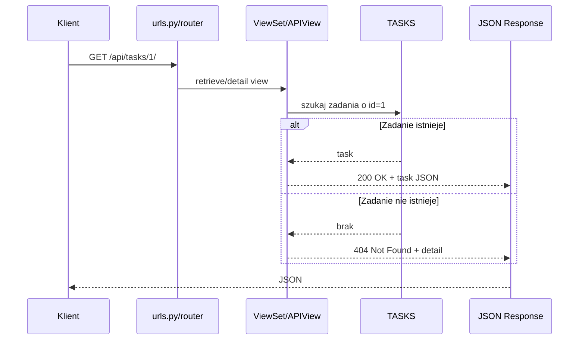
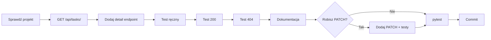

# 🏠 Weekend 5 — Zadanie domowe: rozbudowa pierwszego API Django

> **Kurs:** AI Python Engineer  
> **Blok:** Weekend 5 — Django: fundamenty web i API  
> **Typ pliku:** zadanie domowe po zajęciach  
> **Cel:** utrwalić routing, widoki API, serializery, walidację, statusy HTTP, testy i dokumentację API  
> **Główny efekt:** API obsługuje listę, tworzenie, szczegóły zasobu, błędy walidacji i testy automatyczne

---

## 🧭 Cel zadania

Celem zadania domowego jest utrwalenie fundamentów Django i Django REST Framework po weekendzie 5.

Po wykonaniu zadania powinieneś/powinnaś lepiej rozumieć:

- routing Django,
- widoki API,
- serializery,
- walidację danych,
- statusy HTTP,
- testowanie endpointów,
- dokumentowanie API,
- przygotowanie backendu pod projekt końcowy.

Najważniejszy przepływ do utrwalenia:

```text
request -> urls.py -> view -> serializer -> response
```

---

## Spis treści

- [Cel zadania](#-cel-zadania)
- [Kontekst biznesowy](#-kontekst-biznesowy)
- [Mapa zadania](#️-mapa-zadania)
- [Szacowany czas](#-szacowany-czas)
- [Wymagania techniczne](#-wymagania-techniczne)
- [Zakres wersji](#-zakres-wersji)
- [Wersja podstawowa](#-wersja-podstawowa)
- [Wersja rozszerzona](#-wersja-rozszerzona)
- [Wersja ambitna](#-wersja-ambitna)
- [Wersja capstone](#-wersja-capstone)
- [Kryteria akceptacji](#-kryteria-akceptacji)
- [Proponowana kolejność pracy](#-proponowana-kolejność-pracy)
- [Proponowane commity](#-proponowane-commity)
- [Najczęstsze błędy](#-najczęstsze-błędy)
- [Pytania kontrolne po zadaniu](#-pytania-kontrolne-po-zadaniu)
- [Szablon krótkiej dokumentacji API](#-szablon-krótkiej-dokumentacji-api)
- [Checklist końcowy](#-checklist-końcowy)
- [Podsumowanie](#-podsumowanie)

---

# 🧩 Kontekst biznesowy

Rozwijasz backend aplikacji do zarządzania zadaniami projektowymi.

Aktualnie aplikacja obsługuje:

- pobranie listy zadań,
- utworzenie nowego zadania,
- walidację pól `title`, `status`, `priority`,
- podstawowe testy API.

Twoim zadaniem jest rozbudować API o:

1. obsługę szczegółów pojedynczego zadania,
2. dodatkowe przypadki walidacji,
3. testy zachowania API,
4. krótką dokumentację endpointów.

---

## Aktualny stan API

| Metoda | Endpoint | Co robi? | Status sukcesu |
|---|---|---|---:|
| `GET` | `/api/tasks/` | zwraca listę zadań | `200` |
| `POST` | `/api/tasks/` | tworzy zadanie | `201` |
| `POST` | `/api/tasks/` | waliduje błędne dane | `400` |

---

## Docelowy stan po zadaniu

| Metoda | Endpoint | Co robi? | Statusy |
|---|---|---|---|
| `GET` | `/api/tasks/` | zwraca listę zadań | `200` |
| `POST` | `/api/tasks/` | tworzy zadanie | `201`, `400` |
| `GET` | `/api/tasks/{id}/` | zwraca szczegóły zadania | `200`, `404` |
| `PATCH` | `/api/tasks/{id}/` | zmienia status zadania, wersja rozszerzona | `200`, `400`, `404` |

---

# 🗺️ Mapa zadania

```mermaid
flowchart TD
    A[Start: działające API listy i tworzenia] --> B[Dodaj GET /api/tasks/{id}/]
    B --> C[Test 200 dla istniejącego zadania]
    C --> D[Test 404 dla brakującego zadania]
    D --> E[Dokumentacja endpointu szczegółów]
    E --> F{Robisz wersję rozszerzoną?}
    F -- Tak --> G[Dodaj PATCH /api/tasks/{id}/]
    G --> H[Test 200 dla zmiany statusu]
    H --> I[Test 400 dla błędnego statusu]
    I --> J[Test 404 dla brakującego zadania]
    F -- Nie --> K[Commit wersji podstawowej]
    J --> L[Commit wersji rozszerzonej]
```

---

## Przepływ dla szczegółów zadania



---

# ⏱️ Szacowany czas

| Wariant | Szacowany czas | Dla kogo? |
|---|---:|---|
| Wersja podstawowa | 2–3 godziny | minimum do utrwalenia Weekendu 5 |
| Wersja rozszerzona | 4–5 godzin | osoby, które chcą poćwiczyć `PATCH` i dodatkową walidację |
| Wersja ambitna | 6+ godzin | osoby gotowe wejść w modele Django i bazę SQLite |
| Wersja capstone | zależnie od projektu | osoby, które chcą przenieść schemat na własną domenę |

---

# 🛠️ Wymagania techniczne

Użyj technologii z Weekendu 5:

- Django,
- Django REST Framework,
- `Serializer`,
- `APIView` albo `ViewSet`,
- `APIClient`,
- `pytest`,
- dane w pamięci jako lista słowników.

Na tym etapie nie musisz jeszcze używać:

- modeli Django,
- migracji,
- PostgreSQL,
- autoryzacji,
- permissions,
- Dockera,
- OpenAPI/Swaggera.

Jeżeli chcesz użyć modeli Django, potraktuj to jako wersję ambitną.

---

# 🧱 Zakres wersji

## Minimum

Zrób:

- `GET /api/tasks/{id}/`,
- test `200` dla istniejącego zadania,
- test `404` dla brakującego zadania,
- dokumentację endpointu szczegółów.

## Rozszerzenie

Dodaj:

- `PATCH /api/tasks/{id}/`,
- serializer zmiany statusu,
- test sukcesu aktualizacji,
- test błędnego statusu,
- test `404`.

## Ambitnie

Przejdź z danych w pamięci na:

- model Django,
- migracje,
- SQLite,
- `ModelSerializer`,
- testy z bazą danych.

## Capstone

Przenieś ten sam schemat na własną domenę, np.:

- `leads`,
- `documents`,
- `tickets`,
- `expenses`,
- `products`.

---

# ✅ Wersja podstawowa

> [!NOTE]
> **Wersja podstawowa i wersja rozszerzona (Zadania 1–8) wykraczają poza zakres Weekend 5 — to podgląd tego, co zbudujemy w Weekend 7 (pełny CRUD, w tym `GET /api/tasks/{id}/`, obsługa `404` i `PATCH /api/tasks/{id}/`). Potraktuj je jako opcjonalne rozszerzenie, nie wymagany zakres tego weekendu.** Weekend 5 kończy się na `GET`/`POST` dla listy zasobów.

---

## Zadanie 1 — Endpoint szczegółów zadania

### Opis biznesowy

Użytkownik chce kliknąć konkretne zadanie na liście i zobaczyć jego szczegóły.

---

### Cel techniczny

Dodaj endpoint:

```text
GET /api/tasks/{id}/
```

---

### Wymagania

Endpoint powinien:

- przyjmować identyfikator zadania z URL-a,
- zwracać dane zadania, jeśli istnieje,
- zwracać status `200 OK` dla istniejącego zadania,
- zwracać status `404 Not Found`, jeśli zadanie nie istnieje,
- zwracać odpowiedź w formacie JSON.

---

### Przykład odpowiedzi sukcesu

```json
{
  "id": 1,
  "title": "Create Django project",
  "description": "Prepare initial backend structure",
  "status": "todo",
  "priority": "high"
}
```

---

### Przykład odpowiedzi błędu

```json
{
  "detail": "Task not found."
}
```

---

### Wskazówki dla `ViewSet`

Jeżeli używasz `ViewSet`, dodaj metodę:

```python
def retrieve(self, request, pk=None):
    ...
```

Przykładowy wariant:

```python
def retrieve(self, request, pk=None):
    try:
        task_id = int(pk)
    except (TypeError, ValueError):
        return Response(
            {"detail": "Invalid task id."},
            status=status.HTTP_400_BAD_REQUEST,
        )

    for task in TASKS:
        if task["id"] == task_id:
            return Response(task, status=status.HTTP_200_OK)

    return Response(
        {"detail": "Task not found."},
        status=status.HTTP_404_NOT_FOUND,
    )
```

---

### Wskazówki dla `APIView`

Jeżeli używasz `APIView`, dodaj osobną klasę, np.:

```python
class TaskDetailAPIView(APIView):
    def get(self, request, task_id):
        ...
```

Wtedy w `urls.py` możesz mieć:

```python
path("api/tasks/<int:task_id>/", TaskDetailAPIView.as_view(), name="task-detail")
```

---

### Kryteria akceptacji

- [ ] `GET /api/tasks/1/` zwraca `200`.
- [ ] `GET /api/tasks/1/` zwraca JSON z danymi zadania.
- [ ] `GET /api/tasks/999/` zwraca `404`.
- [ ] `GET /api/tasks/999/` zwraca JSON z polem `detail`.

---

## Zadanie 2 — Test istniejącego zadania

### Opis biznesowy

Chcesz mieć pewność, że frontend może pobrać szczegóły istniejącego zadania.

---

### Cel techniczny

Dodaj test dla:

```text
GET /api/tasks/1/
```

---

### Wymagania testu

Test powinien sprawdzać:

- status `200`,
- obecność pola `id`,
- obecność pola `title`,
- zgodność `id` z oczekiwaną wartością.

---

### Przykładowy test

```python
from rest_framework.test import APIClient


def test_task_detail_returns_200_for_existing_task():
    client = APIClient()

    response = client.get("/api/tasks/1/")

    assert response.status_code == 200
    assert response.data["id"] == 1
    assert "title" in response.data
```

---

### Wskazówki

- Nie sprawdzaj wszystkiego naraz.
- Zacznij od statusu.
- Potem sprawdź minimalną strukturę odpowiedzi.
- Testuj kontrakt API, nie implementację widoku.

---

### Kryteria akceptacji

- [ ] Test przechodzi.
- [ ] Test ma czytelną nazwę.
- [ ] Test sprawdza status i podstawowe pola.

---

## Zadanie 3 — Test nieistniejącego zadania

### Opis biznesowy

Frontend powinien dostać przewidywalną odpowiedź, gdy zadanie nie istnieje.

---

### Cel techniczny

Dodaj test dla:

```text
GET /api/tasks/999/
```

---

### Wymagania testu

Test powinien sprawdzać:

- status `404`,
- obecność pola `detail` w odpowiedzi.

---

### Przykładowy test

```python
def test_task_detail_returns_404_for_missing_task():
    client = APIClient()

    response = client.get("/api/tasks/999/")

    assert response.status_code == 404
    assert "detail" in response.data
```

---

### Wskazówki

- Nie zwracaj `500` dla brakującego zadania.
- Brak zasobu to naturalna sytuacja w API.
- Dobre API odpowiada przewidywalnie.

---

### Kryteria akceptacji

- [ ] Test przechodzi.
- [ ] Brakujące zadanie zwraca `404`.
- [ ] Odpowiedź ma pole `detail`.

---

## Zadanie 4 — Dokumentacja endpointu szczegółów

### Opis biznesowy

Inny developer powinien wiedzieć, jak pobrać szczegóły zadania.

---

### Cel techniczny

Uzupełnij dokumentację API o endpoint:

```text
GET /api/tasks/{id}/
```

---

### Dokumentacja powinna zawierać

- metodę HTTP,
- adres endpointu,
- opis działania,
- przykład odpowiedzi `200`,
- przykład odpowiedzi `404`.

---

### Przykładowy fragment dokumentacji

```markdown
## GET /api/tasks/{id}/

Zwraca szczegóły jednego zadania.

### Status sukcesu

200 OK

### Przykładowa odpowiedź 200

{
  "id": 1,
  "title": "Create Django project",
  "description": "Prepare initial backend structure",
  "status": "todo",
  "priority": "high"
}

### Status błędu

404 Not Found

### Przykładowa odpowiedź 404

{
  "detail": "Task not found."
}
```

---

### Kryteria akceptacji

- [ ] Dokumentacja zawiera `GET /api/tasks/{id}/`.
- [ ] Dokumentacja pokazuje przykład `200`.
- [ ] Dokumentacja pokazuje przykład `404`.

---

# 🚀 Wersja rozszerzona

---

## Zadanie 5 — Endpoint zmiany statusu zadania

### Opis biznesowy

Użytkownik chce zmienić status zadania, np. z `todo` na `in_progress`.

---

### Cel techniczny

Dodaj możliwość częściowej aktualizacji zadania.

Endpoint:

```text
PATCH /api/tasks/{id}/
```

---

### Wymagania

Endpoint powinien:

- przyjmować `status` w body requestu,
- sprawdzać, czy zadanie istnieje,
- walidować nowy status,
- zwracać `200 OK` po poprawnej zmianie,
- zwracać `400 Bad Request` dla błędnego statusu,
- zwracać `404 Not Found` dla nieistniejącego zadania.

---

### Przykładowy request

```json
{
  "status": "in_progress"
}
```

---

### Przykładowa odpowiedź

```json
{
  "id": 1,
  "title": "Create Django project",
  "description": "Prepare initial backend structure",
  "status": "in_progress",
  "priority": "high"
}
```

---

### Osobny serializer do zmiany statusu

Możesz użyć osobnego serializera:

```python
class TaskStatusUpdateSerializer(serializers.Serializer):
    status = serializers.ChoiceField(choices=["todo", "in_progress", "done"])
```

To dobra praktyka, bo endpoint zmiany statusu nie musi przyjmować wszystkich pól zadania.

---

### Przykład dla `ViewSet`

```python
def partial_update(self, request, pk=None):
    try:
        task_id = int(pk)
    except (TypeError, ValueError):
        return Response(
            {"detail": "Invalid task id."},
            status=status.HTTP_400_BAD_REQUEST,
        )

    task = None

    for item in TASKS:
        if item["id"] == task_id:
            task = item
            break

    if task is None:
        return Response(
            {"detail": "Task not found."},
            status=status.HTTP_404_NOT_FOUND,
        )

    serializer = TaskStatusUpdateSerializer(data=request.data)

    if serializer.is_valid():
        task["status"] = serializer.validated_data["status"]
        return Response(task, status=status.HTTP_200_OK)

    return Response(serializer.errors, status=status.HTTP_400_BAD_REQUEST)
```

---

### Kryteria akceptacji

- [ ] `PATCH /api/tasks/1/` z poprawnym statusem zwraca `200`.
- [ ] Status zadania zmienia się w odpowiedzi.
- [ ] Błędny status zwraca `400`.
- [ ] Brakujące zadanie zwraca `404`.

---

## Zadanie 6 — Test zmiany statusu

### Cel techniczny

Dodaj test poprawnej zmiany statusu.

---

### Test powinien sprawdzać

- status `200`,
- nową wartość pola `status`,
- że `id` zadania się nie zmieniło.

---

### Przykładowy test

```python
def test_update_task_status_returns_200():
    client = APIClient()
    payload = {
        "status": "in_progress",
    }

    response = client.patch("/api/tasks/1/", payload, format="json")

    assert response.status_code == 200
    assert response.data["id"] == 1
    assert response.data["status"] == "in_progress"
```

---

### Kryteria akceptacji

- [ ] Test przechodzi.
- [ ] Test sprawdza status `200`.
- [ ] Test sprawdza nowy status zadania.

---

## Zadanie 7 — Test błędnego statusu przy aktualizacji

### Cel techniczny

Dodaj test walidacji dla endpointu `PATCH`.

---

### Błędny payload

```json
{
  "status": "blocked"
}
```

---

### Oczekiwany status

```text
400 Bad Request
```

---

### Przykładowy test

```python
def test_update_task_status_with_invalid_status_returns_400():
    client = APIClient()
    payload = {
        "status": "blocked",
    }

    response = client.patch("/api/tasks/1/", payload, format="json")

    assert response.status_code == 400
    assert "status" in response.data
```

---

### Kryteria akceptacji

- [ ] Test przechodzi.
- [ ] Błędny status zwraca `400`.
- [ ] Odpowiedź zawiera błąd pola `status`.

---

## Zadanie 8 — Test zmiany statusu nieistniejącego zadania

### Cel techniczny

Dodaj test dla sytuacji, gdy użytkownik próbuje zmienić status zadania, które nie istnieje.

Endpoint:

```text
PATCH /api/tasks/999/
```

Oczekiwany status:

```text
404 Not Found
```

---

### Przykładowy test

```python
def test_update_missing_task_status_returns_404():
    client = APIClient()
    payload = {
        "status": "done",
    }

    response = client.patch("/api/tasks/999/", payload, format="json")

    assert response.status_code == 404
    assert "detail" in response.data
```

---

### Kryteria akceptacji

- [ ] Test przechodzi.
- [ ] Brakujące zadanie zwraca `404`.
- [ ] Odpowiedź zawiera `detail`.

---

# 🏆 Wersja ambitna

> [!NOTE]
> **Wersja ambitna (Zadania 9–11) wykracza poza zakres Weekend 5 — to podgląd tego, co zbudujemy w Weekend 6 (modele Django, migracje, `ModelSerializer`, testy z bazą danych). Potraktuj ją jako opcjonalny/stretch goal, nie wymagany zakres tego weekendu.** Na Weekend 5 dane trzymamy w pamięci (lista/prosta klasa), bez modeli i migracji.

---

## Zadanie 9 — Przejście z danych w pamięci na model Django

### Opis biznesowy

Dane zadań powinny przetrwać restart serwera.

---

### Cel techniczny

Dodaj model `Task` i użyj bazy SQLite.

---

### Wymagania

Dodaj model z polami:

- `title`,
- `description`,
- `status`,
- `priority`,
- `created_at`.

---

### Przykład modelu

```python
from django.db import models


class Task(models.Model):
    STATUS_CHOICES = [
        ("todo", "To do"),
        ("in_progress", "In progress"),
        ("done", "Done"),
    ]

    PRIORITY_CHOICES = [
        ("low", "Low"),
        ("medium", "Medium"),
        ("high", "High"),
    ]

    title = models.CharField(max_length=120)
    description = models.TextField(blank=True)
    status = models.CharField(max_length=20, choices=STATUS_CHOICES)
    priority = models.CharField(max_length=20, choices=PRIORITY_CHOICES)
    created_at = models.DateTimeField(auto_now_add=True)

    def __str__(self):
        return self.title
```

---

### Komendy

```bash
python manage.py makemigrations
python manage.py migrate
```

---

### Uwaga

To wykracza lekko poza Weekend 5. Jeśli modele są jeszcze niejasne, zostań przy wersji podstawowej i rozszerzonej.

---

### Kryteria akceptacji

- [ ] Istnieje model `Task`.
- [ ] Migracje uruchamiają się poprawnie.
- [ ] Dane zapisują się w SQLite.
- [ ] API nadal działa po restarcie serwera.

---

## Zadanie 10 — `ModelSerializer`

### Cel techniczny

Zamień zwykły `Serializer` na `ModelSerializer`.

---

### Przykład

```python
from rest_framework import serializers

from .models import Task


class TaskSerializer(serializers.ModelSerializer):
    class Meta:
        model = Task
        fields = ["id", "title", "description", "status", "priority", "created_at"]
```

---

### Wymagania

Po zmianie API powinno nadal obsługiwać:

- `GET /api/tasks/`,
- `POST /api/tasks/`,
- `GET /api/tasks/{id}/`,
- testy sukcesu,
- testy błędnych danych.

---

### Kryteria akceptacji

- [ ] API używa `ModelSerializer`.
- [ ] `GET /api/tasks/` działa.
- [ ] `POST /api/tasks/` działa.
- [ ] Walidacja nadal działa.
- [ ] Testy przechodzą.

---

## Zadanie 11 — Testy z bazą danych

### Cel techniczny

Dodaj testy używające bazy testowej Django.

---

### Wymaganie

Testy korzystające z bazy powinny mieć:

```python
import pytest


@pytest.mark.django_db
def test_something():
    ...
```

---

### Co przetestować?

- utworzenie zadania zapisuje rekord w bazie,
- lista zadań zwraca obiekty z bazy,
- szczegóły zadania zwracają właściwy rekord,
- nieistniejące zadanie zwraca `404`.

---

### Kryteria akceptacji

- [ ] Testy z bazą mają `@pytest.mark.django_db`.
- [ ] Testy tworzą dane testowe.
- [ ] Testy nie zależą od danych zapisanych ręcznie w bazie.
- [ ] `pytest` przechodzi.

---

# 🧩 Wersja capstone

---

## Cel

Zastosuj ten sam schemat w swoim projekcie końcowym.

Zamiast `tasks` możesz mieć np.:

| Domena | Aplikacja | Encja | Endpoint |
|---|---|---|---|
| CRM | `leads` | `Lead` | `/api/leads/` |
| Dokumenty AI | `documents` | `Document` | `/api/documents/` |
| Helpdesk | `tickets` | `Ticket` | `/api/tickets/` |
| Wydatki | `expenses` | `Expense` | `/api/expenses/` |
| Produkty | `products` | `Product` | `/api/products/` |

---

## Zadanie 12 — Własna encja

Wybierz jedną encję z własnego projektu.

Opisz:

- nazwę aplikacji Django,
- nazwę encji,
- pola,
- które pola są wymagane,
- które pole ma ograniczone kategorie,
- adres endpointu listy,
- adres endpointu szczegółów.

---

### Szablon

```text
Nazwa aplikacji:
Nazwa encji:
Endpoint listy:
Endpoint szczegółów:

Pola:
1.
2.
3.
4.
5.

Pole wymagane:
Pole opcjonalne:
Pole słownikowe:
Dozwolone wartości:
```

---

### Przykład dla dokumentów AI

```text
Nazwa aplikacji: documents
Nazwa encji: Document
Endpoint listy: /api/documents/
Endpoint szczegółów: /api/documents/{id}/

Pola:
1. id
2. title
3. document_type
4. status
5. summary

Pole wymagane: title
Pole opcjonalne: summary
Pole słownikowe: document_type
Dozwolone wartości: contract, invoice, report, note, other
```

---

## Zadanie 13 — Serializer dla własnej domeny

Utwórz serializer dla własnej encji.

---

### Wymagania

- nazwy pól po angielsku,
- minimum 5 pól,
- minimum jedno pole wymagane,
- minimum jedno pole opcjonalne,
- minimum jedno `ChoiceField`.

---

### Przykład

```python
from rest_framework import serializers


class DocumentSerializer(serializers.Serializer):
    id = serializers.IntegerField(read_only=True)
    title = serializers.CharField(max_length=160)
    document_type = serializers.ChoiceField(
        choices=["contract", "invoice", "report", "note", "other"]
    )
    status = serializers.ChoiceField(
        choices=["uploaded", "processing", "reviewed", "archived"]
    )
    summary = serializers.CharField(required=False, allow_blank=True)
```

---

### Kryteria akceptacji

- [ ] Serializer ma minimum 5 pól.
- [ ] Serializer ma minimum jedno `ChoiceField`.
- [ ] Serializer waliduje brak pola wymaganego.
- [ ] Serializer waliduje błędną wartość słownikową.

---

## Zadanie 14 — Endpointy dla własnej domeny

Dodaj:

- `GET /api/<resource>/`,
- `POST /api/<resource>/`,
- `GET /api/<resource>/{id}/`.

---

### Przykład

```text
GET /api/documents/
POST /api/documents/
GET /api/documents/1/
```

---

### Kryteria akceptacji

- [ ] Lista zasobów zwraca `200`.
- [ ] Poprawny `POST` zwraca `201`.
- [ ] Brak zasobu zwraca `404`.
- [ ] Błędne dane zwracają `400`.

---

## Zadanie 15 — Testy dla własnej domeny

Dodaj minimum 4 testy:

1. Lista zwraca `200`.
2. Poprawny POST zwraca `201`.
3. Brak wymaganego pola zwraca `400`.
4. Nieistniejący obiekt zwraca `404`.

---

### Przykładowe nazwy testów

```python
def test_documents_list_returns_200():
    ...


def test_create_document_returns_201():
    ...


def test_create_document_without_title_returns_400():
    ...


def test_document_detail_returns_404_for_missing_document():
    ...
```

---

### Kryteria akceptacji

- [ ] Istnieją minimum 4 testy.
- [ ] Testy mają czytelne nazwy.
- [ ] Testy przechodzą.
- [ ] Testy sprawdzają zarówno sukces, jak i błędy.

---

# ✅ Kryteria akceptacji

---

## Minimum

Zadanie jest zaliczone, jeśli:

```text
[ ] Działa GET /api/tasks/
[ ] Działa POST /api/tasks/
[ ] Działa GET /api/tasks/{id}/
[ ] Nieistniejące zadanie zwraca 404
[ ] Poprawny POST zwraca 201
[ ] Błędny POST zwraca 400
[ ] Istnieje serializer z walidacją
[ ] Istnieją minimum 4 testy API
[ ] pytest przechodzi
[ ] Dokumentacja API jest uzupełniona
```

---

## Poziom dobry

```text
[ ] Wszystkie wymagania minimum są spełnione
[ ] Kod jest podzielony na urls.py, views.py, serializers.py
[ ] Testy mają czytelne nazwy
[ ] Błędy walidacji mają przewidywalny format
[ ] Statusy HTTP są poprawne
[ ] Dokumentacja zawiera przykłady requestów i response’ów
```

---

## Poziom bardzo dobry

```text
[ ] Działa PATCH /api/tasks/{id}/
[ ] Są testy dla PATCH
[ ] Jest test 404 dla szczegółów
[ ] Jest test 400 dla błędnego statusu przy PATCH
[ ] Projekt jest dopasowany do domeny capstone
[ ] Kod jest gotowy do przejścia na modele Django
```

---

# 🧭 Proponowana kolejność pracy

1. Uruchom projekt.
2. Sprawdź `/health/`.
3. Sprawdź `GET /api/tasks/`.
4. Dodaj endpoint szczegółów.
5. Przetestuj endpoint szczegółów ręcznie.
6. Dodaj test `200` dla szczegółów.
7. Dodaj test `404` dla szczegółów.
8. Uzupełnij dokumentację.
9. Dodaj `PATCH`, jeśli robisz wersję rozszerzoną.
10. Dodaj testy `PATCH`.
11. Uruchom `pytest`.
12. Zrób commit.

---

## Kolejność jako diagram



---

# 💾 Proponowane commity

## Dla wersji podstawowej

```bash
git status
git add .
git commit -m "Extend tasks API with detail endpoint"
```

---

## Dla wersji rozszerzonej

```bash
git status
git add .
git commit -m "Add task status update endpoint"
```

---

## Dla wersji capstone

```bash
git status
git add .
git commit -m "Adapt initial API to capstone domain"
```

---

## Dobre zasady commitowania

- commituj działający kod,
- przed commitem uruchom `pytest`,
- commit message niech mówi, co doszło,
- nie mieszaj refaktoru, nowej funkcji i naprawy testów w jednym ogromnym commicie.

---

# 🧯 Najczęstsze błędy

---

## Błąd 1 — `GET /api/tasks/999/` zwraca `500`

To oznacza, że nie obsługujesz sytuacji braku zadania.

Poprawne zachowanie:

```text
404 Not Found
```

---

## Błąd 2 — błędny status zwraca `200`

Jeśli klient wysyła niepoprawne dane, API nie powinno udawać sukcesu.

Poprawne zachowanie:

```text
400 Bad Request
```

---

## Błąd 3 — test sprawdza dokładny tekst błędu

Lepiej sprawdzić obecność pola:

```python
assert "status" in response.data
```

niż pełny tekst:

```python
assert response.data["status"][0] == "..."
```

Tekst błędu może się zmienić między wersjami biblioteki albo konfiguracją języka.

---

## Błąd 4 — endpoint działa ręcznie, ale test zwraca `404`

Sprawdź, czy test używa dokładnie tego samego URL-a:

```python
response = client.get("/api/tasks/1/")
```

Pamiętaj o końcowym ukośniku.

---

## Błąd 5 — mylenie `APIView` i `ViewSet`

W `APIView` używasz:

```python
def get(self, request):
    ...

def post(self, request):
    ...
```

W `ViewSet` używasz:

```python
def list(self, request):
    ...

def retrieve(self, request, pk=None):
    ...

def create(self, request):
    ...
```

---

## Błąd 6 — `PATCH` działa bez walidacji

Nie aktualizuj statusu bez sprawdzenia, czy wartość jest dozwolona.

Źle:

```python
task["status"] = request.data["status"]
```

Lepiej:

```python
serializer = TaskStatusUpdateSerializer(data=request.data)

if serializer.is_valid():
    task["status"] = serializer.validated_data["status"]
```

---

## Błąd 7 — testy zależą od kolejności

Jeżeli dane są globalną listą `TASKS`, jeden test może zmienić stan dla kolejnego.

Na tym etapie możesz:

- unikać sprawdzania dokładnej długości listy,
- testować strukturę i statusy,
- w razie potrzeby resetować dane testowe,
- pamiętać, że baza testowa rozwiąże ten problem w kolejnych blokach.

---

# ❓ Pytania kontrolne po zadaniu

Odpowiedz własnymi słowami:

1. Co dzieje się, gdy klient wysyła `GET /api/tasks/1/`?
2. Gdzie w kodzie znajduje się routing dla tego endpointu?
3. Która metoda widoku obsługuje szczegóły zadania?
4. Dlaczego brak zadania powinien zwrócić `404`, a nie `500`?
5. Co robi serializer przy `POST`?
6. Dlaczego błędny `status` powinien zwrócić `400`?
7. Co sprawdza test poprawnego `POST`?
8. Co sprawdza test błędnych danych?
9. Jak ten backend będzie później połączony z bazą danych?
10. Jak przeniesiesz ten schemat do własnego capstone?

---

# 📝 Szablon krótkiej dokumentacji API

Skopiuj i uzupełnij w `README.md` albo `api.md`.

```markdown
# API Documentation

## GET /api/tasks/

Opis:
Zwraca listę zadań.

Status sukcesu:
200 OK

Przykładowa odpowiedź:
[
  {
    "id": 1,
    "title": "Create Django project",
    "description": "Prepare backend structure",
    "status": "todo",
    "priority": "high"
  }
]

## POST /api/tasks/

Opis:
Tworzy nowe zadanie.

Status sukcesu:
201 Created

Status błędu:
400 Bad Request

Przykładowy request:
{
  "title": "Write tests",
  "description": "Cover API behavior",
  "status": "todo",
  "priority": "medium"
}

## GET /api/tasks/{id}/

Opis:
Zwraca szczegóły jednego zadania.

Status sukcesu:
200 OK

Status błędu:
404 Not Found

Przykładowa odpowiedź 404:
{
  "detail": "Task not found."
}

## PATCH /api/tasks/{id}/

Opis:
Zmienia status zadania.

Status sukcesu:
200 OK

Status błędu walidacji:
400 Bad Request

Status dla braku zadania:
404 Not Found
```

---

# ✅ Checklist końcowy

## Wersja podstawowa

- [ ] Projekt uruchamia się lokalnie.
- [ ] `GET /api/tasks/` działa.
- [ ] `POST /api/tasks/` działa.
- [ ] `GET /api/tasks/1/` działa.
- [ ] `GET /api/tasks/999/` zwraca `404`.
- [ ] Istnieje test dla istniejącego zadania.
- [ ] Istnieje test dla nieistniejącego zadania.
- [ ] Dokumentacja API została uzupełniona.
- [ ] `pytest` przechodzi.
- [ ] Zrobiony jest commit.

---

## Wersja rozszerzona

- [ ] `PATCH /api/tasks/1/` działa.
- [ ] Poprawny status zwraca `200`.
- [ ] Błędny status zwraca `400`.
- [ ] Brakujące zadanie zwraca `404`.
- [ ] Istnieje osobny serializer do zmiany statusu.
- [ ] Są testy dla `PATCH`.
- [ ] Dokumentacja opisuje `PATCH`.
- [ ] `pytest` przechodzi.
- [ ] Zrobiony jest commit.

---

## Wersja capstone

- [ ] Masz własną aplikację domenową.
- [ ] Masz własną encję.
- [ ] Serializer ma minimum 5 pól.
- [ ] Serializer ma minimum jedno `ChoiceField`.
- [ ] Działa lista zasobów.
- [ ] Działa tworzenie zasobu.
- [ ] Działa szczegół zasobu.
- [ ] Brak zasobu zwraca `404`.
- [ ] Błędne dane zwracają `400`.
- [ ] Istnieją minimum 4 testy.
- [ ] Dokumentacja API jest uzupełniona.

---

# 🧠 Podsumowanie

Po zadaniu domowym powinieneś/powinnaś mieć API, które obsługuje nie tylko listę i tworzenie, ale też szczegóły zasobu oraz przewidywalne błędy.

To bardzo ważny krok w stronę pełnego CRUD API.

W kolejnym etapie ten sam schemat zostanie połączony z bazą danych:

```text
request -> urls.py -> view -> serializer -> model -> database -> response
```

> [!IMPORTANT]  
> Najważniejszy efekt tego zadania: API nie tylko działa w idealnym przypadku, ale też przewidywalnie obsługuje błędy.
