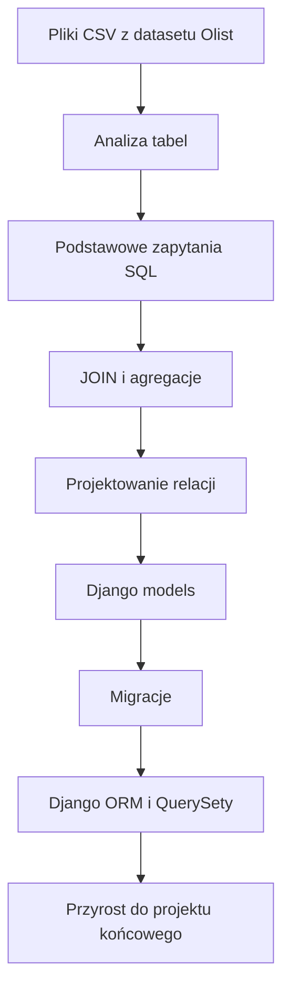
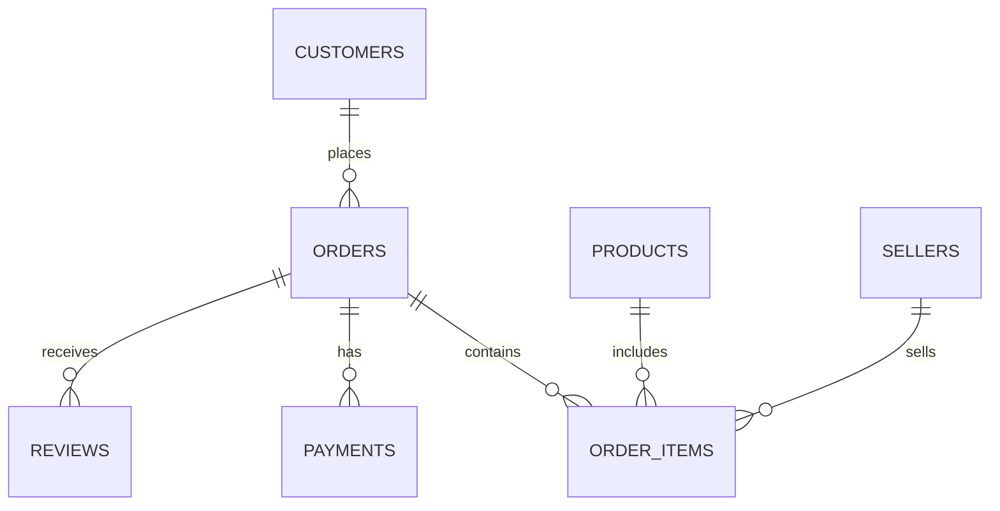

# 🚀 Weekend 6 — SQL + Django ORM + migracje

> **Kurs:** AI Python Engineer  
> **Blok:** Weekend 6  
> **Temat:** SQL, projektowanie relacyjne, Django ORM i migracje  
> **Typ pliku:** README bloku / indeks materiałów  
> **Główny efekt:** uczestnik potrafi przejść od danych tabelarycznych do modeli Django, migracji i podstawowych zapytań ORM.

---

## 🧭 Spis treści

1. [🎯 Cel bloku](#-cel-bloku)
2. [🗺️ Mapa bloku](#️-mapa-bloku)
3. [📚 Tematy bloku](#-tematy-bloku)
4. [📁 Struktura katalogu](#-struktura-katalogu)
5. [🧩 Opis plików](#-opis-plików)
6. [⚙️ Setup środowiska](#️-setup-środowiska)
7. [🗃️ Dataset](#️-dataset)
8. [🧪 Jak pracować z materiałami?](#-jak-pracować-z-materiałami)
9. [✅ Cel po zakończeniu bloku](#-cel-po-zakończeniu-bloku)
10. [🧠 Co warto zapamiętać?](#-co-warto-zapamiętać)

---

## 🎯 Cel bloku

Ten blok łączy trzy bardzo ważne obszary pracy backendowej:

- pisanie zapytań SQL,
- projektowanie relacyjnego modelu danych,
- przeniesienie tego modelu do Django przez modele, migracje i ORM.

Po zakończeniu weekendu uczestnik powinien rozumieć, jak dane przechodzą drogę od plików CSV i tabel SQL do trwałego modelu danych w aplikacji Django.

> [!IMPORTANT]
> Najważniejsza zasada tego bloku: **najpierw rozumiemy dane i relacje, dopiero potem piszemy modele Django oraz QuerySety.**

---

## 🗺️ Mapa bloku



---

## 📚 Tematy bloku

| Obszar | Zakres |
|---|---|
| SQL | `SELECT`, `WHERE`, `JOIN`, `GROUP BY`, `HAVING` |
| Model relacyjny | tabele, relacje, klucze główne `PK`, klucze obce `FK` |
| Django models | mapowanie tabel na klasy modeli |
| Django ORM | `filter`, `get`, `order_by`, `annotate` |
| Optymalizacja zapytań | wstęp do `select_related` i `prefetch_related` |
| Migracje | `makemigrations`, `migrate`, `showmigrations`, `sqlmigrate` |
| Projekt końcowy | własny trwały model danych w aplikacji Django |

> [!TIP]
> Traktuj SQL i Django ORM jako dwa sposoby mówienia o tym samym: danych, relacjach i zapytaniach.

---

## 📁 Struktura katalogu

Materiały tego bloku leżą płasko, bez podkatalogów:

```text
Weekend_6-SQL_Django_ORM_migracje/
├── README.md
├── readme_trener.md
├── readme_kursant.md
├── teoria.md
├── capstone.md
├── cwiczenia_clean_w6.ipynb
├── cwiczenia_solved_w6.ipynb
├── cwiczenia_sql_clean.sql
└── cwiczenia_sql_solved.sql
```

> [!NOTE]
> Dataset (pliki CSV Olist) nie jest częścią repozytorium — pobierasz go samodzielnie i wypakowujesz do lokalnego katalogu `data/` obok notebooków (patrz sekcja [🗃️ Dataset](#️-dataset)). Projekt Django z Weekendu 5 (`web/`) leży w repo `ai-knowledge-desk`, nie w tym folderze materiałów kursowych.

---

## 🧩 Opis plików

| Plik | Dla kogo? | Opis |
|---|---:|---|
| `README.md` | wszyscy | główny indeks materiałów weekendu |
| `readme_trener.md` | trener | instrukcja prowadzenia bloku |
| `readme_kursant.md` | kursant | instrukcja pracy dla uczestników |
| `teoria.md` | wszyscy | krótkie kompendium SQL, ORM i migracji |
| `cwiczenia_clean_w6.ipynb` | kursant | ćwiczenia bez rozwiązań |
| `cwiczenia_solved_w6.ipynb` | trener / po zajęciach | ćwiczenia z rozwiązaniami |
| `cwiczenia_sql_clean.sql` | kursant | zadania SQL bez rozwiązań |
| `cwiczenia_sql_solved.sql` | trener / po zajęciach | zadania SQL z rozwiązaniami |
| `capstone.md` | kursant | zadanie do projektu końcowego |

---

## ⚙️ Setup środowiska

### 1. Utwórz środowisko wirtualne

Linux / macOS:

```bash
python -m venv .venv
source .venv/bin/activate
```

Windows:

```bash
python -m venv .venv
.venv\Scripts\activate
```

---

### 2. Zainstaluj zależności

```bash
pip install django pandas jupyter ipykernel python-dotenv "psycopg[binary]"
```

| Pakiet | Po co jest potrzebny? |
|---|---|
| `django` | aplikacja backendowa i ORM |
| `pandas` | praca z danymi tabelarycznymi |
| `jupyter` | notebooki z ćwiczeniami |
| `ipykernel` | kernel Pythona dla Jupyter Notebook |
| `python-dotenv` | obsługa zmiennych środowiskowych |
| `psycopg[binary]` | połączenie z PostgreSQL |

---

### 3. Uruchom Jupyter Notebook

```bash
jupyter notebook
```

---

### 4. Sprawdź projekt Django swojego capstone

Projekt Django `ai-knowledge-desk` (katalog `web/`) żyje w Twoim własnym repozytorium, nie w tym folderze materiałów kursowych — patrz `capstone.md`.

```bash
cd web
python manage.py check
python manage.py migrate
python manage.py runserver
```

> [!WARNING]
> Jeśli `python manage.py migrate` kończy się błędem, najpierw sprawdź konfigurację bazy danych oraz plik `.env`.

---

## 🗃️ Dataset

W bloku używany jest dataset:

**Olist Brazilian E-Commerce Public Dataset**  
https://www.kaggle.com/datasets/olistbr/brazilian-ecommerce

Pliki CSV umieść w katalogu:

```text
data/
```

Wymagane pliki:

| Plik CSV | Przykładowa rola w ćwiczeniach |
|---|---|
| `olist_customers_dataset.csv` | dane klientów |
| `olist_orders_dataset.csv` | dane zamówień |
| `olist_order_items_dataset.csv` | pozycje zamówień |
| `olist_products_dataset.csv` | produkty |
| `olist_sellers_dataset.csv` | sprzedawcy |
| `olist_order_payments_dataset.csv` | płatności |
| `olist_order_reviews_dataset.csv` | opinie |



> [!TIP]
> Dataset Olist jest dobrym przykładem danych e-commerce: zawiera klientów, zamówienia, produkty, sprzedawców, płatności i opinie.

---

## 🧪 Jak pracować z materiałami?

Rekomendowana kolejność pracy:

1. Zacznij od `readme_kursant.md`.
2. Przejdź przez teorię w `teoria.md`.
3. Rozwiąż ćwiczenia z pliku `cwiczenia_sql_clean.sql`.
4. Wykonaj notebook `cwiczenia_clean_w6.ipynb`.
5. Sprawdź rozwiązania dopiero po samodzielnej próbie.
6. Przenieś wybrane relacje do modeli Django.
7. Wykonaj przyrost opisany w `capstone.md`.


---

## ✅ Cel po zakończeniu bloku

Po tym bloku uczestnik powinien umieć:

- [ ] napisać podstawowe zapytania SQL,
- [ ] użyć `SELECT`, `WHERE`, `JOIN`, `GROUP BY` i `HAVING`,
- [ ] połączyć tabele przez `JOIN`,
- [ ] wykonać prostą agregację przez `GROUP BY`,
- [ ] zaprojektować relacje `1:N` i `N:M`,
- [ ] wskazać klucze główne `PK` i klucze obce `FK`,
- [ ] stworzyć modele Django z `ForeignKey`,
- [ ] dodać podstawowe constraints,
- [ ] wygenerować migracje przez `makemigrations`,
- [ ] uruchomić migracje przez `migrate`,
- [ ] sprawdzić migracje przez `showmigrations` i `sqlmigrate`,
- [ ] napisać podstawowe QuerySety,
- [ ] rozbudować projekt końcowy o trwały model danych.

---

## ⚠️ Typowe pułapki

| Problem | Co sprawdzić? |
|---|---|
| Brak plików CSV | Czy pliki są w katalogu `data/`? |
| Błąd importu pakietów | Czy aktywne jest środowisko `.venv`? |
| Django nie startuje | Czy wykonano `python manage.py check`? |
| Migracje nie działają | Czy modele są poprawnie zapisane i aplikacja jest w `INSTALLED_APPS`? |
| QuerySet zwraca za dużo danych | Czy użyto właściwego `filter()`? |
| Problem z relacjami | Czy `ForeignKey` wskazuje poprawny model? |

---

## 🧠 Co warto zapamiętać?

- SQL pomaga zrozumieć, **jak naprawdę pracuje baza danych**.
- Django ORM pozwala pisać zapytania do bazy w Pythonie, ale nadal bazuje na tych samych pojęciach: tabelach, relacjach, filtrach i agregacjach.
- Migracje są pomostem między kodem modeli Django a strukturą bazy danych.
- Dobrze zaprojektowany model danych ułatwia późniejsze tworzenie API, widoków, panelu admina i analityki.

> [!IMPORTANT]
> Jeśli rozumiesz relacje między tabelami, łatwiej zaprojektujesz modele Django i unikniesz chaotycznej struktury danych w projekcie końcowym.

