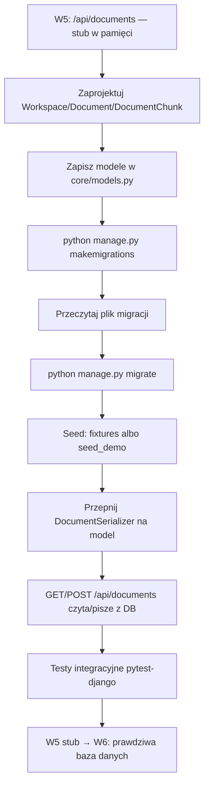
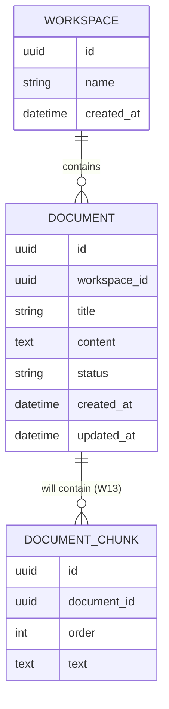
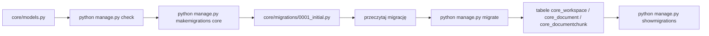

# 🧩 Weekend 6 — Capstone: SQL, Django ORM i migracje w projekcie końcowym

> **Kurs:** AI Python Engineer
> **Blok:** Weekend 6
> **Temat:** projektowanie modelu danych, Django models, migracje, ORM i pierwsze zapytania do prawdziwej bazy
> **Typ pliku:** przyrost do projektu końcowego (`ai-knowledge-desk`)
> **Główny efekt:** endpoint `/api/documents` z Weekendu 5 przestaje być stubem w pamięci i zaczyna czytać/pisać z prawdziwej bazy danych przez Django ORM.

---

## 🧭 Spis treści

1. [Kontekst](#kontekst)
2. [🗺️ Mapa przyrostu](#️-mapa-przyrostu)
3. [Co dochodzi do projektu](#co-dochodzi-do-projektu)
4. [🗃️ Model danych — `Workspace`, `Document`, `DocumentChunk`](#️-model-danych--workspace-document-documentchunk)
5. [🔧 Serializer przepięty na model](#-serializer-przepięty-na-model)
6. [🌐 `GET`/`POST /api/documents` podpięte do bazy](#-getpost-apidocuments-podpięte-do-bazy)
7. [🧬 Migracje](#-migracje)
8. [🌱 Dane testowe — fixtures i `seed_demo`](#-dane-testowe--fixtures-i-seed_demo)
9. [🧪 Testy integracyjne](#-testy-integracyjne)
10. [Kroki](#kroki)
11. [🚫 Czego świadomie NIE robimy w tym przyroście](#-czego-świadomie-nie-robimy-w-tym-przyroście)
12. [⚠️ Najczęstsze błędy](#️-najczęstsze-błędy)
13. [Definition of Done](#definition-of-done)
14. [Co dopisać do README](#co-dopisać-do-readme)

---

## Kontekst

Po Weekendzie 5 masz działający szkielet Django (`config`/`core`) z endpointami `GET /api/health`, `GET /api/version` i `GET/POST /api/documents` — ten ostatni to na razie **stub**: trzyma dokumenty w liście w pamięci (albo w prostym obiekcie bez migracji), a `DocumentSerializer` ma tylko pola `id`, `title`, `content`. W tym przyroście `/api/documents` dostaje prawdziwy fundament danych: modele `Workspace`, `Document` i `DocumentChunk`, migracje, dane testowe i testy integracyjne DB + API.

> [!IMPORTANT]
> To jest **upgrade istniejącego stuba, nie budowa czegoś od zera**. Endpoint `/api/documents` już istnieje z W5 — dziś zamieniasz jego wewnętrzną implementację (lista w pamięci → Django ORM + baza), zachowując te same ścieżki URL.

---

## 🗺️ Mapa przyrostu



### 🧱 Relacje danych po tym przyroście



> [!NOTE]
> `DocumentChunk` pojawia się w tym weekendzie **tylko jako placeholder** — model i migracja istnieją, żeby relacja `Document → DocumentChunk` była gotowa pod realny chunking i embeddingi w Weekendzie 13 (RAG). W tym przyroście nie budujesz dla niego żadnego endpointu ani logiki chunkowania.

---

## Co dochodzi do projektu

| Element | Stan po W5 | Stan po W6 |
|---|---|---|
| Model danych | brak modeli w bazie — `Document` istnieje tylko jako obiekt w pamięci / prosta struktura bez migracji | `Workspace`, `Document`, `DocumentChunk` jako modele Django z migracjami |
| Baza danych | brak trwałych tabel dla dokumentów | tabele `core_workspace`, `core_document`, `core_documentchunk` po `migrate` |
| `DocumentSerializer` | pola `id`, `title`, `content` (stub) | przepięty na model `Document`: `id`, `workspace`, `title`, `content`, `status`, `created_at`, `updated_at` |
| `GET /api/documents` | zwraca listę z pamięci | zwraca `Document.objects.all()` z bazy (posortowane, z `select_related("workspace")`) |
| `POST /api/documents` | dopisuje do listy w pamięci, ginie po restarcie | tworzy rekord `Document` w bazie, trwały między restartami |
| Dane testowe | brak / ręcznie wpisane w kodzie stuba | fixtures i/lub management command `seed_demo` |
| Testy | testy stubu z W5 (pytest-django, bez bazy) | testy integracyjne uderzające przez `APIClient` w prawdziwą bazę testową |
| Format błędów | `{"error": {"code", "message", "details"}}` | bez zmian — ten sam format, teraz też dla błędów walidacji ORM (np. brakujący `workspace`) |

---

## 🗃️ Model danych — `Workspace`, `Document`, `DocumentChunk`

To jest **domyślny, wymagany model danych dla capstone w tym weekendzie** — nie jedna z kilku równorzędnych propozycji domenowych. `ai-knowledge-desk` to wewnętrzna baza wiedzy firmy: `Workspace` to organizacja/zespół, `Document` to wgrany dokument, `DocumentChunk` to jego przyszły fragment po chunkowaniu.

Zapisz w `core/models.py` dokładnie taką strukturę:

```python
import uuid
from django.db import models


class Workspace(models.Model):
    id = models.UUIDField(primary_key=True, default=uuid.uuid4, editable=False)
    name = models.CharField(max_length=200)
    created_at = models.DateTimeField(auto_now_add=True)


class Document(models.Model):
    id = models.UUIDField(primary_key=True, default=uuid.uuid4, editable=False)
    workspace = models.ForeignKey(Workspace, on_delete=models.CASCADE, related_name="documents")
    title = models.CharField(max_length=255)
    content = models.TextField()
    status = models.CharField(max_length=20, choices=[("draft", "draft"), ("ready", "ready")], default="draft")
    created_at = models.DateTimeField(auto_now_add=True)
    updated_at = models.DateTimeField(auto_now=True)


class DocumentChunk(models.Model):  # placeholder do W13
    id = models.UUIDField(primary_key=True, default=uuid.uuid4, editable=False)
    document = models.ForeignKey(Document, on_delete=models.CASCADE, related_name="chunks")
    order = models.PositiveIntegerField()
    text = models.TextField()
```

### Co warto zauważyć

| Element | Dlaczego jest ważny? |
|---|---|
| `UUIDField(primary_key=True, default=uuid.uuid4)` | id nie zdradza liczby rekordów ani kolejności tworzenia — dobra praktyka dla publicznego API |
| `related_name="documents"` na `Document.workspace` | pozwala pisać `workspace.documents.all()` zamiast `Document.objects.filter(workspace=...)` |
| `on_delete=models.CASCADE` | usunięcie workspace kasuje jego dokumenty — świadoma decyzja biznesowa dla tej domeny |
| `status` z `choices` i `default="draft"` | ogranicza wartości do kontrolowanej listy już na poziomie modelu |
| `DocumentChunk` jako osobny model już teraz | relacja `Document → DocumentChunk` jest gotowa, zanim w W13 pojawi się realny chunking + embeddingi |

> [!WARNING]
> **Nie zmieniaj nazw** `Workspace`, `Document`, `DocumentChunk` ani pól `id`/`workspace`/`title`/`content`/`status`/`created_at`/`updated_at`/`order`/`text`. Te nazwy są zablokowane od tego weekendu i będą używane bez zmian aż do W13 (chunking) i dalej — kolejne capstone doklejają pola i relacje, ale nie przemianowują tego, co już istnieje.

### Jeśli Twój projekt ma inną domenę

Jeżeli w poprzednich weekendach (W1–W4) pracowałeś/-aś nad wyraźnie inną domeną niż baza wiedzy, dostosuj **nazwy pól biznesowych** (np. `title` → `name` w Twoim kontekście), ale zachowaj **dokładnie ten sam kształt**: encja-właściciel (`Workspace`), encja-dokument należąca do właściciela przez `ForeignKey`, `status` z dwoma stanami i placeholder na przyszłe fragmentowanie treści. Domyślnym i rekomendowanym wyborem pozostaje jednak dokładnie `Workspace`/`Document`/`DocumentChunk` jak wyżej — to one są używane w reszcie tego dokumentu i w kolejnych weekendach.

---

## 🔧 Serializer przepięty na model

W5 miał `DocumentSerializer` z polami `id`, `title`, `content` działający na obiekcie w pamięci. Teraz przepinasz go na prawdziwy model:

```python
# core/serializers.py
from rest_framework import serializers

from .models import Document


class DocumentSerializer(serializers.ModelSerializer):
    class Meta:
        model = Document
        fields = ["id", "workspace", "title", "content", "status", "created_at", "updated_at"]
        read_only_fields = ["id", "created_at", "updated_at"]
```

| Pole | Skąd się bierze | Uwaga |
|---|---|---|
| `id` | `read_only` | generowany automatycznie jako UUID |
| `workspace` | wymagane przy `POST` | klient wysyła UUID istniejącego workspace |
| `title`, `content` | te same co w stubie z W5 | teraz walidowane też przez ograniczenia modelu (`max_length=255`) |
| `status` | opcjonalne przy `POST` | domyślnie `"draft"`, jeśli nie podano |
| `created_at`, `updated_at` | `read_only` | ustawiane przez `auto_now_add` / `auto_now` |

---

## 🌐 `GET`/`POST /api/documents` podpięte do bazy

Te same ścieżki URL co w W5 — zmienia się tylko to, co dzieje się wewnątrz widoku.

```python
# core/views.py
from rest_framework import status
from rest_framework.response import Response
from rest_framework.views import APIView

from .models import Document
from .serializers import DocumentSerializer


class DocumentListCreateView(APIView):
    def get(self, request):
        documents = Document.objects.select_related("workspace").order_by("-created_at")
        serializer = DocumentSerializer(documents, many=True)
        return Response(serializer.data)

    def post(self, request):
        serializer = DocumentSerializer(data=request.data)
        if not serializer.is_valid():
            return Response(
                {
                    "error": {
                        "code": "validation_error",
                        "message": "Nieprawidłowe dane dokumentu.",
                        "details": serializer.errors,
                    }
                },
                status=status.HTTP_400_BAD_REQUEST,
            )
        document = serializer.save()
        return Response(DocumentSerializer(document).data, status=status.HTTP_201_CREATED)
```

`core/urls.py` nie zmienia ścieżek — nadal `GET/POST /api/documents`, tylko widok pod spodem czyta i pisze z bazy:

```python
# core/urls.py (fragment, ścieżka bez zmian od W5)
from django.urls import path

from .views import DocumentListCreateView

urlpatterns = [
    # ... /api/health, /api/version z W5 ...
    path("api/documents", DocumentListCreateView.as_view(), name="document-list-create"),
]
```

> [!TIP]
> `select_related("workspace")` w `GET` to świadomy, ale **minimalny** krok w stronę wydajnych zapytań — pełny audyt N+1 (`select_related`/`prefetch_related` na wszystkich listach, także dla `chunks`) to zadanie Weekendu 7.

### Przykładowe wywołania

```bash
# Lista dokumentów
curl http://localhost:8000/api/documents

# Utworzenie dokumentu
curl -X POST http://localhost:8000/api/documents \
  -H "Content-Type: application/json" \
  -d '{"workspace": "11111111-1111-1111-1111-111111111111", "title": "Onboarding", "content": "Pierwsze kroki w firmie."}'
```

Błędny request (bez `workspace`) zwraca spójny format błędu ustalony w W5:

```json
{
  "error": {
    "code": "validation_error",
    "message": "Nieprawidłowe dane dokumentu.",
    "details": {
      "workspace": ["This field is required."]
    }
  }
}
```

---

## 🧬 Migracje



```bash
python manage.py check
python manage.py makemigrations core
python manage.py migrate
python manage.py showmigrations core
```

W wygenerowanym pliku `core/migrations/0001_initial.py` sprawdź:

- czy powstają trzy modele: `Workspace`, `Document`, `DocumentChunk`,
- czy `Document.workspace` i `DocumentChunk.document` to `ForeignKey` z `on_delete=CASCADE`,
- czy `id` we wszystkich trzech modelach to `UUIDField` jako `primary_key`,
- czy `status` ma zdefiniowane `choices` i `default="draft"`.

### ✅ Checklist migracji

- [ ] `python manage.py check` przechodzi bez błędów.
- [ ] `makemigrations core` utworzyło plik migracji (nie jest pusty).
- [ ] Plik migracji został przeczytany, nie tylko wygenerowany.
- [ ] `python manage.py migrate` przechodzi bez błędów.
- [ ] `showmigrations core` pokazuje migrację jako wykonaną (`[X]`).
- [ ] W bazie istnieją trzy nowe tabele.

---

## 🌱 Dane testowe — fixtures i `seed_demo`

Potrzebujesz danych testowych, żeby ręcznie i automatycznie sprawdzić `GET /api/documents`. Wybierz jedną z dwóch dróg (albo obie).

### Wariant A — management command `seed_demo`

```python
# core/management/commands/seed_demo.py
from django.core.management.base import BaseCommand

from core.models import Document, Workspace


class Command(BaseCommand):
    help = "Zasila lokalną bazę przykładowym workspace i dokumentami."

    def handle(self, *args, **options):
        workspace, _ = Workspace.objects.get_or_create(name="Demo Workspace")

        demo_documents = [
            {"title": "Onboarding — pierwsze kroki", "content": "Witaj w firmie...", "status": "ready"},
            {"title": "Polityka urlopowa", "content": "Zasady wnioskowania o urlop...", "status": "draft"},
            {"title": "FAQ dla nowych pracowników", "content": "Najczęstsze pytania...", "status": "ready"},
        ]

        for data in demo_documents:
            Document.objects.get_or_create(
                workspace=workspace,
                title=data["title"],
                defaults={"content": data["content"], "status": data["status"]},
            )

        self.stdout.write(self.style.SUCCESS("seed_demo: gotowe."))
```

```bash
python manage.py seed_demo
```

### Wariant B — fixture JSON

```json
// core/fixtures/demo_documents.json
[
  {
    "model": "core.workspace",
    "pk": "11111111-1111-1111-1111-111111111111",
    "fields": {"name": "Demo Workspace", "created_at": "2026-01-01T09:00:00Z"}
  },
  {
    "model": "core.document",
    "pk": "22222222-2222-2222-2222-222222222222",
    "fields": {
      "workspace": "11111111-1111-1111-1111-111111111111",
      "title": "Onboarding — pierwsze kroki",
      "content": "Witaj w firmie...",
      "status": "ready",
      "created_at": "2026-01-01T09:05:00Z",
      "updated_at": "2026-01-01T09:05:00Z"
    }
  }
]
```

```bash
python manage.py loaddata demo_documents
```

> [!TIP]
> `seed_demo` jest wygodniejszy do codziennej pracy lokalnej (idempotentny dzięki `get_or_create`), fixture lepiej nadaje się do odtwarzalnych danych w CI/testach. Wybierz to, co pasuje do Twojego workflow — capstone wymaga **przynajmniej jednego** z tych dwóch.

---

## 🧪 Testy integracyjne

Testy muszą przechodzić **przez prawdziwe API i uderzać w bazę** — nie testujemy tu samych modeli w oderwaniu od widoku.

```python
# core/tests/test_documents_api.py
import pytest
from rest_framework.test import APIClient

from core.models import Document, Workspace


@pytest.mark.django_db
def test_list_documents_reads_from_database():
    workspace = Workspace.objects.create(name="Acme")
    Document.objects.create(workspace=workspace, title="Regulamin", content="Treść regulaminu.")

    client = APIClient()
    response = client.get("/api/documents")

    assert response.status_code == 200
    titles = [item["title"] for item in response.data]
    assert "Regulamin" in titles


@pytest.mark.django_db
def test_create_document_persists_to_database():
    workspace = Workspace.objects.create(name="Acme")
    client = APIClient()

    payload = {
        "workspace": str(workspace.id),
        "title": "Nowy dokument",
        "content": "Świeża treść.",
    }
    response = client.post("/api/documents", payload, format="json")

    assert response.status_code == 201
    assert Document.objects.filter(title="Nowy dokument", workspace=workspace).exists()


@pytest.mark.django_db
def test_create_document_without_workspace_returns_error_envelope():
    client = APIClient()

    response = client.post(
        "/api/documents",
        {"title": "Bez workspace", "content": "..."},
        format="json",
    )

    assert response.status_code == 400
    assert response.data["error"]["code"] == "validation_error"
    assert "workspace" in response.data["error"]["details"]


@pytest.mark.django_db
def test_created_document_defaults_to_draft_status():
    workspace = Workspace.objects.create(name="Acme")
    client = APIClient()

    response = client.post(
        "/api/documents",
        {"workspace": str(workspace.id), "title": "Status domyślny", "content": "..."},
        format="json",
    )

    assert response.status_code == 201
    assert response.data["status"] == "draft"
```

### ✅ Checklist testów integracyjnych

- [ ] Przynajmniej jeden test tworzy dane przez ORM i odczytuje je przez `GET /api/documents`.
- [ ] Przynajmniej jeden test tworzy dane przez `POST /api/documents` i sprawdza stan w bazie (`Document.objects.filter(...)`).
- [ ] Przynajmniej jeden test sprawdza błąd walidacji w formacie `{"error": {"code", "message", "details"}}`.
- [ ] Testy używają `@pytest.mark.django_db` (albo `TestCase`), nie mockują bazy.
- [ ] `pytest` przechodzi lokalnie bez błędów.

---

## Kroki

1. Przeczytaj jeszcze raz stub `/api/documents` z Weekendu 5 — zanotuj, co dokładnie zamienisz (lista w pamięci → ORM).
2. Dodaj do `core/models.py` modele `Workspace`, `Document`, `DocumentChunk` dokładnie jak w sekcji [Model danych](#️-model-danych--workspace-document-documentchunk).
3. Uruchom `python manage.py check`, popraw ewentualne błędy.
4. Wygeneruj migrację: `python manage.py makemigrations core` i przeczytaj wynikowy plik.
5. Zastosuj migrację: `python manage.py migrate`, sprawdź `showmigrations core`.
6. Przepnij `DocumentSerializer` na model `Document` (pola: `id`, `workspace`, `title`, `content`, `status`, `created_at`, `updated_at`).
7. Zamień implementację `GET/POST /api/documents` ze stuba w pamięci na zapytania ORM (`Document.objects...`), zachowując te same ścieżki URL i format błędów `{"error": {"code","message","details"}}`.
8. Dodaj dane testowe — `seed_demo` i/lub fixture — i uruchom je lokalnie.
9. Ręcznie sprawdź `GET`/`POST /api/documents` przez `curl` albo Postmana.
10. Napisz minimum 4 testy integracyjne pytest-django (lista z bazy, tworzenie z zapisem do bazy, błąd walidacji, wartość domyślna `status`).
11. Zaktualizuj `README.md` projektu `ai-knowledge-desk` o sekcję z modelem danych i instrukcją migracji/seeda (patrz [Co dopisać do README](#co-dopisać-do-readme)).

---

## 🚫 Czego świadomie NIE robimy w tym przyroście

To ważne, żeby nie przesadzić z zakresem — poniższe rzeczy celowo zostają na Weekend 7.

| Nie rób jeszcze | Dlaczego | Kiedy |
|---|---|---|
| `GET /api/documents/{id}`, `PATCH /api/documents/{id}`, `DELETE /api/documents/{id}` | pełny CRUD na pojedynczym zasobie to osobny temat (routing, permissions na obiekcie) | Weekend 7 |
| `transaction.atomic()` przy tworzeniu dokumentu | wieloetapowe operacje transakcyjne pojawią się razem z pierwszym "job placeholderem" | Weekend 7 |
| Pełny audyt N+1 (`prefetch_related` dla `chunks`, systematyczny przegląd list) | dziś wystarczy jeden świadomy `select_related("workspace")`; pełna optymalizacja to osobne ćwiczenie | Weekend 7 |
| Realne chunkowanie i embeddingi w `DocumentChunk` | model to na razie tylko placeholder pod relację | Weekend 13 |
| Autoryzacja i filtrowanie dokumentów per użytkownik | `WorkspaceMembership` i JWT dochodzą dopiero z auth | Weekend 8 |

---

## ⚠️ Najczęstsze błędy

### Błąd 1 — zostawienie stuba w pamięci obok modeli

Objaw: modele istnieją i mają migracje, ale widok nadal czyta z listy w pamięci albo z globalnej zmiennej modułu.

Jak poprawić: `DocumentListCreateView` musi w całości korzystać z `Document.objects...` — żadnej listy w pamięci nie powinno już zostać w kodzie widoku.

### Błąd 2 — `Document` bez wymaganego `workspace`

Zły przykład:

```python
class Document(models.Model):
    title = models.CharField(max_length=255)
    content = models.TextField()
```

To nie jest zgodne ze specyfikacją tego weekendu — `workspace` jako `ForeignKey` jest wymagany od początku, nie jako pole opcjonalne dodawane "później".

### Błąd 3 — zmiana formatu błędów "przy okazji"

Nie zamieniaj `{"error": {"code","message","details"}}` na `{"detail": ...}` albo `{"errors": [...]}` tylko dlatego, że tak domyślnie robi DRF przy błędzie walidacji `ModelSerializer`. Format ustalony w W5 obowiązuje też tutaj — opakuj `serializer.errors` w ten sam envelope.

### Błąd 4 — pusta albo brakująca migracja

Objaw: `makemigrations` nic nie wygenerowało albo wygenerowało pustą migrację.

Jak poprawić: sprawdź, czy `core` jest w `INSTALLED_APPS`, czy modele faktycznie się zapisały w `core/models.py`, i czy nie ma literówki w nazwie pliku.

### Błąd 5 — testy bez `@pytest.mark.django_db`

Objaw: test próbuje odczytać/zapisać dane i wywala błąd dostępu do bazy.

Jak poprawić: każdy test, który dotyka ORM (bezpośrednio albo przez endpoint), musi mieć `@pytest.mark.django_db` albo dziedziczyć po klasie testowej z dostępem do bazy.

---

## Definition of Done

Przyrost po Weekendzie 6 jest gotowy, jeśli spełnia wszystkie poniższe punkty.

### Modele i migracje

- [ ] `core/models.py` zawiera `Workspace`, `Document`, `DocumentChunk` dokładnie z polami jak w specyfikacji.
- [ ] `python manage.py check` przechodzi bez błędów.
- [ ] Migracja została wygenerowana (`makemigrations core`) i przeczytana.
- [ ] `python manage.py migrate` przechodzi bez błędów.
- [ ] `showmigrations core` pokazuje migrację jako wykonaną.

### Serializer i API

- [ ] `DocumentSerializer` jest przepięty na model `Document` (pola: `id`, `workspace`, `title`, `content`, `status`, `created_at`, `updated_at`).
- [ ] `GET /api/documents` czyta dane z bazy przez Django ORM (nie z listy w pamięci).
- [ ] `POST /api/documents` zapisuje nowy rekord `Document` do bazy.
- [ ] Ścieżki URL `/api/documents` nie zmieniły się względem W5.
- [ ] Błędy walidacji nadal mają format `{"error": {"code", "message", "details"}}`.

### Dane testowe

- [ ] Istnieje `seed_demo` i/lub fixture z danymi demo.
- [ ] Po uruchomieniu seeda `GET /api/documents` zwraca niepustą listę.

### Testy

- [ ] Istnieją minimum 4 testy integracyjne pytest-django uderzające przez `APIClient` w prawdziwą bazę testową.
- [ ] Testy pokrywają: listę z bazy, tworzenie z zapisem do bazy, błąd walidacji w formacie error envelope, domyślny `status`.
- [ ] `pytest` przechodzi lokalnie.

### Zakres

- [ ] Nie dodano `GET/PATCH/DELETE /api/documents/{id}` (to Weekend 7).
- [ ] Nie dodano `transaction.atomic()` ani optymalizacji N+1 poza pojedynczym `select_related` (to Weekend 7).
- [ ] `DocumentChunk` istnieje tylko jako model + migracja, bez logiki chunkowania (to Weekend 13).

### Dokumentacja

- [ ] README projektu `ai-knowledge-desk` opisuje model danych i sposób odtworzenia bazy lokalnie (migracje + seed).

---

## Co dopisać do README

Dopisz do głównego `README.md` swojego projektu `ai-knowledge-desk` (np. jako nową sekcję `## Model danych (W6)`):

```markdown
## Model danych (W6)

Backend (`web/`, app `core`) ma teraz trwały model danych w PostgreSQL/SQLite zamiast stuba w pamięci z W5:

- `Workspace(id: UUID, name, created_at)` — organizacja/zespół.
- `Document(id: UUID, workspace: FK → Workspace, title, content, status: draft|ready, created_at, updated_at)` — dokument należący do workspace.
- `DocumentChunk(id: UUID, document: FK → Document, order, text)` — placeholder pod realny chunking i embeddingi (Weekend 13).

### Migracje

\`\`\`bash
python manage.py makemigrations core
python manage.py migrate
\`\`\`

### Dane testowe

\`\`\`bash
python manage.py seed_demo
# albo
python manage.py loaddata demo_documents
\`\`\`

### API

- `GET /api/documents` — lista dokumentów z bazy.
- `POST /api/documents` — tworzy dokument w bazie (wymaga `workspace`, `title`, `content`; `status` opcjonalny, domyślnie `draft`).

Pełny CRUD (`GET/PATCH/DELETE /api/documents/{id}`) oraz optymalizacja zapytań (`select_related`/`prefetch_related`, `transaction.atomic()`) dochodzą w Weekendzie 7.
```

> [!TIP]
> Ten fragment README to nie tylko formalność — to notatka, którą sam/sama przeczytasz za trzy weekendy, kiedy będziesz dodawać `IngestJob` albo pełny CRUD i zapomnisz, dlaczego `DocumentChunk` jest akurat taki pusty.
