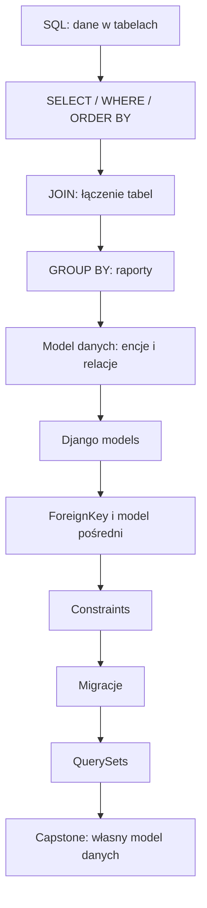
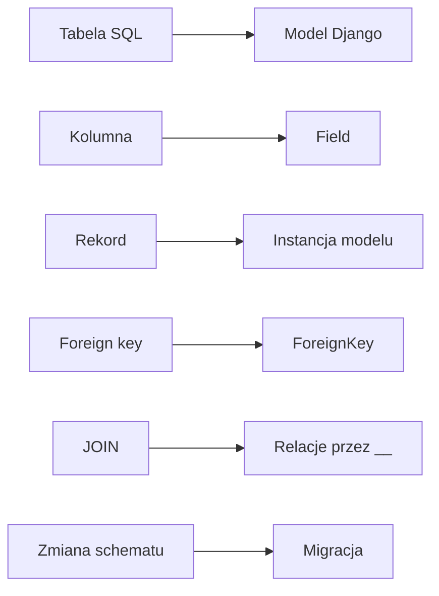
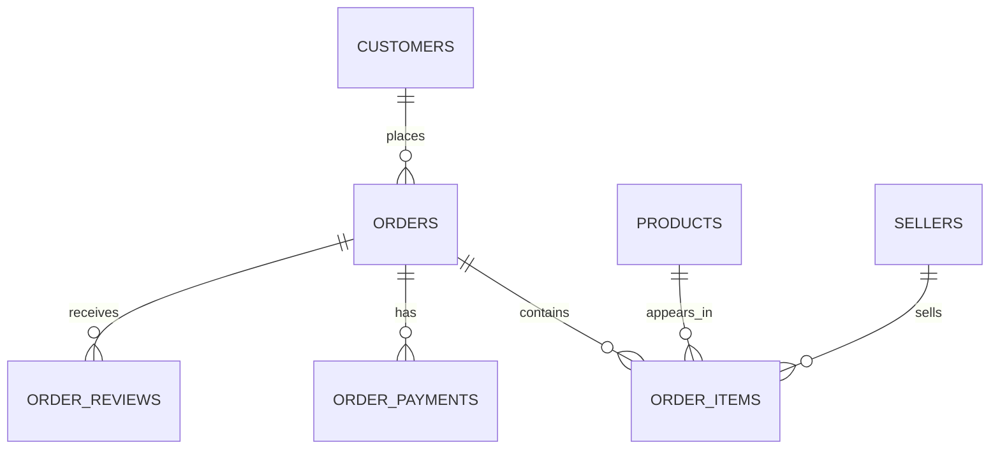
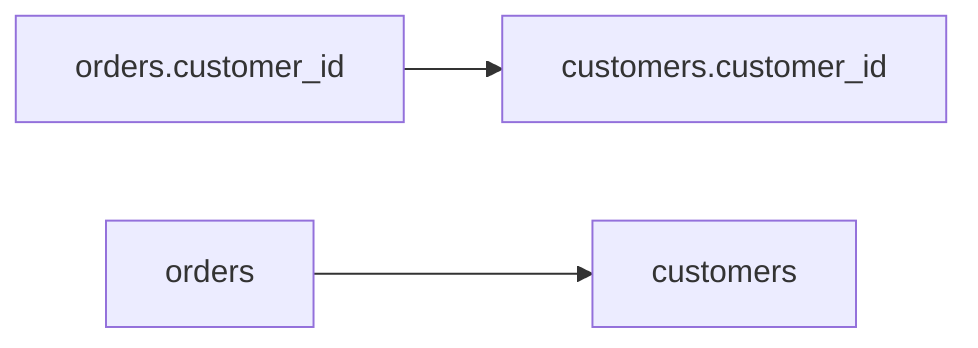
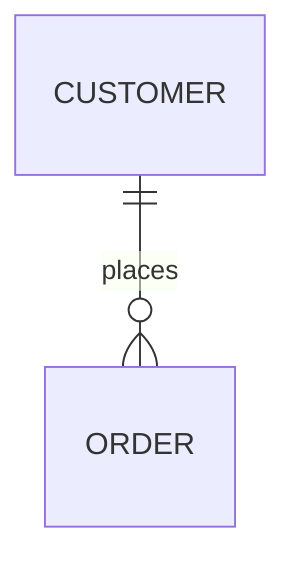
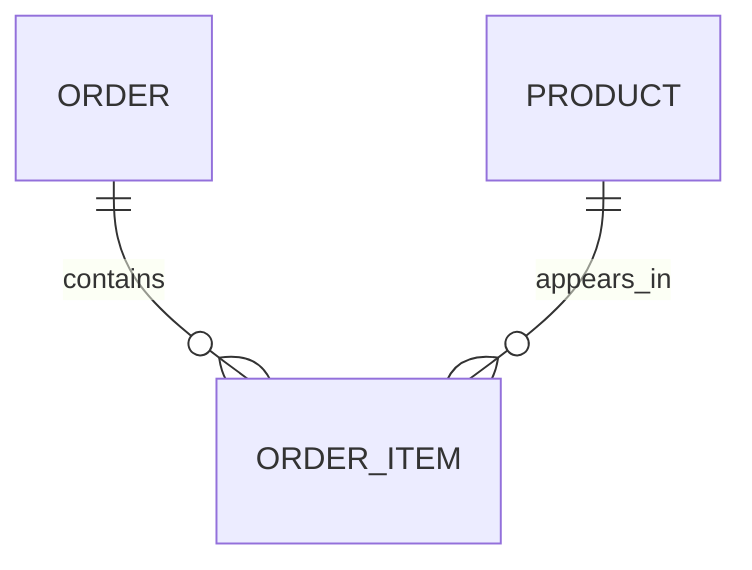
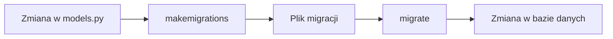

# 🎓 Weekend 6 — SQL + Django ORM + migracje

> **Kurs:** AI Python Engineer  
> **Blok:** Weekend 6  
> **Temat:** SQL, relacyjne modelowanie danych, Django ORM i migracje  
> **Główny efekt:** Twoja aplikacja Django zaczyna mieć trwały, sensowny model danych w bazie

---

## 🧭 O co chodzi w tym bloku?

W tym weekendzie przechodzimy od:

```text
mam dane w tabelkach
```

do:

```text
moja aplikacja Django ma porządny model danych i potrafi bezpiecznie zapisywać informacje w bazie
```

W sobotę pracujemy z **SQL**. Nauczysz się pobierać dane, filtrować je, łączyć tabele przez `JOIN`, robić proste raporty przez `GROUP BY` i projektować relacje między tabelami.

W niedzielę przenosimy te same idee do **Django**. Tworzysz modele, relacje `ForeignKey`, model pośredni typu `OrderItem`, podstawowe constraints, zapytania przez Django ORM oraz migracje.

Najważniejsza myśl tego weekendu:

> **ORM nie zwalnia z rozumienia bazy danych.**  
> Django pomaga pisać zapytania w Pythonie, ale pod spodem nadal działa SQL.

---

## Spis treści

- [O co chodzi w tym bloku?](#-o-co-chodzi-w-tym-bloku)
- [Mapa bloku](#️-mapa-bloku)
- [Po tym bloku będziesz umieć](#-po-tym-bloku-będziesz-umieć)
- [Czego potrzebujesz przed zajęciami?](#-czego-potrzebujesz-przed-zajęciami)
- [Narzędzia](#-narzędzia)
- [Instalacja środowiska](#-instalacja-środowiska)
- [Dataset](#-dataset)
- [Najważniejsze tabele](#-najważniejsze-tabele)
- [Sobota — SQL i model danych](#-sobota--sql-i-model-danych)
- [Niedziela — Django ORM i migracje](#-niedziela--django-orm-i-migracje)
- [Plan pracy w skrócie](#-plan-pracy-w-skrócie)
- [Najważniejsze ćwiczenia](#-najważniejsze-ćwiczenia)
- [Typowe błędy](#-typowe-błędy-na-które-warto-uważać)
- [Jak korzystać z AI w tym bloku?](#-jak-korzystać-z-ai-w-tym-bloku)
- [Połączenie z projektem końcowym](#-połączenie-z-projektem-końcowym)
- [Zadanie domowe](#-zadanie-domowe)
- [Mini cheat sheet](#-mini-cheat-sheet)
- [Checklista po weekendzie](#-checklista-po-weekendzie)
- [Co warto zapamiętać?](#-co-warto-zapamiętać)

---

# 🗺️ Mapa bloku



---

## Główne przejście tego weekendu



---

## Najprostszy model mentalny

```text
SQL pokazuje, jak baza myśli o danych.
Django ORM pozwala pracować z tymi danymi w Pythonie.
Migracje zapisują historię zmian struktury bazy.
```

---

# 🎯 Po tym bloku będziesz umieć

Po zakończeniu weekendu będziesz umieć:

- wyjaśnić, czym są tabela, rekord, kolumna, klucz główny i klucz obcy,
- pisać podstawowe zapytania SQL z `SELECT`, `WHERE`, `ORDER BY`, `LIMIT`,
- łączyć tabele przez `JOIN`,
- tworzyć proste raporty przez `GROUP BY`, `COUNT`, `SUM`, `AVG`,
- rozpoznać relacje 1:N i N:M,
- zaprojektować prosty model danych dla aplikacji webowej,
- odwzorować tabele na Django models,
- używać pól takich jak `CharField`, `TextField`, `DecimalField`, `DateTimeField`, `BooleanField`,
- tworzyć relacje przez `ForeignKey` i prosty model pośredni,
- dodać podstawowe constraints do modeli,
- korzystać z Django QuerySets: `all`, `filter`, `get`, `exclude`, `order_by`, `count`,
- filtrować dane po relacjach, np. `customer__email`,
- zrozumieć podstawową różnicę między `select_related` i `prefetch_related`,
- wygenerować i uruchomić migracje przez `makemigrations` i `migrate`,
- sprawdzić, jaki SQL generuje Django,
- rozszerzyć projekt końcowy o własny model danych.

---

# ✅ Czego potrzebujesz przed zajęciami?

Powinieneś/powinnaś mieć podstawową znajomość:

- Pythona: zmienne, funkcje, listy, słowniki, klasy na poziomie podstawowym,
- pracy w terminalu,
- środowiska wirtualnego `venv`,
- podstaw Django: projekt, aplikacja, `settings.py`, `manage.py`,
- podstaw Git,
- podstaw działania API.

Nie musisz znać SQL. Zaczynamy od fundamentów.

---

# 🛠️ Narzędzia

W tym bloku używamy:

- Python 3.11 lub nowszy,
- Django 5.x albo wersja wskazana przez prowadzącego,
- SQLite lokalnie na start,
- opcjonalnie PostgreSQL jako docelowa baza dla projektu końcowego,
- Jupyter Notebook lub JupyterLab,
- `pandas` do szybkiego podglądu danych,
- terminal,
- edytor kodu, np. VS Code,
- opcjonalnie DBeaver, DB Browser for SQLite albo pgAdmin.

---

# ⚙️ Instalacja środowiska

## 1. Utwórz środowisko wirtualne

Linux / macOS:

```bash
python -m venv .venv
source .venv/bin/activate
```

Windows PowerShell:

```powershell
python -m venv .venv
.venv\Scripts\activate
```

---

## 2. Zainstaluj zależności

Jeżeli masz plik `requirements.txt`:

```bash
pip install -r requirements.txt
```

Jeżeli instalujesz ręcznie:

```bash
pip install django pandas jupyter ipykernel python-dotenv "psycopg[binary]"
```

---

## 3. Sprawdź, czy Django działa

W katalogu projektu uruchom:

```bash
python manage.py check
```

Jeżeli projekt ma już migracje:

```bash
python manage.py migrate
```

Uruchom serwer:

```bash
python manage.py runserver
```

Wejdź w przeglądarce na:

```text
http://127.0.0.1:8000/
```

---

## Szybka checklista środowiska

- [ ] Mam aktywne `.venv`.
- [ ] `python --version` działa.
- [ ] `pip list` pokazuje Django.
- [ ] `python manage.py check` przechodzi.
- [ ] `python manage.py runserver` uruchamia serwer.
- [ ] Wiem, z jakiej bazy korzysta projekt.

---

# 🗃️ Dataset

## Nazwa datasetu

**Olist Brazilian E-Commerce Public Dataset**

## Źródło

Dataset publiczny dostępny na Kaggle:

```text
https://www.kaggle.com/datasets/olistbr/brazilian-ecommerce
```

---

## Dlaczego używamy tego datasetu?

To realny dataset e-commerce. Dzięki temu ćwiczymy rzeczy podobne do codziennej pracy backend developera:

- klienci,
- zamówienia,
- produkty,
- sprzedawcy,
- płatności,
- opinie,
- pozycje zamówień,
- relacje między tabelami,
- raporty sprzedażowe,
- dane pod przyszłe API.

Nie pracujemy na abstrakcyjnych tabelkach typu `table_1`, tylko na danych, które przypominają prawdziwy marketplace.

---

## Mapa relacji w datasecie



---

# 📊 Najważniejsze tabele

## `customers`

Tabela klientów.

| Kolumna | Typ | Opis biznesowy |
|---|---|---|
| `customer_id` | text | identyfikator klienta w kontekście zamówienia |
| `customer_unique_id` | text | unikalny identyfikator klienta |
| `customer_zip_code_prefix` | integer | prefiks kodu pocztowego |
| `customer_city` | text | miasto klienta |
| `customer_state` | text | stan/region klienta |

---

## `orders`

Tabela zamówień.

| Kolumna | Typ | Opis biznesowy |
|---|---|---|
| `order_id` | text | identyfikator zamówienia |
| `customer_id` | text | klient, który złożył zamówienie |
| `order_status` | text | status zamówienia |
| `order_purchase_timestamp` | datetime | data złożenia zamówienia |
| `order_approved_at` | datetime | data akceptacji płatności |
| `order_delivered_carrier_date` | datetime | data przekazania przewoźnikowi |
| `order_delivered_customer_date` | datetime | data dostawy do klienta |
| `order_estimated_delivery_date` | datetime | planowana data dostawy |

---

## `order_items`

Tabela pozycji zamówień.

| Kolumna | Typ | Opis biznesowy |
|---|---|---|
| `order_id` | text | zamówienie |
| `order_item_id` | integer | numer pozycji w zamówieniu |
| `product_id` | text | produkt |
| `seller_id` | text | sprzedawca |
| `shipping_limit_date` | datetime | graniczna data wysyłki |
| `price` | decimal | cena produktu |
| `freight_value` | decimal | koszt dostawy |

---

## `products`

Tabela produktów.

| Kolumna | Typ | Opis biznesowy |
|---|---|---|
| `product_id` | text | identyfikator produktu |
| `product_category_name` | text | kategoria produktu |
| `product_name_lenght` | integer | długość nazwy produktu |
| `product_description_lenght` | integer | długość opisu |
| `product_photos_qty` | integer | liczba zdjęć |
| `product_weight_g` | integer | waga produktu w gramach |
| `product_length_cm` | integer | długość produktu |
| `product_height_cm` | integer | wysokość produktu |
| `product_width_cm` | integer | szerokość produktu |

> [!NOTE]  
> W oryginalnym datasecie występuje literówka `lenght`. To dobry przykład tego, że realne dane bywają niedoskonałe.

---

## `sellers`

Tabela sprzedawców.

| Kolumna | Typ | Opis biznesowy |
|---|---|---|
| `seller_id` | text | identyfikator sprzedawcy |
| `seller_zip_code_prefix` | integer | prefiks kodu pocztowego |
| `seller_city` | text | miasto sprzedawcy |
| `seller_state` | text | stan/region sprzedawcy |

---

## `order_payments`

Tabela płatności.

| Kolumna | Typ | Opis biznesowy |
|---|---|---|
| `order_id` | text | zamówienie |
| `payment_sequential` | integer | numer płatności |
| `payment_type` | text | typ płatności |
| `payment_installments` | integer | liczba rat |
| `payment_value` | decimal | wartość płatności |

---

## `order_reviews`

Tabela opinii.

| Kolumna | Typ | Opis biznesowy |
|---|---|---|
| `review_id` | text | identyfikator opinii |
| `order_id` | text | zamówienie |
| `review_score` | integer | ocena od 1 do 5 |
| `review_comment_title` | text | tytuł opinii |
| `review_comment_message` | text | treść opinii |
| `review_creation_date` | datetime | data wystawienia opinii |
| `review_answer_timestamp` | datetime | data odpowiedzi |

---

## Kategorie i etykiety w danych

Najważniejsze pola kategoryczne:

- `order_status`, np. `delivered`, `shipped`, `canceled`, `processing`,
- `payment_type`, np. `credit_card`, `boleto`, `voucher`, `debit_card`,
- `review_score`, czyli ocena od 1 do 5,
- `product_category_name`, czyli kategoria produktu,
- `customer_state`, czyli region klienta.

---

# 🧱 Sobota — SQL i model danych

## 1. `SELECT`, `WHERE`, `ORDER BY`, `LIMIT`

Zaczynamy od prostych zapytań.

```sql
SELECT order_id, customer_id, order_status, order_purchase_timestamp
FROM orders
WHERE order_status = 'delivered'
ORDER BY order_purchase_timestamp DESC
LIMIT 10;
```

Co tu się dzieje?

- wybieramy konkretne kolumny,
- wskazujemy tabelę,
- filtrujemy tylko dostarczone zamówienia,
- sortujemy od najnowszych,
- bierzemy tylko 10 rekordów.

---

## Praktyczna zasada

Nie używaj `SELECT *` z automatu.

W pracy backendowej zwykle pobierasz tylko te kolumny, których naprawdę potrzebujesz.

---

## 2. `JOIN`

`JOIN` pozwala połączyć dane z kilku tabel.

```sql
SELECT
    o.order_id,
    o.order_status,
    c.customer_city,
    c.customer_state
FROM orders AS o
JOIN customers AS c
    ON o.customer_id = c.customer_id
LIMIT 10;
```

Tu łączymy zamówienia z klientami.

Najważniejsze pytanie przy JOIN-ach:

```text
Po jakiej kolumnie te tabele naprawdę są ze sobą powiązane?
```

---

## Wizualnie



---

## 3. `GROUP BY`

`GROUP BY` pozwala robić raporty.

```sql
SELECT
    order_status,
    COUNT(*) AS orders_count
FROM orders
GROUP BY order_status
ORDER BY orders_count DESC;
```

To zapytanie odpowiada na pytanie:

```text
Ile zamówień mamy w każdym statusie?
```

---

## 4. Model danych

Po części SQL projektujemy schemat danych.

Będziemy rozpoznawać:

- encje, czyli główne obiekty biznesowe,
- atrybuty, czyli cechy obiektów,
- relacje 1:N,
- relacje N:M,
- klucze główne,
- klucze obce.

---

## Relacja 1:N

Przykład:

```text
Jeden klient może mieć wiele zamówień.
```

Czyli:

- `Customer` jest po stronie „jeden”,
- `Order` jest po stronie „wiele”,
- klucz obcy trafia do `Order`.



---

## Relacja N:M

Przykład:

```text
Jedno zamówienie może mieć wiele produktów.
Jeden produkt może pojawić się w wielu zamówieniach.
```

W praktyce tworzymy model pośredni:

- `Order`,
- `Product`,
- `OrderItem`.

`OrderItem` może mieć własne pola, np. `quantity`, `unit_price`.



---

# 🧩 Niedziela — Django ORM i migracje

## 1. Django models

Model Django to klasa Pythona, która opisuje tabelę w bazie.

```python
from django.db import models


class Customer(models.Model):
    email = models.EmailField(unique=True)
    full_name = models.CharField(max_length=255)
    city = models.CharField(max_length=120, blank=True)

    def __str__(self):
        return self.email
```

W uproszczeniu:

- klasa `Customer` odpowiada tabeli,
- pole `email` odpowiada kolumnie,
- `unique=True` oznacza, że email nie może się powtarzać,
- `__str__` pomaga czytelnie pokazywać obiekt w panelu admina i shellu.

---

## 2. `ForeignKey`

`ForeignKey` opisuje relację wiele-do-jednego.

```python
class Order(models.Model):
    customer = models.ForeignKey(
        Customer,
        on_delete=models.PROTECT,
        related_name="orders",
    )
    status = models.CharField(max_length=30)
    created_at = models.DateTimeField(auto_now_add=True)
```

To oznacza:

- jedno zamówienie należy do jednego klienta,
- jeden klient może mieć wiele zamówień,
- w bazie Django utworzy kolumnę `customer_id`,
- w kodzie piszemy `order.customer`, a nie `order.customer_id`.

---

## 3. Model pośredni `OrderItem`

Dla pozycji zamówienia lepszy jest osobny model niż proste `ManyToManyField`, bo relacja ma własne dane: ilość i cenę.

```python
class OrderItem(models.Model):
    order = models.ForeignKey(
        Order,
        on_delete=models.CASCADE,
        related_name="items",
    )
    product = models.ForeignKey(
        Product,
        on_delete=models.PROTECT,
        related_name="order_items",
    )
    quantity = models.PositiveIntegerField()
    unit_price = models.DecimalField(max_digits=10, decimal_places=2)
```

---

## Praktyczna zasada

Jeżeli relacja ma własne pola, np.:

- `quantity`,
- `price`,
- `status`,
- `created_at`,

to zwykle potrzebujesz osobnego modelu pośredniego.

---

## 4. Constraints

Constraints to reguły pilnowane przez bazę danych.

```python
from django.db import models
from django.db.models import Q


class OrderItem(models.Model):
    order = models.ForeignKey("Order", on_delete=models.CASCADE)
    product = models.ForeignKey("Product", on_delete=models.PROTECT)
    quantity = models.PositiveIntegerField()
    unit_price = models.DecimalField(max_digits=10, decimal_places=2)

    class Meta:
        constraints = [
            models.CheckConstraint(
                check=Q(quantity__gt=0),
                name="order_item_quantity_gt_0",
            ),
            models.CheckConstraint(
                check=Q(unit_price__gte=0),
                name="order_item_unit_price_gte_0",
            ),
            models.UniqueConstraint(
                fields=["order", "product"],
                name="unique_product_per_order",
            ),
        ]
```

Dzięki temu baza pilnuje, że:

- ilość musi być większa od 0,
- cena nie może być ujemna,
- ten sam produkt nie powinien pojawić się dwa razy w jednym zamówieniu.

---

## 5. QuerySets

QuerySet to zapytanie do bazy opisane w Pythonie.

```python
Order.objects.all()

Order.objects.filter(status="paid")

Order.objects.filter(customer__email="ola@example.com")

Order.objects.order_by("-created_at")[:10]

Order.objects.count()
```

---

## Porównanie SQL i ORM

| SQL | Django ORM |
|---|---|
| `SELECT * FROM orders` | `Order.objects.all()` |
| `WHERE status = 'paid'` | `Order.objects.filter(status="paid")` |
| `ORDER BY created_at DESC` | `Order.objects.order_by("-created_at")` |
| `LIMIT 10` | `Order.objects.all()[:10]` |
| `JOIN customers` | `Order.objects.filter(customer__email="...")` |

---

## 6. Migracje

Migracje to historia zmian struktury bazy danych.

Typowy workflow:

```bash
python manage.py makemigrations
python manage.py migrate
```

Przydatne komendy:

```bash
python manage.py showmigrations
python manage.py sqlmigrate orders 0001
python manage.py check
```

---

## Ważne

- `makemigrations` tworzy plik migracji,
- `migrate` stosuje migrację do bazy,
- plik migracji jest częścią projektu,
- w pracy zespołowej nie kasujemy migracji „bo przeszkadzają”,
- jeśli dodajesz wymagane pole do tabeli z danymi, Django może zapytać o wartość domyślną.

---

## Migracje jako proces



---

# 🗓️ Plan pracy w skrócie

## Sobota

1. Poznajemy dataset e-commerce.
2. Piszemy pierwsze zapytania SQL.
3. Filtrujemy i sortujemy dane.
4. Łączymy tabele przez `JOIN`.
5. Tworzymy raporty przez `GROUP BY`.
6. Projektujemy prosty model relacyjny.
7. Mapujemy tabele na przyszłe Django models.

---

## Niedziela

1. Tworzymy aplikację Django.
2. Dodajemy modele `Customer`, `Product`, `Order`, `OrderItem`.
3. Dodajemy relacje i constraints.
4. Generujemy migracje.
5. Uruchamiamy migracje.
6. Piszemy zapytania przez ORM.
7. Omawiamy `select_related` i `prefetch_related`.
8. Dodajemy model danych do projektu końcowego.

---

# 🧪 Najważniejsze ćwiczenia

W trakcie bloku zrobisz między innymi:

- pobranie ostatnich zamówień z bazy,
- filtrowanie zamówień po statusie,
- połączenie zamówień z klientami,
- połączenie zamówień z produktami,
- znalezienie zamówień bez opinii,
- raport liczby zamówień po statusach,
- raport przychodu po kategoriach,
- raport średniego kosztu dostawy po regionie,
- projekt prostego ERD,
- utworzenie modeli Django,
- dodanie relacji `ForeignKey`,
- dodanie modelu pośredniego `OrderItem`,
- dodanie constraints,
- wygenerowanie migracji,
- sprawdzenie SQL generowanego przez Django,
- napisanie kilku QuerySetów do przyszłych endpointów API.

---

## Szybka mapa ćwiczeń

| Obszar | Co ćwiczymy? |
|---|---|
| SQL podstawy | `SELECT`, `WHERE`, `ORDER BY`, `LIMIT` |
| SQL relacje | `JOIN`, `LEFT JOIN` |
| SQL raporty | `GROUP BY`, `COUNT`, `SUM`, `AVG`, `HAVING` |
| Modelowanie | encje, atrybuty, PK, FK, 1:N, N:M |
| Django models | pola, relacje, `choices`, constraints |
| ORM | `filter`, `get`, `order_by`, `annotate` |
| Migracje | `makemigrations`, `migrate`, `sqlmigrate` |
| Capstone | własne modele domenowe |

---

# ⚠️ Typowe błędy, na które warto uważać

## SQL

- Pisanie `SELECT *` w każdym zapytaniu.
- JOIN po złej kolumnie.
- Brak aliasów przy wielu tabelach.
- Mylenie `WHERE` i `HAVING`.
- Liczenie rekordów bez sprawdzenia, czy JOIN ich nie zwielokrotnił.
- Brak jasnej definicji metryki, np. „przychód” może oznaczać różne rzeczy.

---

## Django models

- Mylenie `null=True` i `blank=True`.
- Używanie `FloatField` do pieniędzy zamiast `DecimalField`.
- Nazywanie pola `customer_id` zamiast `customer`.
- Brak `related_name`, gdy relacja będzie często używana.
- Zbyt szybkie używanie `ManyToManyField`, gdy potrzebny jest model pośredni.

---

## ORM

- Nadużywanie `get`.
- Zapominanie, że `get` może rzucić wyjątek.
- Brak świadomości, że QuerySet jest leniwy.
- Robienie wielu zapytań w pętli bez potrzeby.
- Brak porównania ORM z SQL, gdy wynik jest dziwny.

---

## Migracje

- Myślenie, że migracje to pliki tymczasowe.
- Kasowanie migracji bez zrozumienia konsekwencji.
- Zmiana struktury bazy ręcznie poza Django.
- Dodawanie pola wymaganego bez wartości domyślnej.
- Brak uruchomienia `python manage.py check` po zmianach.

---

# 🤖 Jak korzystać z AI w tym bloku?

AI może być bardzo pomocne, ale nie powinno zastępować myślenia.

---

## Dobre zastosowania

- wyjaśnienie zapytania SQL krok po kroku,
- znalezienie potencjalnego błędu w JOIN-ie,
- porównanie SQL i Django ORM,
- sprawdzenie, czy model Django ma sensowne relacje,
- podpowiedź, gdzie może pojawić się problem N+1,
- wyjaśnienie błędu migracji.

---

## Przykładowe prompty

```text
Wyjaśnij to zapytanie SQL krok po kroku prostym językiem.
```

```text
Sprawdź, czy ten JOIN nie zwielokrotni mi danych. Oto zapytanie: ...
```

```text
Zamień to zapytanie SQL na Django ORM i wyjaśnij, co robi każda część.
```

```text
Przejrzyj ten model Django i wskaż potencjalne problemy z relacjami, constraints i nazwami pól.
```

```text
Wyjaśnij, dlaczego Django prosi mnie o default podczas tworzenia migracji.
```

---

## Zawsze sprawdzaj odpowiedź AI

- czy nazwy tabel istnieją,
- czy nazwy kolumn istnieją,
- czy wynik ma sens biznesowy,
- czy zapytanie nie zwraca za dużo rekordów,
- czy migracja rzeczywiście przechodzi,
- czy AI nie wymyśliło nieistniejącej tabeli, pola albo relacji.

---

# 🧩 Połączenie z projektem końcowym

Po tym weekendzie Twój projekt końcowy powinien dostać prawdziwy model danych.

---

## Minimalny zakres

1. Zaprojektuj minimum 3 modele domenowe.
2. Dodaj minimum 2 relacje między modelami.
3. Dodaj minimum jeden `ForeignKey`.
4. Dodaj minimum jeden constraint.
5. Wygeneruj migracje.
6. Uruchom migracje.
7. Dodaj kilka rekordów testowych.
8. Napisz minimum 5 zapytań ORM, które później wykorzystasz w API.

---

## Przykłady dla różnych projektów

### Aplikacja rekrutacyjna

- `Candidate`
- `JobOffer`
- `Application`
- `Skill`

### CRM

- `Customer`
- `ContactNote`
- `Deal`
- `SalesActivity`

### Helpdesk

- `User`
- `Ticket`
- `TicketComment`
- `TicketStatus`

### E-learning

- `Course`
- `Lesson`
- `Enrollment`
- `Progress`

### AI knowledge base

- `Document`
- `Chunk`
- `EmbeddingJob`
- `QueryLog`

---

# 🏠 Zadanie domowe

## Wersja podstawowa

Rozszerz swój projekt końcowy o model danych.

Wymagania:

- minimum 3 modele,
- minimum 2 relacje,
- minimum 1 constraint,
- poprawnie wygenerowane migracje,
- poprawnie uruchomione migracje,
- minimum 5 zapytań ORM zapisanych w notatkach lub osobnym pliku,
- krótki opis relacji między modelami w README projektu.

---

## Wersja rozszerzona

Dla chętnych:

- dodaj model pośredni dla relacji N:M,
- dodaj minimum 2 constraints,
- użyj `annotate` do prostego raportu,
- sprawdź SQL generowany przez QuerySet,
- znajdź jedno miejsce, gdzie może pojawić się problem N+1,
- zaproponuj, czy użyć tam `select_related`, czy `prefetch_related`.

---

# 🧾 Mini cheat sheet

## SQL — podstawowy schemat

```sql
SELECT column_1, column_2
FROM table_name
WHERE condition
ORDER BY column_1 DESC
LIMIT 10;
```

---

## SQL — JOIN

```sql
SELECT
    a.column_1,
    b.column_2
FROM table_a AS a
JOIN table_b AS b
    ON a.id = b.table_a_id;
```

---

## SQL — GROUP BY

```sql
SELECT
    category,
    COUNT(*) AS items_count
FROM products
GROUP BY category
ORDER BY items_count DESC;
```

---

## Django ORM — podstawy

```python
Model.objects.all()

Model.objects.filter(status="active")

Model.objects.get(id=1)

Model.objects.exclude(status="deleted")

Model.objects.order_by("-created_at")

Model.objects.filter(customer__email="ola@example.com")
```

---

## Django ORM — relacje

```python
Order.objects.filter(customer__email="ola@example.com")

OrderItem.objects.filter(product__category="books")

Customer.objects.filter(orders__status="paid")
```

---

## Migracje

```bash
python manage.py makemigrations
python manage.py migrate
python manage.py showmigrations
python manage.py sqlmigrate app_name migration_number
```

---

## Różnice, które warto zapamiętać

| Pojęcie | Znaczenie |
|---|---|
| `null=True` | baza może przechowywać `NULL` |
| `blank=True` | formularz/walidacja może przyjąć pustą wartość |
| `ForeignKey` | relacja wiele-do-jednego |
| `ManyToManyField` | relacja wiele-do-wielu bez dodatkowych danych |
| model pośredni | relacja wiele-do-wielu z dodatkowymi polami |
| `makemigrations` | tworzy plik migracji |
| `migrate` | stosuje migrację do bazy |
| `select_related` | dobre dla FK / OneToOne |
| `prefetch_related` | dobre dla M2M / reverse FK |

---

# ✅ Checklista po weekendzie

Sprawdź, czy potrafisz:

## SQL

- [ ] napisać `SELECT` z konkretnymi kolumnami,
- [ ] użyć `WHERE`,
- [ ] użyć `ORDER BY`,
- [ ] użyć `LIMIT`,
- [ ] połączyć dwie tabele przez `JOIN`,
- [ ] rozpoznać, kiedy JOIN zwielokrotnia dane,
- [ ] użyć `GROUP BY`,
- [ ] użyć `COUNT`, `SUM`, `AVG`,
- [ ] odróżnić `WHERE` od `HAVING`.

---

## Modelowanie danych

- [ ] wskazać encje w opisie biznesowym,
- [ ] odróżnić encję od atrybutu,
- [ ] wskazać relację 1:N,
- [ ] wskazać relację N:M,
- [ ] wyjaśnić, po co jest model pośredni,
- [ ] wskazać PK i FK.

---

## Django models i ORM

- [ ] stworzyć model Django,
- [ ] dodać `CharField`,
- [ ] dodać `DecimalField`,
- [ ] dodać `ForeignKey`,
- [ ] dodać `choices`,
- [ ] dodać constraint,
- [ ] uruchomić `makemigrations`,
- [ ] uruchomić `migrate`,
- [ ] użyć `filter`,
- [ ] użyć `get`,
- [ ] użyć `order_by`,
- [ ] filtrować po relacji przez `__`,
- [ ] sprawdzić SQL generowany przez QuerySet.

---

## Capstone

- [ ] mam pomysł na minimum 3 modele domenowe,
- [ ] mam minimum 2 relacje,
- [ ] wiem, gdzie potrzebuję `ForeignKey`,
- [ ] wiem, czy potrzebuję modelu pośredniego,
- [ ] wiem, jakie constraints warto dodać,
- [ ] wiem, jakie QuerySety będą potrzebne w API.

---

# 🧠 Co warto zapamiętać?

- SQL to język rozmowy z bazą danych.
- Django ORM generuje SQL, ale nie usuwa potrzeby rozumienia relacji.
- Dobry backend zaczyna się od dobrego modelu danych.
- `ForeignKey` leży zwykle po stronie „wiele”.
- Gdy relacja ma własne dane, często potrzebujesz modelu pośredniego.
- Migracje są historią zmian bazy.
- Constraints pomagają chronić jakość danych.
- QuerySet jest leniwy i wykonuje SQL dopiero wtedy, gdy potrzebny jest wynik.
- `select_related` i `prefetch_related` pomagają ograniczać liczbę zapytań.
- AI może pomagać, ale wynik zawsze trzeba sprawdzić.

---

> [!IMPORTANT]  
> Po tym weekendzie nie chodzi o to, żeby znać cały SQL i cały Django ORM.  
> Chodzi o to, żeby rozumieć relacje, wiedzieć jak zapisać je w modelach i bezpiecznie przeprowadzać zmiany schematu przez migracje.
