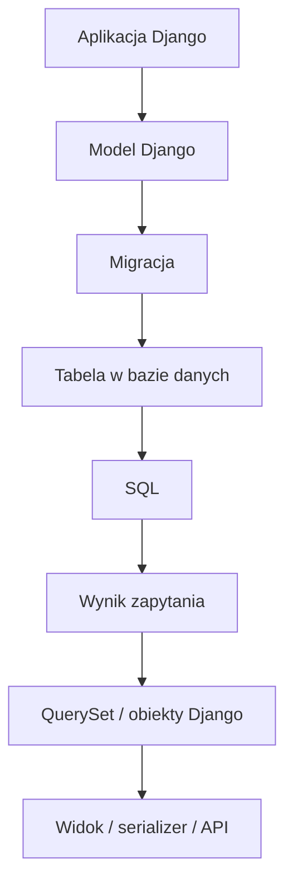
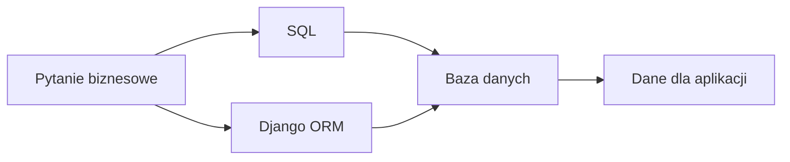
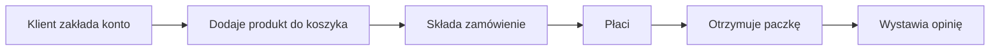
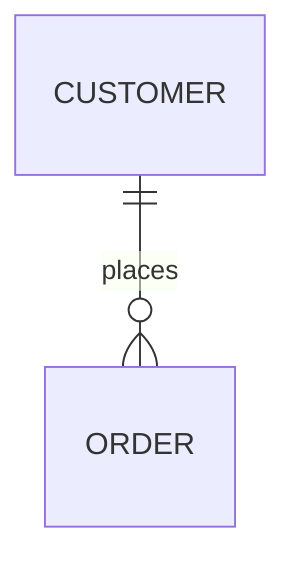
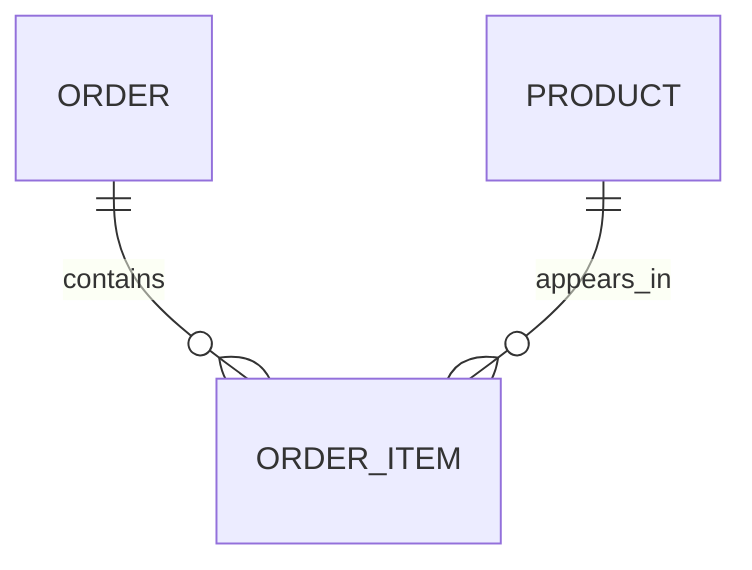
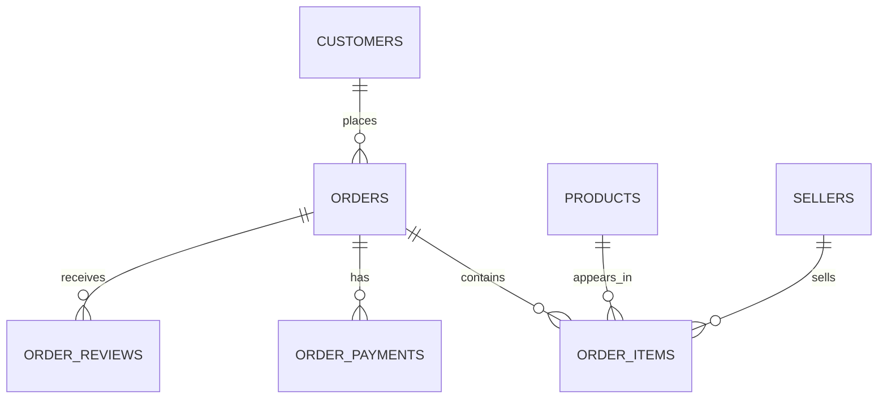
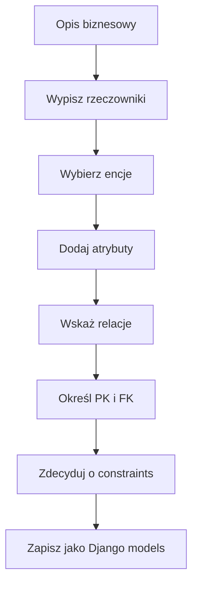
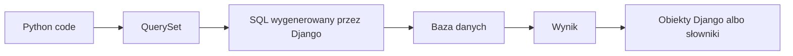
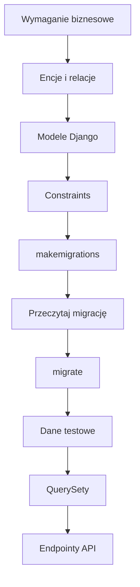

# 📚 Weekend 6 — SQL + Django ORM + migracje

> **Kurs:** AI Python Engineer  
> **Blok:** Weekend 6  
> **Typ pliku:** teoria / kompendium  
> **Temat:** relacyjne bazy danych, SQL, projektowanie modelu danych, Django ORM i migracje  
> **Główna idea:** Django ORM jest wygodną warstwą Pythona nad SQL-em, ale baza danych nadal działa relacyjnie.

---

## 🧭 Jak korzystać z tego pliku?

Ten plik jest kompendium do weekendu o bazach danych, SQL, Django ORM i migracjach.

Nie musisz zapamiętać wszystkiego od razu. Najważniejsze jest, żeby po tym bloku rozumieć:

```text
dane -> tabele -> relacje -> modele Django -> migracje -> QuerySety -> API
```

W praktyce backend developer powinien umieć poruszać się na dwóch poziomach:

| Poziom | Co robisz? | Przykład |
|---|---|---|
| SQL / baza danych | rozumiesz tabele, relacje i zapytania | `SELECT`, `JOIN`, `GROUP BY` |
| Django ORM | pracujesz z bazą przez kod Pythona | `Order.objects.filter(...)` |

---

## Spis treści

- [Cel teorii](#-cel-teorii)
- [Mapa pojęć](#️-mapa-pojęć)
- [1. Po co backend developerowi baza danych?](#1-po-co-backend-developerowi-baza-danych)
- [2. Relacyjna baza danych — podstawowe pojęcia](#2-relacyjna-baza-danych--podstawowe-pojęcia)
- [3. Dataset używany w ćwiczeniach](#3-dataset-używany-w-ćwiczeniach)
- [4. SQL — podstawy](#4-sql--podstawy)
- [5. JOIN — łączenie tabel](#5-join--łączenie-tabel)
- [6. Agregacje i GROUP BY](#6-agregacje-i-group-by)
- [7. Kolejność logiczna zapytania SQL](#7-kolejność-logiczna-zapytania-sql)
- [8. Projektowanie modelu danych](#8-projektowanie-modelu-danych)
- [9. Django models](#9-django-models)
- [10. Constraints](#10-constraints)
- [11. Django ORM](#11-django-orm)
- [12. `select_related` i `prefetch_related`](#12-select_related-i-prefetch_related)
- [13. Migracje Django](#13-migracje-django)
- [14. Przykładowy model e-commerce w Django](#14-przykładowy-model-e-commerce-w-django)
- [15. SQL ⇄ Django ORM — szybkie mapowanie](#15-sql--django-orm--szybkie-mapowanie)
- [16. AI jako pomocnik w pracy z SQL i ORM](#16-ai-jako-pomocnik-w-pracy-z-sql-i-orm)
- [17. Typowe pułapki](#17-typowe-pułapki)
- [18. Minimalna ścieżka pracy backend developera](#18-minimalna-ścieżka-pracy-backend-developera)
- [19. Mini cheat sheet](#19-mini-cheat-sheet)
- [20. Co trzeba zapamiętać po tym bloku?](#20-co-trzeba-zapamiętać-po-tym-bloku)

---

# 🎯 Cel teorii

Ten plik pomaga zrozumieć, co dzieje się „pod spodem”, kiedy aplikacja Django zapisuje i odczytuje dane.

Najważniejsza idea:

> **Django ORM jest wygodną warstwą Pythona nad SQL-em, ale baza danych nadal działa relacyjnie. Dobry backend developer powinien rozumieć oba poziomy.**

---

# 🗺️ Mapa pojęć



---

## SQL i ORM — dwa języki tego samego świata



Przykład pytania biznesowego:

```text
Pokaż 10 ostatnich opłaconych zamówień klienta.
```

Możesz odpowiedzieć na nie:

- zapytaniem SQL,
- QuerySetem Django ORM,
- albo endpointem API, który pod spodem używa ORM.

---

# 1. Po co backend developerowi baza danych?

Aplikacja webowa zwykle musi zapamiętywać informacje po zakończeniu działania programu.

Przykłady danych, które aplikacja musi przechowywać:

- użytkownicy,
- zamówienia,
- produkty,
- płatności,
- wiadomości,
- dokumenty,
- logi,
- konfiguracje,
- wyniki działania AI,
- historia zapytań do modelu językowego.

---

## Dane w zmiennej a dane w bazie

| Miejsce przechowywania | Co się dzieje po restarcie aplikacji? | Przykład |
|---|---|---|
| Zmienna Pythona | dane znikają | `TASKS = []` |
| Plik lokalny | dane zostają, ale trudno nimi zarządzać przy wielu użytkownikach | CSV, JSON |
| Baza danych | dane zostają i można je bezpiecznie filtrować, łączyć, aktualizować | SQLite, PostgreSQL |

---

## Przykład z aplikacji e-commerce

Typowy przepływ:



Każdy z tych kroków powinien zostać zapisany w bazie danych.

Bez bazy aplikacja nie pamiętałaby:

- kto kupił produkt,
- kiedy złożył zamówienie,
- czy zapłacił,
- co zostało wysłane,
- jaką opinię wystawił klient.

---

# 2. Relacyjna baza danych — podstawowe pojęcia

Relacyjna baza danych przechowuje dane w tabelach i relacjach między nimi.

---

## 2.1. Tabela

Tabela to uporządkowany zbiór danych jednego typu.

Przykład: tabela `orders` przechowuje zamówienia.

| order_id | customer_id | order_status | order_purchase_timestamp |
|---|---|---|---|
| A001 | C001 | delivered | 2024-01-10 12:30:00 |
| A002 | C002 | canceled | 2024-01-11 09:15:00 |

---

## 2.2. Kolumna

Kolumna opisuje jedną cechę rekordu.

Przykłady kolumn:

- `order_id`,
- `customer_id`,
- `order_status`,
- `created_at`,
- `price`.

---

## 2.3. Rekord / wiersz

Rekord to pojedynczy wpis w tabeli.

W tabeli `orders` jeden rekord oznacza jedno zamówienie.

---

## 2.4. Klucz główny — Primary Key

Klucz główny, czyli `PRIMARY KEY`, jednoznacznie identyfikuje rekord w tabeli.

Przykłady:

- `customers.customer_id`,
- `orders.order_id`,
- `products.product_id`.

Dobry klucz główny powinien być:

- unikalny,
- niepusty,
- stabilny,
- możliwy do użycia w relacjach.

---

## 2.5. Klucz obcy — Foreign Key

Klucz obcy, czyli `FOREIGN KEY`, wskazuje rekord w innej tabeli.

Przykład:

Tabela `orders` ma kolumnę `customer_id`, która wskazuje klienta z tabeli `customers`.

```text
customers.customer_id  <-  orders.customer_id
```

To oznacza:

- jedno zamówienie należy do jednego klienta,
- jeden klient może mieć wiele zamówień.

---

## 2.6. Relacja 1:N



Przykład:

```text
Jeden klient może mieć wiele zamówień.
Jedno zamówienie należy do jednego klienta.
```

Klucz obcy trafia zwykle po stronie „wiele”, czyli do tabeli `orders`.

---

## 2.7. Relacja N:M



Przykład:

```text
Jedno zamówienie może mieć wiele produktów.
Jeden produkt może pojawić się w wielu zamówieniach.
```

Do tego potrzebujemy tabeli pośredniej, np. `order_items`.

---

# 3. Dataset używany w ćwiczeniach

## Nazwa

**Olist Brazilian E-Commerce Public Dataset**

## Źródło

```text
https://www.kaggle.com/datasets/olistbr/brazilian-ecommerce
```

## Kontekst biznesowy

Dataset opisuje marketplace e-commerce. Zawiera informacje o klientach, zamówieniach, produktach, sprzedawcach, płatnościach i opiniach.

To dobry przykład do nauki backendu, bo podobne struktury występują w prawdziwych aplikacjach webowych.

---

## 3.1. Mapa relacji datasetu



---

## 3.2. Główne tabele

### `customers`

Klienci.

| Kolumna | Typ | Opis |
|---|---|---|
| `customer_id` | text | identyfikator klienta w kontekście zamówienia |
| `customer_unique_id` | text | unikalny identyfikator klienta |
| `customer_zip_code_prefix` | integer | prefiks kodu pocztowego |
| `customer_city` | text | miasto klienta |
| `customer_state` | text | stan/region klienta |

---

### `orders`

Zamówienia.

| Kolumna | Typ | Opis |
|---|---|---|
| `order_id` | text | identyfikator zamówienia |
| `customer_id` | text | klient przypisany do zamówienia |
| `order_status` | text | status zamówienia |
| `order_purchase_timestamp` | datetime | data zakupu |
| `order_approved_at` | datetime | data akceptacji płatności |
| `order_delivered_carrier_date` | datetime | data przekazania przewoźnikowi |
| `order_delivered_customer_date` | datetime | data dostawy |
| `order_estimated_delivery_date` | datetime | planowana data dostawy |

---

### `order_items`

Pozycje zamówień.

| Kolumna | Typ | Opis |
|---|---|---|
| `order_id` | text | zamówienie |
| `order_item_id` | integer | numer pozycji w zamówieniu |
| `product_id` | text | produkt |
| `seller_id` | text | sprzedawca |
| `shipping_limit_date` | datetime | graniczna data wysyłki |
| `price` | decimal | cena produktu |
| `freight_value` | decimal | koszt dostawy |

---

### `products`

Produkty.

| Kolumna | Typ | Opis |
|---|---|---|
| `product_id` | text | identyfikator produktu |
| `product_category_name` | text | kategoria produktu |
| `product_name_lenght` | integer | długość nazwy produktu |
| `product_description_lenght` | integer | długość opisu |
| `product_photos_qty` | integer | liczba zdjęć |
| `product_weight_g` | integer | waga produktu |
| `product_length_cm` | integer | długość produktu |
| `product_height_cm` | integer | wysokość produktu |
| `product_width_cm` | integer | szerokość produktu |

> [!NOTE]  
> W oryginalnym datasecie występuje literówka `lenght` zamiast `length`. To dobry przykład tego, że realne dane bywają niedoskonałe.

---

### `sellers`

Sprzedawcy.

| Kolumna | Typ | Opis |
|---|---|---|
| `seller_id` | text | identyfikator sprzedawcy |
| `seller_zip_code_prefix` | integer | prefiks kodu pocztowego |
| `seller_city` | text | miasto sprzedawcy |
| `seller_state` | text | stan/region sprzedawcy |

---

### `order_payments`

Płatności.

| Kolumna | Typ | Opis |
|---|---|---|
| `order_id` | text | zamówienie |
| `payment_sequential` | integer | numer płatności |
| `payment_type` | text | typ płatności |
| `payment_installments` | integer | liczba rat |
| `payment_value` | decimal | wartość płatności |

---

### `order_reviews`

Opinie.

| Kolumna | Typ | Opis |
|---|---|---|
| `review_id` | text | identyfikator opinii |
| `order_id` | text | zamówienie |
| `review_score` | integer | ocena od 1 do 5 |
| `review_comment_title` | text | tytuł opinii |
| `review_comment_message` | text | treść opinii |
| `review_creation_date` | datetime | data utworzenia opinii |
| `review_answer_timestamp` | datetime | data odpowiedzi |

---

# 4. SQL — podstawy

SQL, czyli **Structured Query Language**, służy do pracy z relacyjnymi bazami danych.

Najczęściej na początku używamy go do:

- odczytywania danych,
- filtrowania danych,
- sortowania,
- łączenia tabel,
- agregowania danych,
- tworzenia raportów.

---

## 4.1. `SELECT`

`SELECT` wybiera kolumny, które chcemy zobaczyć.

```sql
SELECT order_id, customer_id, order_status
FROM orders;
```

Znaczenie:

- pobierz kolumny `order_id`, `customer_id`, `order_status`,
- z tabeli `orders`.

---

## `SELECT *`

Można użyć `*`, aby pobrać wszystkie kolumny:

```sql
SELECT *
FROM orders;
```

W praktyce backendowej lepiej nie nadużywać `SELECT *`, bo:

- pobieramy więcej danych niż potrzeba,
- trudniej czytać wynik,
- zmiana struktury tabeli może nieoczekiwanie zmienić wynik zapytania,
- przy dużych tabelach może to pogarszać wydajność.

---

## 4.2. `LIMIT`

`LIMIT` ogranicza liczbę rekordów.

```sql
SELECT order_id, order_status
FROM orders
LIMIT 10;
```

Przydatne przy eksploracji danych.

Zanim uruchomisz duże zapytanie, obejrzyj małą próbkę.

---

## 4.3. `WHERE`

`WHERE` filtruje rekordy.

```sql
SELECT order_id, order_status
FROM orders
WHERE order_status = 'delivered';
```

Inne przykłady warunków:

```sql
SELECT order_id, order_purchase_timestamp
FROM orders
WHERE order_purchase_timestamp >= '2018-01-01';
```

```sql
SELECT product_id, price
FROM order_items
WHERE price > 100;
```

---

## Popularne operatory

| Operator | Znaczenie |
|---|---|
| `=` | równe |
| `!=` albo `<>` | różne |
| `>` | większe |
| `<` | mniejsze |
| `>=` | większe lub równe |
| `<=` | mniejsze lub równe |
| `BETWEEN` | pomiędzy |
| `IN` | jeden z podanych wariantów |
| `LIKE` | dopasowanie tekstu |
| `IS NULL` | brak wartości |

---

## 4.4. `AND`, `OR`, `NOT`

Warunki można łączyć.

```sql
SELECT order_id, order_status, order_purchase_timestamp
FROM orders
WHERE order_status = 'delivered'
  AND order_purchase_timestamp >= '2018-01-01';
```

```sql
SELECT order_id, order_status
FROM orders
WHERE order_status = 'canceled'
   OR order_status = 'unavailable';
```

Lepszy zapis dla wielu wartości:

```sql
SELECT order_id, order_status
FROM orders
WHERE order_status IN ('canceled', 'unavailable');
```

---

## 4.5. `ORDER BY`

`ORDER BY` sortuje wynik.

```sql
SELECT order_id, order_purchase_timestamp
FROM orders
ORDER BY order_purchase_timestamp DESC
LIMIT 10;
```

- `ASC` — rosnąco,
- `DESC` — malejąco.

Przykład biznesowy:

```text
Chcemy zobaczyć 10 najnowszych zamówień.
```

---

## 4.6. Podstawowy szablon zapytania

```sql
SELECT column_1, column_2
FROM table_name
WHERE condition
ORDER BY column_1 DESC
LIMIT 10;
```

---

# 5. JOIN — łączenie tabel

Dane w relacyjnej bazie zwykle są rozdzielone na wiele tabel.

Nie trzymamy wszystkiego w jednej tabeli, bo prowadziłoby to do:

- duplikacji danych,
- trudności w aktualizacji,
- niespójności,
- większego ryzyka błędów.

`JOIN` pozwala połączyć rekordy z kilku tabel.

---

## 5.1. `INNER JOIN`

`INNER JOIN` zwraca tylko rekordy, które mają dopasowanie po obu stronach.

```sql
SELECT
    o.order_id,
    o.order_status,
    c.customer_city,
    c.customer_state
FROM orders AS o
JOIN customers AS c
    ON o.customer_id = c.customer_id
LIMIT 10;
```

Znaczenie:

- `orders AS o` — tabela `orders` ma alias `o`,
- `customers AS c` — tabela `customers` ma alias `c`,
- `ON o.customer_id = c.customer_id` — warunek połączenia.

Alias pomaga czytać zapytania i unikać niejednoznacznych nazw kolumn.

---

## 5.2. JOIN wielu tabel

Przykład: zamówienia, pozycje zamówień i produkty.

```sql
SELECT
    o.order_id,
    o.order_status,
    oi.price,
    p.product_category_name
FROM orders AS o
JOIN order_items AS oi
    ON o.order_id = oi.order_id
JOIN products AS p
    ON oi.product_id = p.product_id
LIMIT 20;
```

Tu jedno zamówienie może pojawić się wiele razy, bo jedno zamówienie może mieć wiele pozycji.

To nie jest błąd SQL-a. To konsekwencja relacji 1:N.

---

## 5.3. `LEFT JOIN`

`LEFT JOIN` zwraca wszystkie rekordy z lewej tabeli oraz dopasowane rekordy z prawej.

Jeżeli po prawej stronie nie ma dopasowania, dostaniemy `NULL`.

Przykład: zamówienia bez opinii.

```sql
SELECT
    o.order_id,
    r.review_id,
    r.review_score
FROM orders AS o
LEFT JOIN order_reviews AS r
    ON o.order_id = r.order_id
WHERE r.review_id IS NULL;
```

To zapytanie odpowiada na pytanie:

```text
Które zamówienia nie mają opinii?
```

---

## 5.4. Typowe błędy przy JOIN

### Błąd 1: JOIN po złej kolumnie

Przykład błędnej intuicji:

```sql
SELECT *
FROM orders AS o
JOIN customers AS c
    ON o.order_id = c.customer_id;
```

`order_id` i `customer_id` oznaczają różne rzeczy. Nawet jeśli technicznie są tekstem, biznesowo nie są tym samym identyfikatorem.

---

### Błąd 2: brak zrozumienia zwielokrotnienia rekordów

Jeśli zamówienie ma 3 pozycje, po dołączeniu `order_items` pojawi się 3 razy.

---

### Błąd 3: brak aliasów

Przy kilku tabelach zapytanie bez aliasów szybko robi się trudne do czytania.

---

## 5.5. Mini checklista JOIN-a

Przed uruchomieniem zapytania z `JOIN` zapytaj:

- [ ] Jakie tabele łączę?
- [ ] Jaka jest relacja biznesowa między tabelami?
- [ ] Po jakiej kolumnie powinienem/powinnam łączyć?
- [ ] Czy relacja jest 1:1, 1:N czy N:M?
- [ ] Czy wynik może zwielokrotnić rekordy?
- [ ] Czy używam aliasów?

---

# 6. Agregacje i GROUP BY

Agregacje pozwalają liczyć podsumowania.

Popularne funkcje:

| Funkcja | Znaczenie |
|---|---|
| `COUNT(*)` | liczba rekordów |
| `SUM(column)` | suma |
| `AVG(column)` | średnia |
| `MIN(column)` | minimum |
| `MAX(column)` | maksimum |

---

## 6.1. `COUNT`

Liczba zamówień po statusie:

```sql
SELECT
    order_status,
    COUNT(*) AS orders_count
FROM orders
GROUP BY order_status
ORDER BY orders_count DESC;
```

Znaczenie:

- grupujemy zamówienia według statusu,
- liczymy rekordy w każdej grupie,
- sortujemy od największej liczby.

---

## 6.2. `SUM`

Przychód po kategoriach produktów:

```sql
SELECT
    p.product_category_name,
    SUM(oi.price) AS total_revenue
FROM order_items AS oi
JOIN products AS p
    ON oi.product_id = p.product_id
WHERE p.product_category_name IS NOT NULL
GROUP BY p.product_category_name
ORDER BY total_revenue DESC;
```

Ważne pytanie biznesowe:

```text
Czy revenue oznacza tylko price, czy price + freight_value?
```

W prawdziwej pracy definicja metryki jest tak samo ważna jak samo zapytanie.

---

## 6.3. `AVG`

Średni koszt dostawy po stanie klienta:

```sql
SELECT
    c.customer_state,
    AVG(oi.freight_value) AS avg_freight
FROM orders AS o
JOIN customers AS c
    ON o.customer_id = c.customer_id
JOIN order_items AS oi
    ON o.order_id = oi.order_id
GROUP BY c.customer_state
ORDER BY avg_freight DESC;
```

---

## 6.4. `HAVING`

`WHERE` filtruje rekordy przed grupowaniem.

`HAVING` filtruje grupy po agregacji.

Przykład: kategorie ze średnią oceną poniżej 3.

```sql
SELECT
    p.product_category_name,
    AVG(r.review_score) AS avg_review_score
FROM products AS p
JOIN order_items AS oi
    ON p.product_id = oi.product_id
JOIN orders AS o
    ON oi.order_id = o.order_id
JOIN order_reviews AS r
    ON o.order_id = r.order_id
WHERE p.product_category_name IS NOT NULL
GROUP BY p.product_category_name
HAVING AVG(r.review_score) < 3
ORDER BY avg_review_score ASC;
```

---

## 6.5. `WHERE` vs `HAVING`

| Pytanie | Użyj |
|---|---|
| Chcę odfiltrować pojedyncze rekordy przed agregacją | `WHERE` |
| Chcę odfiltrować grupy po agregacji | `HAVING` |

Przykład:

```text
Tylko zamówienia delivered -> WHERE
Tylko kategorie ze średnią oceną < 3 -> HAVING
```

---

# 7. Kolejność logiczna zapytania SQL

SQL piszemy zwykle tak:

```text
SELECT
FROM
JOIN
WHERE
GROUP BY
HAVING
ORDER BY
LIMIT
```

Ale logicznie baza myśli mniej więcej tak:

1. `FROM`
2. `JOIN`
3. `WHERE`
4. `GROUP BY`
5. agregacje
6. `HAVING`
7. `SELECT`
8. `ORDER BY`
9. `LIMIT`

---

## Dlaczego to ważne?

Pomaga zrozumieć:

- dlaczego niektóre aliasy nie są dostępne w `WHERE`,
- dlaczego `HAVING` działa po agregacji,
- dlaczego najpierw trzeba ustalić źródło danych,
- dlaczego błędny JOIN psuje cały raport.

---

# 8. Projektowanie modelu danych

## 8.1. Encja

Encja to ważny obiekt biznesowy, który chcemy zapisać.

Przykłady:

- `Customer`,
- `Order`,
- `Product`,
- `Seller`,
- `Payment`,
- `Review`.

Dobra wskazówka:

> Jeżeli w opisie biznesowym pojawia się rzeczownik, może być kandydatem na encję.

Nie każdy rzeczownik musi być jednak osobną tabelą.

---

## 8.2. Atrybut

Atrybut to cecha encji.

Przykład:

Encja `Product` może mieć atrybuty:

- `name`,
- `category`,
- `price`,
- `weight`,
- `is_active`.

---

## 8.3. Relacja 1:N

Relacja jeden-do-wielu oznacza, że jeden rekord z tabeli A może mieć wiele rekordów w tabeli B.

Przykład:

```text
Jeden klient może mieć wiele zamówień.
```

```text
Customer 1 ---- N Order
```

W bazie klucz obcy trafia po stronie „wiele”, czyli do `orders`.

```text
orders.customer_id -> customers.customer_id
```

W Django:

```python
class Order(models.Model):
    customer = models.ForeignKey(Customer, on_delete=models.PROTECT)
```

---

## 8.4. Relacja N:M

Relacja wiele-do-wielu oznacza, że:

- jedno zamówienie może mieć wiele produktów,
- jeden produkt może występować w wielu zamówieniach.

Nie zapisujemy listy produktów w jednej kolumnie.

Zamiast tego tworzymy tabelę pośrednią.

```text
Order 1 ---- N OrderItem N ---- 1 Product
```

`OrderItem` ma własne pola:

- `quantity`,
- `unit_price`,
- czasem `discount`,
- czasem `status`.

W Django:

```python
class OrderItem(models.Model):
    order = models.ForeignKey(Order, on_delete=models.CASCADE)
    product = models.ForeignKey(Product, on_delete=models.PROTECT)
    quantity = models.PositiveIntegerField()
    unit_price = models.DecimalField(max_digits=10, decimal_places=2)
```

---

## 8.5. Kiedy użyć `ManyToManyField`?

`ManyToManyField` jest wygodne, gdy relacja nie ma dodatkowych danych.

Przykład:

- artykuł ma wiele tagów,
- tag może być przypisany do wielu artykułów.

```python
class Article(models.Model):
    title = models.CharField(max_length=255)
    tags = models.ManyToManyField("Tag", related_name="articles")


class Tag(models.Model):
    name = models.CharField(max_length=50)
```

Ale gdy relacja ma własne pola, lepiej użyć osobnego modelu.

Dla zamówień `OrderItem` jest lepsze niż proste `ManyToManyField`, bo pozycja zamówienia ma `quantity` i `unit_price`.

---

## 8.6. Prosty proces projektowania modelu



---

# 9. Django models

Model Django to klasa Pythona opisująca tabelę w bazie.

```python
from django.db import models


class Customer(models.Model):
    email = models.EmailField(unique=True)
    full_name = models.CharField(max_length=255)
    city = models.CharField(max_length=120, blank=True)

    def __str__(self):
        return self.email
```

---

## Mapowanie Django na bazę danych

| Django | Baza danych |
|---|---|
| klasa modelu | tabela |
| pole modelu | kolumna |
| obiekt modelu | rekord |
| `ForeignKey` | klucz obcy |
| migracja | zmiana schematu bazy |

---

## 9.1. Popularne pola modelu

| Pole Django | Kiedy używać |
|---|---|
| `CharField` | krótki tekst, wymagany `max_length` |
| `TextField` | dłuższy tekst |
| `EmailField` | adres e-mail |
| `IntegerField` | liczba całkowita |
| `PositiveIntegerField` | dodatnia liczba całkowita |
| `DecimalField` | pieniądze i wartości wymagające precyzji |
| `FloatField` | pomiary, wartości przybliżone |
| `BooleanField` | prawda/fałsz |
| `DateField` | data |
| `DateTimeField` | data i czas |
| `ForeignKey` | relacja wiele-do-jednego |
| `ManyToManyField` | relacja wiele-do-wielu |

---

## 9.2. Dlaczego nie `FloatField` do pieniędzy?

Pieniądze wymagają precyzji. `FloatField` przechowuje wartości zmiennoprzecinkowe, które mogą mieć drobne błędy reprezentacji.

Do ceny używaj:

```python
price = models.DecimalField(max_digits=10, decimal_places=2)
```

Znaczenie:

- `max_digits=10` — maksymalnie 10 cyfr łącznie,
- `decimal_places=2` — 2 miejsca po przecinku.

---

## 9.3. `null` vs `blank`

To bardzo częsta pułapka.

| Opcja | Dotyczy | Znaczenie |
|---|---|---|
| `null=True` | baza danych | w kolumnie można zapisać `NULL` |
| `blank=True` | formularze / walidacja | pole może być puste w formularzu |

Przykład:

```python
description = models.TextField(blank=True)
delivered_at = models.DateTimeField(null=True, blank=True)
```

Interpretacja:

- opis może być pustym tekstem,
- data dostawy może nie istnieć, więc w bazie dopuszczamy `NULL`.

Dla pól tekstowych zwykle częściej stosujemy `blank=True` niż `null=True`.

---

## 9.4. `choices`

`choices` ogranicza wartości pola do znanego zestawu.

```python
class Order(models.Model):
    class Status(models.TextChoices):
        DRAFT = "draft", "Draft"
        PAID = "paid", "Paid"
        SHIPPED = "shipped", "Shipped"
        DELIVERED = "delivered", "Delivered"
        CANCELED = "canceled", "Canceled"

    status = models.CharField(
        max_length=30,
        choices=Status.choices,
        default=Status.DRAFT,
    )
```

Korzyści:

- mniej literówek,
- lepsza czytelność,
- łatwiejsza walidacja,
- wygodne użycie w adminie i formularzach.

---

## 9.5. `on_delete`

`on_delete` mówi Django, co zrobić z rekordami zależnymi, gdy usuwamy rekord nadrzędny.

| Opcja | Znaczenie |
|---|---|
| `CASCADE` | usuń też rekordy zależne |
| `PROTECT` | zablokuj usunięcie, jeśli istnieją zależne rekordy |
| `SET_NULL` | ustaw FK na `NULL`, wymaga `null=True` |
| `SET_DEFAULT` | ustaw wartość domyślną |
| `DO_NOTHING` | nic nie rób, ryzykowne bez świadomości konsekwencji |

Przykład:

```python
customer = models.ForeignKey(
    Customer,
    on_delete=models.PROTECT,
    related_name="orders",
)
```

Interpretacja:

Nie pozwalamy usunąć klienta, jeśli ma zamówienia.

To zwykle ma sens biznesowo, bo nie chcemy przypadkiem stracić historii zamówień.

---

## 9.6. `related_name`

`related_name` określa nazwę relacji w drugą stronę.

```python
class Order(models.Model):
    customer = models.ForeignKey(
        Customer,
        on_delete=models.PROTECT,
        related_name="orders",
    )
```

Dzięki temu można napisać:

```python
customer.orders.all()
```

Bez `related_name` Django tworzy domyślną nazwę typu `order_set`.

---

# 10. Constraints

Constraints to reguły na poziomie bazy danych.

Aplikacja może mieć walidację, ale baza też powinna pilnować najważniejszych zasad.

Dlaczego?

Bo dane mogą trafić do bazy z różnych miejsc:

- panel admina,
- API,
- skrypt importujący,
- testy,
- shell,
- przyszła integracja,
- migracja danych.

---

## 10.1. `unique=True`

Pole musi mieć unikalną wartość.

```python
email = models.EmailField(unique=True)
```

Przykład biznesowy:

Dwóch klientów nie powinno mieć tego samego adresu e-mail, jeśli e-mail służy jako login.

---

## 10.2. `UniqueConstraint`

Unikalność może dotyczyć kombinacji pól.

Przykład:

Ten sam produkt nie powinien pojawić się dwa razy w tym samym zamówieniu.

```python
models.UniqueConstraint(
    fields=["order", "product"],
    name="unique_product_per_order",
)
```

---

## 10.3. `CheckConstraint`

`CheckConstraint` pilnuje warunku logicznego.

```python
from django.db.models import Q


models.CheckConstraint(
    check=Q(quantity__gt=0),
    name="order_item_quantity_gt_0",
)
```

Znaczenie:

```text
quantity musi być większe od 0.
```

Inny przykład:

```python
models.CheckConstraint(
    check=Q(unit_price__gte=0),
    name="order_item_unit_price_gte_0",
)
```

Cena jednostkowa nie może być ujemna.

---

# 11. Django ORM

ORM, czyli **Object-Relational Mapping**, pozwala pracować z bazą przez obiekty Pythona.

Zamiast pisać:

```sql
SELECT *
FROM orders
WHERE status = 'paid';
```

możemy napisać:

```python
Order.objects.filter(status="paid")
```

Django wygeneruje SQL pod spodem.

---

## 11.1. QuerySet

QuerySet to opis zapytania do bazy.

Przykłady:

```python
Order.objects.all()
Order.objects.filter(status="paid")
Order.objects.exclude(status="canceled")
Order.objects.order_by("-created_at")
```

QuerySet jest leniwy. To znaczy, że Django nie musi od razu wykonywać zapytania.

Zapytanie wykona się np. gdy:

- przeiterujesz po QuerySecie,
- zamienisz go na listę,
- użyjesz `len`,
- użyjesz `count`,
- pobierzesz konkretny element,
- wyrenderujesz dane w template.

---

## 11.2. `all`

```python
orders = Order.objects.all()
```

To odpowiada mniej więcej:

```sql
SELECT *
FROM orders;
```

W praktyce rzadko chcemy bezwarunkowo pobierać wszystko z dużej tabeli.

---

## 11.3. `filter`

```python
orders = Order.objects.filter(status="paid")
```

SQL-owa intuicja:

```sql
SELECT *
FROM orders
WHERE status = 'paid';
```

Kilka warunków:

```python
orders = Order.objects.filter(
    status="paid",
    customer__city="Warszawa",
)
```

Django domyślnie łączy warunki przez `AND`.

---

## 11.4. Filtrowanie po relacjach

Django używa podwójnego podkreślenia `__` do przechodzenia po relacjach.

```python
Order.objects.filter(customer__email="ola@example.com")
```

SQL-owa intuicja:

```sql
SELECT orders.*
FROM orders
JOIN customers
    ON orders.customer_id = customers.id
WHERE customers.email = 'ola@example.com';
```

To jest jedno z najważniejszych mapowań SQL ⇄ ORM.

---

## 11.5. `get`

`get` zwraca dokładnie jeden obiekt.

```python
order = Order.objects.get(id=1)
```

Uwaga:

- jeśli nie ma wyniku, Django rzuci `DoesNotExist`,
- jeśli jest więcej niż jeden wynik, Django rzuci `MultipleObjectsReturned`.

Dlatego `get` stosuj wtedy, gdy naprawdę oczekujesz jednego rekordu.

Bezpieczniej w wielu przypadkach:

```python
order = Order.objects.filter(id=1).first()
```

---

## 11.6. `order_by`

```python
latest_orders = Order.objects.order_by("-created_at")[:10]
```

Znaczenie:

- `-created_at` — malejąco,
- `[:10]` — ograniczenie do 10 wyników.

SQL-owa intuicja:

```sql
SELECT *
FROM orders
ORDER BY created_at DESC
LIMIT 10;
```

---

## 11.7. `values`

`values` zwraca słowniki zamiast obiektów modelu.

```python
Order.objects.values("status")
```

Przykładowy wynik:

```python
[
    {"status": "paid"},
    {"status": "delivered"},
]
```

Przydatne przy raportach i agregacjach.

---

## 11.8. `annotate`

`annotate` dodaje wyliczoną wartość do wyniku.

Przykład: liczba zamówień po statusie.

```python
from django.db.models import Count


Order.objects.values("status").annotate(
    orders_count=Count("id")
).order_by("-orders_count")
```

SQL-owa intuicja:

```sql
SELECT
    status,
    COUNT(id) AS orders_count
FROM orders
GROUP BY status
ORDER BY orders_count DESC;
```

---

## 11.9. `aggregate`

`aggregate` zwraca jedno podsumowanie dla całego QuerySetu.

```python
from django.db.models import Sum


OrderItem.objects.aggregate(
    total_revenue=Sum("unit_price")
)
```

Różnica:

- `annotate` dodaje wyliczenia do wielu grup lub rekordów,
- `aggregate` zwraca jedno podsumowanie.

---

## 11.10. `Q` objects

`Q` pozwala budować bardziej złożone warunki, np. `OR`.

```python
from django.db.models import Q


Order.objects.filter(
    Q(status="paid") | Q(status="shipped")
)
```

SQL-owa intuicja:

```sql
WHERE status = 'paid'
   OR status = 'shipped'
```

---

# 12. `select_related` i `prefetch_related`

## Problem N+1

Problem N+1 pojawia się wtedy, gdy aplikacja wykonuje jedno zapytanie po listę obiektów, a potem dodatkowe zapytanie dla każdego obiektu z listy.

Przykład:

```python
orders = Order.objects.all()

for order in orders:
    print(order.customer.email)
```

Intuicyjnie:

- 1 zapytanie pobiera zamówienia,
- N kolejnych zapytań pobiera klientów dla każdego zamówienia.

Przy 100 zamówieniach może zrobić się 101 zapytań.

---

## `select_related`

`select_related` stosujemy głównie dla:

- `ForeignKey`,
- `OneToOneField`.

Przykład:

```python
orders = Order.objects.select_related("customer").all()

for order in orders:
    print(order.customer.email)
```

Django pobierze zamówienia i klientów w jednym zapytaniu SQL z JOIN-em.

---

## `prefetch_related`

`prefetch_related` stosujemy głównie dla:

- `ManyToManyField`,
- reverse ForeignKey, np. `order.items`,
- relacji, których nie da się sensownie pobrać jednym prostym JOIN-em bez zwielokrotnienia obiektów.

Przykład:

```python
orders = Order.objects.prefetch_related("items").all()

for order in orders:
    print(order.items.all())
```

Django wykona osobne zapytanie po elementy i połączy je w Pythonie.

---

## Prosta zasada

| Relacja | Narzędzie |
|---|---|
| FK do jednego obiektu | `select_related` |
| OneToOne | `select_related` |
| reverse FK, czyli wiele obiektów | `prefetch_related` |
| ManyToMany | `prefetch_related` |

Nie optymalizuj na ślepo. Najpierw zauważ problem, potem wybierz narzędzie.

---

# 13. Migracje Django

Migracje to wersjonowana historia zmian struktury bazy danych.

Kiedy zmieniasz `models.py`, baza danych sama się nie zmienia. Trzeba wygenerować i uruchomić migrację.

Typowy workflow:

```bash
python manage.py makemigrations
python manage.py migrate
```

---

## 13.1. `makemigrations`

Tworzy plik migracji na podstawie zmian w modelach.

```bash
python manage.py makemigrations
```

Przykład efektu:

```text
orders/migrations/0001_initial.py
```

Ten plik opisuje operacje, np.:

- utworzenie tabeli,
- dodanie kolumny,
- zmianę typu pola,
- dodanie constraintu.

---

## 13.2. `migrate`

Stosuje migracje do bazy danych.

```bash
python manage.py migrate
```

Django sprawdza, które migracje były już wykonane, i uruchamia brakujące.

---

## 13.3. `showmigrations`

Pokazuje listę migracji i informację, które zostały zastosowane.

```bash
python manage.py showmigrations
```

Przykładowa intuicja:

```text
[X] 0001_initial
[ ] 0002_add_product_is_active
```

`[X]` oznacza migrację wykonaną.

---

## 13.4. `sqlmigrate`

Pokazuje SQL, który Django wygeneruje dla migracji.

```bash
python manage.py sqlmigrate orders 0001
```

To bardzo dobre narzędzie edukacyjne, bo pozwala zobaczyć, że ORM i migracje finalnie prowadzą do SQL-a.

---

## 13.5. Dodanie nowego pola

Przykład:

```python
class Product(models.Model):
    name = models.CharField(max_length=255)
    is_active = models.BooleanField(default=True)
```

Potem:

```bash
python manage.py makemigrations
python manage.py migrate
```

Jeżeli tabela ma już dane, a dodajesz pole wymagane bez `default`, Django może zapytać, jaką wartość wpisać do istniejących rekordów.

---

## 13.6. Dlaczego nie kasować migracji bez zrozumienia?

Migracje są częścią historii projektu.

W pracy zespołowej:

- inni developerzy mają swoje bazy,
- serwer testowy ma swoją bazę,
- produkcja ma swoją bazę,
- CI/CD uruchamia migracje automatycznie.

Kasowanie migracji „bo przeszkadzają” może spowodować konflikty i niespójność.

Na początku kursu, w ćwiczeniowej bazie, czasem można zresetować migracje. W prawdziwym projekcie trzeba robić to świadomie.

---

# 14. Przykładowy model e-commerce w Django

```python
from django.db import models
from django.db.models import Q


class Customer(models.Model):
    email = models.EmailField(unique=True)
    full_name = models.CharField(max_length=255)
    city = models.CharField(max_length=120, blank=True)
    state = models.CharField(max_length=40, blank=True)

    def __str__(self):
        return self.email


class Product(models.Model):
    class Category(models.TextChoices):
        BOOKS = "books", "Books"
        ELECTRONICS = "electronics", "Electronics"
        HOME = "home", "Home"
        OTHER = "other", "Other"

    name = models.CharField(max_length=255)
    category = models.CharField(
        max_length=40,
        choices=Category.choices,
        default=Category.OTHER,
    )
    price = models.DecimalField(max_digits=10, decimal_places=2)
    is_active = models.BooleanField(default=True)

    def __str__(self):
        return self.name


class Order(models.Model):
    class Status(models.TextChoices):
        DRAFT = "draft", "Draft"
        PAID = "paid", "Paid"
        SHIPPED = "shipped", "Shipped"
        DELIVERED = "delivered", "Delivered"
        CANCELED = "canceled", "Canceled"

    customer = models.ForeignKey(
        Customer,
        on_delete=models.PROTECT,
        related_name="orders",
    )
    status = models.CharField(
        max_length=30,
        choices=Status.choices,
        default=Status.DRAFT,
    )
    created_at = models.DateTimeField(auto_now_add=True)

    def __str__(self):
        return f"Order #{self.id} for {self.customer.email}"


class OrderItem(models.Model):
    order = models.ForeignKey(
        Order,
        on_delete=models.CASCADE,
        related_name="items",
    )
    product = models.ForeignKey(
        Product,
        on_delete=models.PROTECT,
        related_name="order_items",
    )
    quantity = models.PositiveIntegerField()
    unit_price = models.DecimalField(max_digits=10, decimal_places=2)

    class Meta:
        constraints = [
            models.CheckConstraint(
                check=Q(quantity__gt=0),
                name="order_item_quantity_gt_0",
            ),
            models.CheckConstraint(
                check=Q(unit_price__gte=0),
                name="order_item_unit_price_gte_0",
            ),
            models.UniqueConstraint(
                fields=["order", "product"],
                name="unique_product_per_order",
            ),
        ]

    def __str__(self):
        return f"{self.quantity} x {self.product.name}"
```

---

# 15. SQL ⇄ Django ORM — szybkie mapowanie

| SQL | Django ORM |
|---|---|
| `SELECT * FROM orders` | `Order.objects.all()` |
| `WHERE status = 'paid'` | `Order.objects.filter(status="paid")` |
| `WHERE status != 'canceled'` | `Order.objects.exclude(status="canceled")` |
| `ORDER BY created_at DESC` | `Order.objects.order_by("-created_at")` |
| `LIMIT 10` | `Order.objects.all()[:10]` |
| `COUNT(*)` | `Order.objects.count()` |
| `JOIN customers` | `Order.objects.filter(customer__email="...")` |
| `GROUP BY status` | `Order.objects.values("status").annotate(count=Count("id"))` |

---

## Przepływ ORM



---

# 16. AI jako pomocnik w pracy z SQL i ORM

AI może pomóc szybciej zrozumieć zapytanie, ale nie powinno być traktowane jako nieomylne źródło prawdy.

---

## Dobre zastosowania

- wyjaśnienie zapytania SQL krok po kroku,
- znalezienie błędu w JOIN-ie,
- porównanie SQL z Django ORM,
- wygenerowanie pierwszej wersji modelu,
- zaproponowanie constraintów,
- wyjaśnienie błędu migracji,
- wskazanie potencjalnego problemu N+1.

---

## Przykładowe prompty

```text
Wyjaśnij to zapytanie SQL krok po kroku prostym językiem:
[wklej zapytanie]
```

```text
Sprawdź, czy ten JOIN może zwielokrotnić rekordy. Wyjaśnij dlaczego:
[wklej zapytanie]
```

```text
Zamień to zapytanie SQL na Django ORM i opisz ograniczenia:
[wklej SQL]
```

```text
Przejrzyj ten model Django. Wskaż problemy z relacjami, nazwami pól i constraints:
[wklej model]
```

```text
Wyjaśnij, dlaczego Django pyta o default przy tej migracji:
[wklej komunikat błędu]
```

---

## Zasada bezpieczeństwa

Po każdej odpowiedzi AI sprawdź:

- czy nazwy tabel są poprawne,
- czy nazwy kolumn istnieją,
- czy relacje są właściwe,
- czy wynik ma sens biznesowy,
- czy zapytanie nie zwraca podejrzanie wielu rekordów,
- czy migracja przechodzi lokalnie,
- czy rozwiązanie nie ukrywa problemu zamiast go naprawić.

---

# 17. Typowe pułapki

## SQL

### `SELECT *` wszędzie

Na początku jest wygodne, ale w aplikacji produkcyjnej lepiej pobierać tylko potrzebne kolumny.

---

### JOIN po złej kolumnie

Kolumny mogą mieć podobny typ, ale inne znaczenie biznesowe.

---

### Mylenie `WHERE` i `HAVING`

- `WHERE` działa przed grupowaniem,
- `HAVING` działa po grupowaniu.

---

### Brak definicji metryki

„Przychód” może oznaczać:

- sumę cen produktów,
- sumę płatności,
- cenę z dostawą,
- tylko zamówienia dostarczone,
- zamówienia bez anulowanych.

Najpierw ustal definicję, potem pisz SQL.

---

## Django models

### `customer_id` zamiast `customer`

W Django pole relacji nazywamy zwykle:

```python
customer = models.ForeignKey(Customer, on_delete=models.PROTECT)
```

Django samo utworzy w bazie kolumnę `customer_id`.

---

### `FloatField` do ceny

Do pieniędzy używaj `DecimalField`.

---

### Brak `related_name`

Nie zawsze jest obowiązkowy, ale często poprawia czytelność kodu.

---

### Zbyt proste `ManyToManyField`

Jeżeli relacja ma własne dane, utwórz model pośredni.

---

## ORM

### Nadużywanie `get`

`get` musi znaleźć dokładnie jeden rekord. W przeciwnym razie rzuci wyjątek.

---

### Zapytania w pętli

Pętla po obiektach i pobieranie relacji może wywołać problem N+1.

---

### Brak sprawdzenia SQL-a

Gdy wynik QuerySetu jest dziwny, sprawdź SQL:

```python
queryset = Order.objects.filter(status="paid")
print(queryset.query)
```

---

## Migracje

### Kasowanie migracji bez planu

Migracje są historią zmian schematu. W projekcie zespołowym nie traktujemy ich jak śmieci.

---

### Dodanie wymaganego pola bez defaultu

Jeśli tabela ma już dane, baza musi wiedzieć, co wpisać do istniejących rekordów.

---

### Ręczne zmiany w bazie

Jeśli zmienisz bazę ręcznie, a nie przez migracje, Django może mieć inny obraz schematu niż rzeczywista baza.

---

# 18. Minimalna ścieżka pracy backend developera

Gdy dodajesz nową funkcję związaną z danymi:

1. Zrozum wymaganie biznesowe.
2. Wypisz encje i relacje.
3. Zaprojektuj model danych.
4. Zdecyduj, które reguły powinny być constraints.
5. Napisz modele Django.
6. Wygeneruj migracje.
7. Przeczytaj migracje.
8. Uruchom migracje.
9. Dodaj dane testowe.
10. Napisz QuerySety potrzebne dla API.
11. Sprawdź liczbę zapytań przy relacjach.
12. Dopiero potem buduj endpointy.

---

## Proces jako diagram



---

# 19. Mini cheat sheet

## SQL

```sql
SELECT column_1, column_2
FROM table_name
WHERE condition
ORDER BY column_1 DESC
LIMIT 10;
```

```sql
SELECT
    a.column_1,
    b.column_2
FROM table_a AS a
JOIN table_b AS b
    ON a.id = b.table_a_id;
```

```sql
SELECT
    category,
    COUNT(*) AS items_count
FROM products
GROUP BY category
HAVING COUNT(*) > 10
ORDER BY items_count DESC;
```

---

## Django models

```python
class Customer(models.Model):
    email = models.EmailField(unique=True)
    full_name = models.CharField(max_length=255)
```

```python
class Order(models.Model):
    customer = models.ForeignKey(
        Customer,
        on_delete=models.PROTECT,
        related_name="orders",
    )
```

---

## Django ORM

```python
Order.objects.all()

Order.objects.filter(status="paid")

Order.objects.filter(customer__email="ola@example.com")

Order.objects.exclude(status="canceled")

Order.objects.order_by("-created_at")[:10]

Order.objects.values("status").annotate(count=Count("id"))
```

---

## Migracje

```bash
python manage.py makemigrations
python manage.py migrate
python manage.py showmigrations
python manage.py sqlmigrate orders 0001
```

---

# 20. Co trzeba zapamiętać po tym bloku?

- Baza danych przechowuje trwały stan aplikacji.
- SQL pozwala pytać bazę o dane.
- `SELECT`, `WHERE`, `JOIN` i `GROUP BY` to fundament pracy z danymi.
- Relacje są ważniejsze niż sama składnia.
- `ForeignKey` zwykle znajduje się po stronie „wiele”.
- Relacja N:M często potrzebuje modelu pośredniego.
- Django model opisuje tabelę.
- Django ORM generuje SQL.
- QuerySet jest leniwy.
- `select_related` jest zwykle dla FK i OneToOne.
- `prefetch_related` jest zwykle dla M2M i reverse FK.
- Migracje są historią zmian schematu bazy.
- Constraints chronią jakość danych.
- AI może pomagać, ale backend developer musi umieć zweryfikować wynik.

---

## Finalna checklista

Po tym bloku sprawdź, czy potrafisz:

- [ ] wyjaśnić, czym jest tabela, rekord i kolumna,
- [ ] wyjaśnić, czym jest PK i FK,
- [ ] napisać prosty `SELECT`,
- [ ] użyć `WHERE`,
- [ ] użyć `JOIN`,
- [ ] użyć `GROUP BY`,
- [ ] wskazać relację 1:N,
- [ ] wskazać relację N:M,
- [ ] wyjaśnić, po co jest model pośredni,
- [ ] stworzyć prosty model Django,
- [ ] dodać `ForeignKey`,
- [ ] dodać `CheckConstraint`,
- [ ] uruchomić `makemigrations`,
- [ ] uruchomić `migrate`,
- [ ] użyć `filter`,
- [ ] użyć `order_by`,
- [ ] filtrować po relacji przez `__`,
- [ ] sprawdzić SQL wygenerowany przez QuerySet.

---

> [!IMPORTANT]  
> Nie chodzi o to, żeby znać cały SQL i cały Django ORM.  
> Chodzi o to, żeby rozumieć relacje, wiedzieć jak zapisać je w modelach i bezpiecznie przeprowadzać zmiany schematu przez migracje.
